# 제1장 사용자 IP (1) — AXI4-Lite IP 만들기

**SoC 설계** · 5주차 1교시(W5_S1) | Vivado/Vitis 2023.2 · Windows 11 · Digilent Cora Z7-07S

---

4주차에는 Xilinx가 만들어 둔 **AXI GPIO**를 가져다 썼다. 레지스터가 몇 개이고 어느 주소에 무엇이 있는지(`GPIO_DATA`는 `+0x0`, `GPIO_TRI`는 `+0x4` …)도 Xilinx 문서(PG144)가 정해 둔 대로 따랐다.

이번 주에는 **같은 일을 하는 IP를 직접 만든다.** 이름은 `my_io`다. 보드 버튼·RGB LED·shield 스위치·shield LED를 이 IP의 입출력으로 연결하고, 레지스터 맵은 **우리가 정한다.**

> **4주차와 무엇이 다른가**
> ```text
>   AXI GPIO (4주차)                         my_io (이번 주)
>   Xilinx가 만든 IP를 설정만 한다           IP를 직접 만든다 (Verilog를 고친다)
>   레지스터 맵은 PG144가 정한다             레지스터 맵을 내가 정한다
>   채널 폭·방향을 GUI에서 고른다            포트를 Verilog에 직접 선언한다
> ```

이번 주는 세 교시에 걸쳐 IP 하나를 끝까지 써 본다.

| 교시 | 장 | 하는 일 |
|---|---|---|
| 1교시 | 제1장 (이 장) | IP 만들기 — 템플릿 생성, Verilog 수정, 패키징 |
| 2교시 | 제2장 | Vivado 프로젝트 — Block Design에 넣고, System ILA를 붙여 Bitstream까지 |
| 3교시 | 제3장 | Vitis 프로젝트 — PS에서 읽고 쓰고, ILA로 버스 파형 보기 |

이번 장의 흐름은 다음과 같다.

> **레지스터 맵 정하기 → 프로젝트 만들기** → **Create and Package New IP** → **템플릿 읽기** → **Verilog 다섯 군데 고치기** → **Re-Package**

---

## 학습 목표

- AXI 슬레이브 IP가 "버스 처리 부분"과 "레지스터–핀 연결 부분"으로 나뉜다는 것을 설명한다.
- 레지스터 맵(주소마다 무엇을 읽고 쓰는지)을 직접 정한다.
- `Create and Package New IP`로 AXI4-Lite IP 템플릿을 만든다.
- 생성된 템플릿에서 쓰기 레지스터(`slv_reg0~3`)와 읽기 선택(`reg_data_out`)을 찾는다.
- 템플릿에 포트를 추가하고 레지스터와 핀을 연결한 뒤 IP를 다시 패키징한다.

---

## 1.1 AXI GPIO 안에서 일어나던 일

4주차 7장에서 `Xil_Out32(베이스 + 0x8, 값)`을 쓰면 LED가 켜졌다. 그 사이에 AXI GPIO 안에서 일어난 일을 둘로 나눠 보면 다음과 같다.

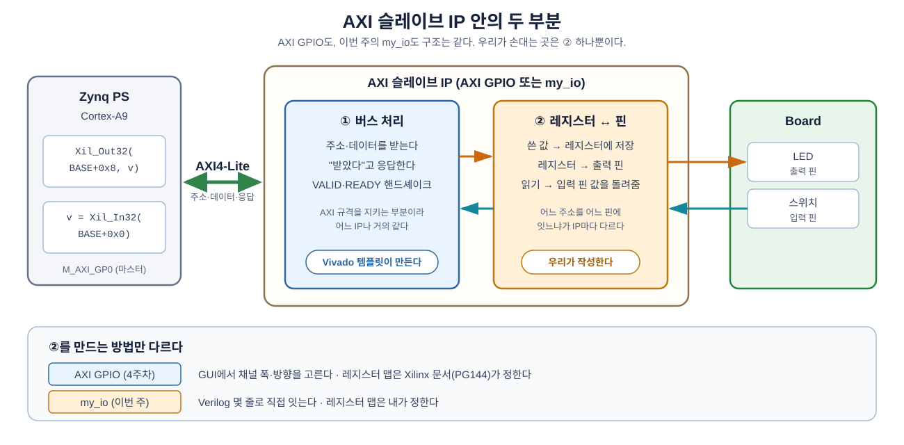

**그림 1-1** AXI 슬레이브 IP는 ① 버스 처리와 ② 레지스터↔핀 연결로 나뉜다. AXI GPIO도 `my_io`도 같은 구조다.

- 초록 양방향 화살표는 PS와 IP 사이의 AXI4-Lite 버스다. 주소·데이터·응답이 모두 이 버스로 오간다.
- 주황 화살표는 쓰기 방향(PS → 레지스터 → LED), 청록 화살표는 읽기 방향(스위치 → PS)이다.
- 파란 칸 ①은 Vivado 템플릿이 만들고, 주황 칸 ②는 우리가 만든다. 아래 띠는 ②를 만드는 방법이 AXI GPIO와 `my_io`에서 어떻게 다른지 보여 준다.

글로 줄여 쓰면 다음과 같다.

```text
  PS ──AXI 버스──▶ ┌─────────────────────────────────────────────┐
                   │ ① 버스 처리                                  │
                   │   주소·데이터를 받고, "받았다"고 응답한다    │
                   │              │                               │
                   │              ▼                               │
                   │ ② 레지스터 ↔ 핀                              │
                   │   쓴 값은 레지스터에 저장 → 출력 핀으로      │ ──▶ LED
                   │   읽을 때는 입력 핀 값을 돌려준다            │ ◀── 스위치
                   └─────────────────────────────────────────────┘
```

①은 AXI 규격(핸드셰이크)을 지키는 부분이라 어느 IP나 거의 같다. 그래서 Vivado가 **템플릿으로 만들어 준다.** 우리가 하는 일은 ②뿐이다. 어느 레지스터를 어느 핀에 연결할지 정하고, Verilog 몇 줄로 잇는다.

---

## 1.2 레지스터 맵 정하기

템플릿은 기본으로 **32비트 레지스터 4개**를 만든다. 레지스터 하나가 4바이트이므로 주소는 `+0x0`, `+0x4`, `+0x8`, `+0xC`가 된다. 이 네 칸에 입출력 네 개를 하나씩 배정한다.

| 주소(오프셋) | 방향 | 연결 | 비트 |
|---|---|---|---|
| `+0x0` | 쓰기 | `led4` — shield LED 4개 | [3:0] |
| `+0x4` | 쓰기 | `led3` — RGB LED1 (bit0=R, bit1=G, bit2=B) | [2:0] |
| `+0x8` | 읽기 | `sw4` — shield 스위치 4개 | [3:0] |
| `+0xC` | 읽기 | `btn2` — BTN0, BTN1 | [1:0] |

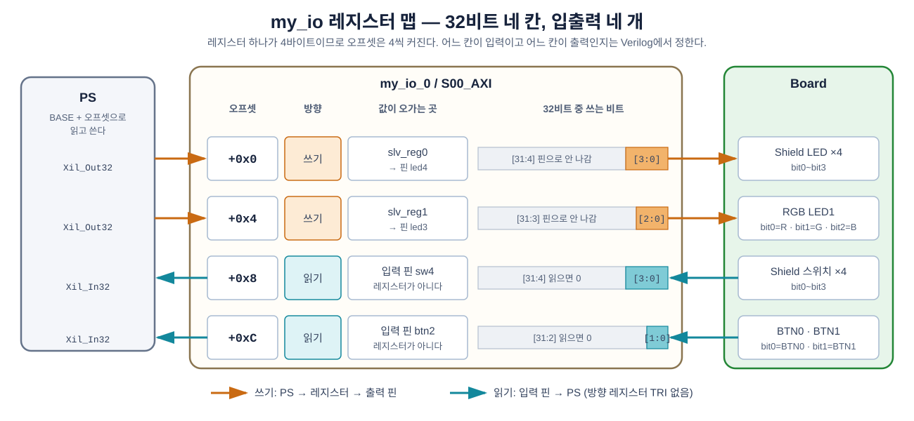

**그림 1-2** 표의 네 칸이 보드의 어느 부품과 이어지는지 그린 것이다.

- 주황 화살표 두 줄(`+0x0`, `+0x4`)은 PS가 **쓰는** 칸이다. 쓴 값은 레지스터에 남고, 아래 몇 비트만 핀으로 나간다.
- 청록 화살표 두 줄(`+0x8`, `+0xC`)은 PS가 **읽는** 칸이다. 레지스터에 저장된 값이 아니라 입력 핀의 지금 값이 돌아온다.
- 가운데 막대는 32비트 중 실제로 쓰는 비트다. 쓰기 칸의 윗비트는 레지스터에 저장되지만 핀으로 나가지 않고, 읽기 칸의 윗비트는 항상 0이다.

포트 이름(`led4`, `led3`, `sw4`, `btn2`)은 4주차 실습과 중간고사에서 쓴 이름 그대로다. 그래서 핀 배정 XDC도 그때와 같다.

> **AXI GPIO와 비교해 보자.** AXI GPIO는 채널마다 `DATA`와 `TRI` 두 레지스터를 두었다. `my_io`에는 방향 레지스터(`TRI`)가 없다. 어느 주소가 입력이고 어느 주소가 출력인지 **Verilog를 쓸 때 정해 버리기** 때문이다. 4주차 9장에서 All Inputs/All Outputs로 고정한 AXI GPIO의 `TRI`가 아무 역할도 하지 않던 것과 같은 이치다.

---

## 1.3 프로젝트 만들기

### 1.3.1 이번 주 작업 폴더

이번 주의 모든 작업은 `week5` 폴더 하나 안에서 한다. Vivado 프로젝트는 `vivado_prj`, Vitis 작업 공간은 `vitis_ws`에 두고, 수업에서 제공하는 파일은 저장소의 `W5_Custom_IP` 폴더를 통째로 복사해 둔다.

```text
.../week5/
├── W5_Custom_IP/            제공 파일 (저장소에서 복사, 고치지 않는다)
│   ├── LAB01/hdl/           1장 Verilog 완성본 (비교용)
│   ├── LAB02/xdc/           2장 핀 배정 XDC
│   ├── LAB02/build_lab05_reference.tcl
│   └── LAB03/src/           3장 C 코드
├── vivado_prj/
│   ├── custom_ip/           1장 IP 만들기 → 2장 Block Design + System ILA
│   └── ip_repo/             1장 — my_io IP 저장소
└── vitis_ws/                3장 — Vitis 작업 공간
```

`vivado_prj`와 `vitis_ws`는 비어 있는 채로 시작한다. 안의 폴더는 Vivado·Vitis가 만든다.

### 1.3.2 `custom_ip` 프로젝트

IP를 만드는 메뉴는 프로젝트가 열려 있어야 쓸 수 있다. 먼저 IP를 만들 때 쓸 프로젝트를 만든다.

`File → Project → New…`에서 Project name을 **`custom_ip`** 로 주고, Project location은 `.../week5/vivado_prj`로 한다. Board는 4주차와 같이 **Cora Z7-07S**를 고른다. 지금은 빈 프로젝트로 두고, 2장에서 이 프로젝트에 Block Design을 만든다.

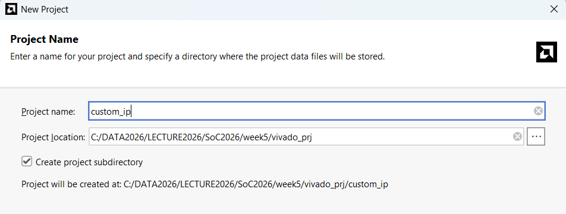

**그림 1-3** 프로젝트 이름은 `custom_ip`다. `Create project subdirectory`가 체크되어 있으므로 `vivado_prj\custom_ip\` 폴더가 생긴다.

> **경로 주의.** `week5` 폴더는 **한글·공백이 없는 짧은 경로**에 둔다(예: `C:\soc2026\week5`). 바탕화면·`문서`·OneDrive 아래는 안 된다. IP Packager는 한글이 섞인 경로에서 특히 잘 실패한다. 이번 장에서 만드는 IP 저장소(`ip_repo`)는 기본으로 프로젝트 폴더 옆(`vivado_prj\ip_repo`)에 생기므로, 프로젝트 경로만 잘 정하면 된다.

---

## 1.4 Create and Package New IP

`Tools → Create and Package New IP…`를 실행하고 첫 화면에서 `Next`를 누른다.

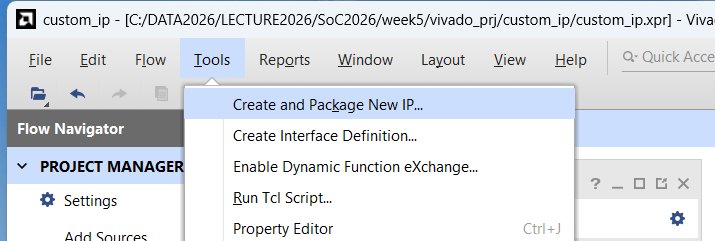

**그림 1-4** `Tools` 메뉴 맨 위에 있다. 프로젝트가 열려 있어야 고를 수 있다.

### 1.4.1 무엇을 만들 것인가

**`Create a new AXI4 peripheral`** 을 고른다. 나머지 선택지(지금 프로젝트나 Block Design을 IP로 묶기)는 이번 주에는 쓰지 않는다.

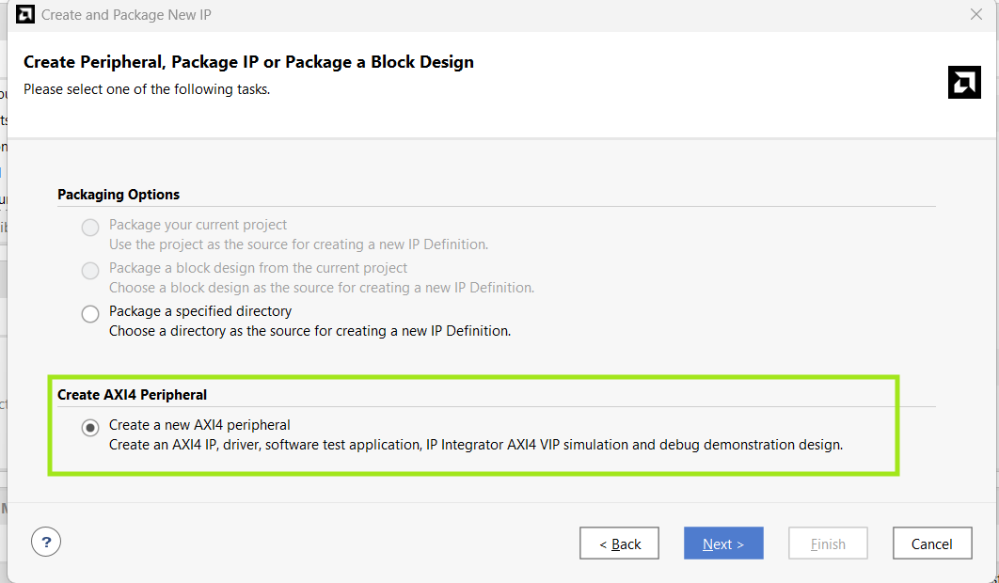

**그림 1-5** 아래쪽 `Create AXI4 Peripheral`의 `Create a new AXI4 peripheral`을 고른다. 위쪽 두 항목은 빈 프로젝트라 회색으로 막혀 있다.

### 1.4.2 Peripheral Details

| 항목 | 값 |
|---|---|
| Name | **`my_io`** |
| Version | `1.0` (기본값) |
| IP location | 기본값 그대로 (`…\vivado_prj\ip_repo`). 경로에 한글이 없는지만 확인 |

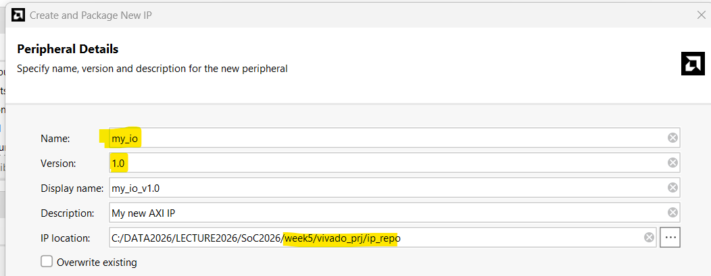

**그림 1-6** `Name`을 `my_io`로 준다. `IP location`에 표시된 경로가 이 IP가 저장될 **IP 저장소**다. `custom_ip` 프로젝트 폴더 옆인 `vivado_prj\ip_repo`가 기본값이다.

### 1.4.3 Add Interfaces

AXI 인터페이스 하나가 기본으로 들어 있다. 값을 바꾸지 않고 확인만 한다.

| 항목 | 값 | 뜻 |
|---|---|---|
| Name | `S00_AXI` | 첫 번째(00) 슬레이브(S) AXI 인터페이스 |
| Interface Type | `Lite` | 레지스터 몇 개를 읽고 쓰는 단순한 AXI(4주차 7.1절) |
| Interface Mode | `Slave` | PS가 마스터, 이 IP는 요청을 받는 쪽 |
| Data Width | `32` | 레지스터 하나가 32비트 |
| Number of Registers | `4` | 1.2절의 네 칸 |

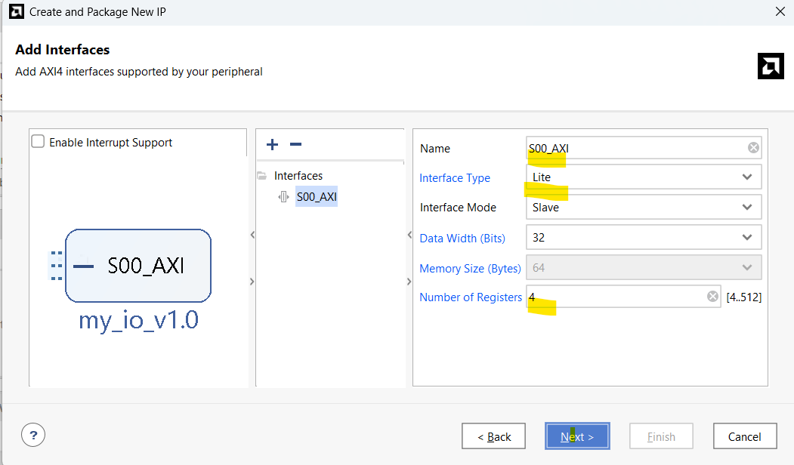

**그림 1-7** 인터페이스 설정은 기본값 그대로다. `Number of Registers`가 `4`인지 확인한다. 왼쪽 위 `Enable Interrupt Support`는 체크하지 않는다(인터럽트는 7주차).

### 1.4.4 Create Peripheral — Edit IP

마지막 화면의 `Next Steps`에서 **`Edit IP`** 를 고르고 `Finish`를 누른다.

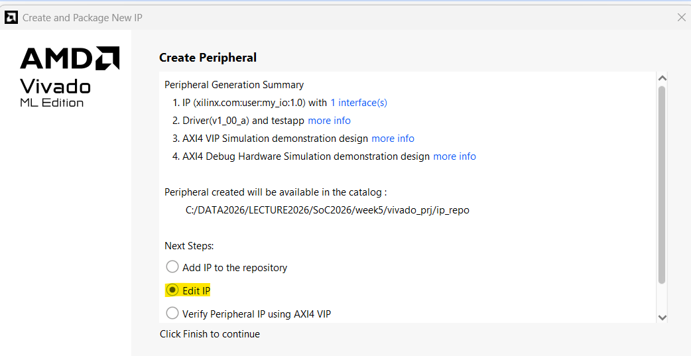

**그림 1-8** `Edit IP`를 고르면 템플릿을 고칠 수 있는 **편집용 프로젝트**가 바로 열린다. 위쪽 요약의 `Peripheral created will be available in the catalog`에 IP 저장소 경로가 다시 나온다.

잠시 뒤 **Vivado 창이 하나 더** 열린다. 프로젝트 이름이 `edit_my_io_v1_0`인 편집용 프로젝트다. 이번 장의 1.7절까지 이 창에서 작업한다(`custom_ip` 창은 그대로 둔다).

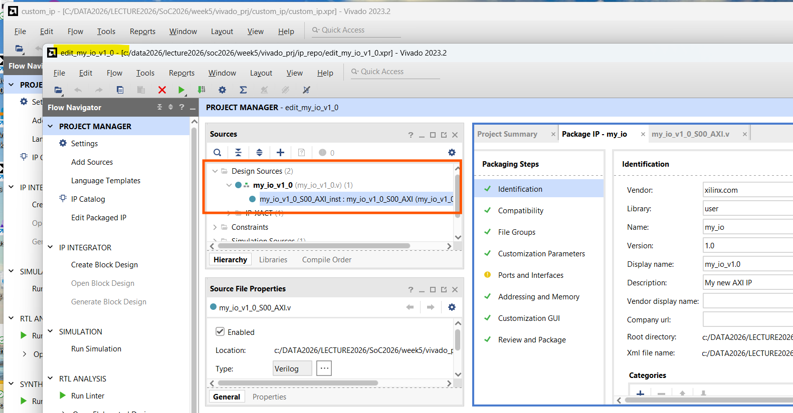

**그림 1-9** 뒤쪽이 `custom_ip`, 앞쪽이 새로 열린 `edit_my_io_v1_0` 창이다. 제목 표시줄의 경로를 보면 편집용 프로젝트는 `ip_repo` 안에 만들어진다. 오른쪽에는 1.7절에서 쓸 `Package IP - my_io` 탭이 이미 열려 있다.

---

## 1.5 생성된 템플릿 읽기

편집용 프로젝트의 `Sources`에 Verilog 파일 두 개가 있다.

| 파일 | 역할 |
|---|---|
| `my_io_v1_0.v` | IP의 **바깥 포장**. Block Design에서 보이는 포트가 여기 선언된다. 안에 아래 모듈 하나를 넣어 둔 것이 전부다 |
| `my_io_v1_0_S00_AXI.v` | **실제 내용**. 1.1절의 ①(버스 처리)과 레지스터 `slv_reg0~3`가 들어 있다 |

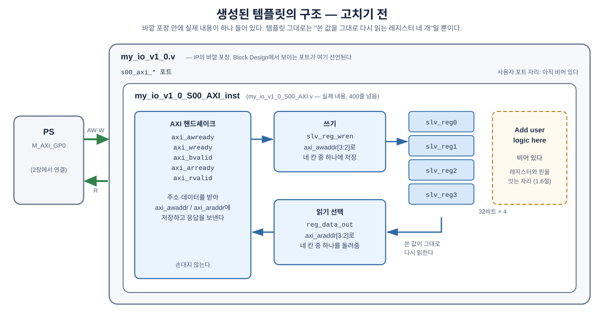

**그림 1-10** 고치기 전 템플릿의 구조. 바깥 포장 안에 실제 내용이 하나 들어 있다.

- 바깥 회색 상자가 `my_io_v1_0.v`, 안쪽 흰 상자가 `my_io_v1_0_S00_AXI.v`다. 바깥 포장의 사용자 포트 자리는 아직 비어 있다.
- 파란 칸은 모두 템플릿이 만든 부분이다. PS가 쓴 값은 `쓰기` 블록을 거쳐 `slv_reg0~3`에 저장되고, 읽을 때는 `읽기 선택`이 그 값을 그대로 돌려준다.
- 점선 주황 칸 `Add user logic here`는 비어 있다. 1.6절에서 여기에 레지스터와 핀을 잇는 줄을 넣는다.

Vivado의 `Sources` 창에서도 같은 계층이 보인다. 안쪽 인스턴스를 더블클릭하면 `my_io_v1_0_S00_AXI.v`가 오른쪽에 열린다.

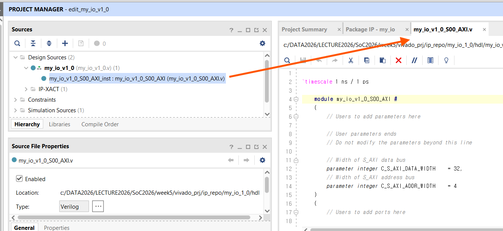

**그림 1-11** `my_io_v1_0`(바깥) 아래에 `my_io_v1_0_S00_AXI_inst`(안쪽)가 있다. 이번 장에서 고치는 파일은 대부분 이 안쪽 파일이다.

`my_io_v1_0_S00_AXI.v`는 400줄이 넘지만 대부분 ①이다. 줄 번호는 버전마다 달라질 수 있으므로, 아래 문자열을 `Ctrl+F`로 찾아서 위치를 확인한다.

| 찾을 문자열 | 무엇이 있나 | 고치나 |
|---|---|---|
| `Users to add ports here` | 사용자 포트를 선언하는 자리 | **고친다** |
| `slv_reg_wren` | PS의 쓰기를 받아 `slv_reg0~3`에 저장하는 부분 | 읽기만 |
| `reg_data_out` | PS가 읽을 때 돌려줄 값을 고르는 부분 | **고친다** |
| `Add user logic here` | 레지스터와 핀을 잇는 자리 | **고친다** |
| `axi_awready`, `axi_wready`, `axi_bvalid`, `axi_arready`, `axi_rvalid` | AXI 핸드셰이크 | 손대지 않는다 |

### 쓰기 — `slv_reg0~3`

레지스터 네 개는 파일 앞부분(약 107줄)에 선언되어 있다. `Number of Registers`를 `4`로 했기 때문에 `slv_reg0`~`slv_reg3` 네 개가 생겼다.

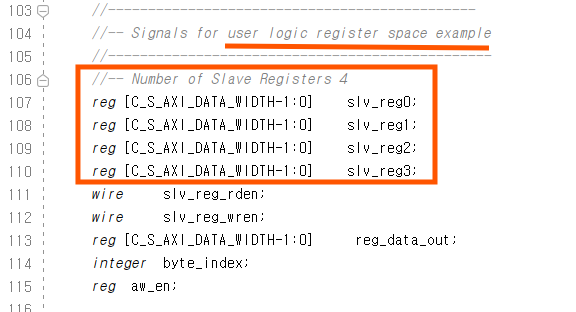

**그림 1-12** 32비트 레지스터 네 개(`slv_reg0~3`)의 선언. 바로 아래 `slv_reg_wren`, `reg_data_out`이 이어서 나오는 쓰기·읽기 부분의 신호다.

`slv_reg_wren`을 찾으면 쓰기 부분이 나온다. PS가 쓰기를 하면 주소에 따라 네 레지스터 중 하나에 값이 저장된다. Vivado 2023.2가 만든 코드는 다음과 같다(`2'h0` 하나만 옮겼다).

```verilog
	assign slv_reg_wren = axi_wready && S_AXI_WVALID && axi_awready && S_AXI_AWVALID;
	...
	    if (slv_reg_wren)
	      begin
	        case ( axi_awaddr[ADDR_LSB+OPT_MEM_ADDR_BITS:ADDR_LSB] )
	          2'h0:
	            for ( byte_index = 0; byte_index <= (C_S_AXI_DATA_WIDTH/8)-1; byte_index = byte_index+1 )
	              if ( S_AXI_WSTRB[byte_index] == 1 ) begin
	                // Respective byte enables are asserted as per write strobes 
	                // Slave register 0
	                slv_reg0[(byte_index*8) +: 8] <= S_AXI_WDATA[(byte_index*8) +: 8];
	              end  
	          2'h1:
	            ...                                   // 같은 모양, slv_reg1
```

`2'h1`~`2'h3`도 레지스터 이름만 `slv_reg1`~`slv_reg3`로 바뀌고 모양은 같다. 줄여 보면 다음과 같다.

| `case` 값 | 주소 | 저장되는 레지스터 |
|---|---|---|
| `2'h0` | `+0x0` | `slv_reg0` |
| `2'h1` | `+0x4` | `slv_reg1` |
| `2'h2` | `+0x8` | `slv_reg2` |
| `2'h3` | `+0xC` | `slv_reg3` |

`for` 문은 32비트를 바이트 4개로 나눠, `S_AXI_WSTRB`가 1인 바이트만 저장한다. `Xil_Out32()`는 항상 4바이트를 다 쓰므로 결과적으로 `slv_reg0 <= S_AXI_WDATA`와 같다. 이 부분은 고치지 않는다.

`2'h0~2'h3`이 곧 주소 `+0x0~+0xC`다. 주소의 아래 2비트는 레지스터 안의 바이트 위치라 빼고, 그 위 2비트로 레지스터를 고른다.

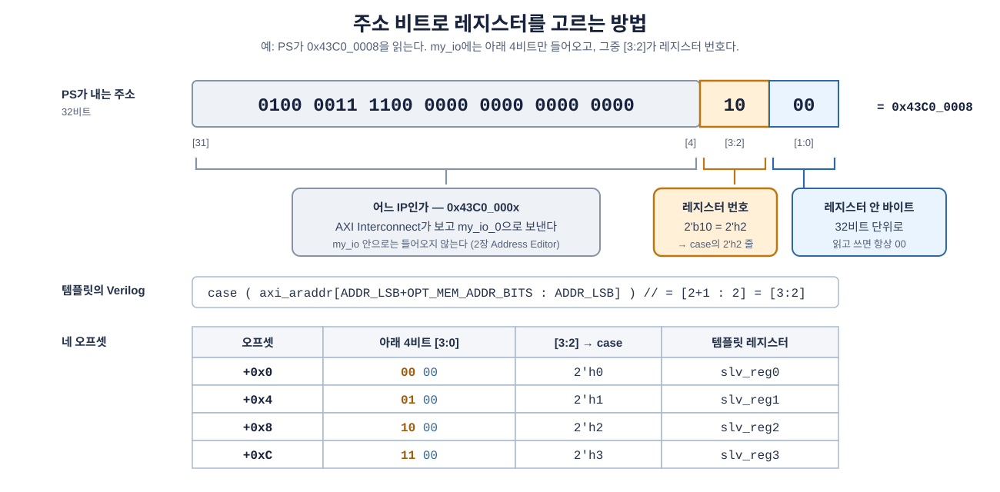

**그림 1-13** PS가 `0x43C0_0008`(2장에서 배정되는 주소 + `0x8`)을 읽을 때 각 비트가 하는 일.

- 회색 부분(`[31:4]`)은 "어느 IP인가"를 정한다. 2장의 AXI Interconnect가 이 부분을 보고 요청을 `my_io_0`으로 보낸다. `my_io` 안으로는 아래 4비트만 들어온다.
- 주황 부분(`[3:2]`)이 레지스터 번호다. 템플릿의 `ADDR_LSB = 2`, `OPT_MEM_ADDR_BITS = 1`이 바로 이 두 비트를 고르는 설정이다.
- 파란 부분(`[1:0]`)은 레지스터 안의 바이트 위치다. 32비트 단위로만 읽고 쓰므로 항상 `00`이다.

### 읽기 — `reg_data_out`

`reg_data_out`을 찾으면 읽기 부분이 나온다. Vivado 2023.2가 만든 코드는 다음과 같다.

```verilog
case ( axi_araddr[ADDR_LSB+OPT_MEM_ADDR_BITS:ADDR_LSB] )
  2'h0   : reg_data_out <= slv_reg0;
  2'h1   : reg_data_out <= slv_reg1;
  2'h2   : reg_data_out <= slv_reg2;
  2'h3   : reg_data_out <= slv_reg3;
  default : reg_data_out <= 0;
endcase
```

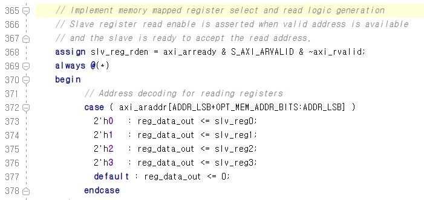

**그림 1-14** 편집기에서 본 읽기 선택(약 372줄). 1.6절 ②에서 이 중 `2'h2`, `2'h3` 두 줄을 바꾼다.

템플릿 그대로라면 **쓴 값을 그대로 다시 읽는** 레지스터 네 개일 뿐이다. 핀과는 아무 관계가 없다. 이제 이것을 핀에 연결한다.

---

## 1.6 Verilog 고치기 — 다섯 군데

고칠 곳은 두 파일에 걸쳐 다섯 군데다. 먼저 전체 지도를 보고 하나씩 고친다.

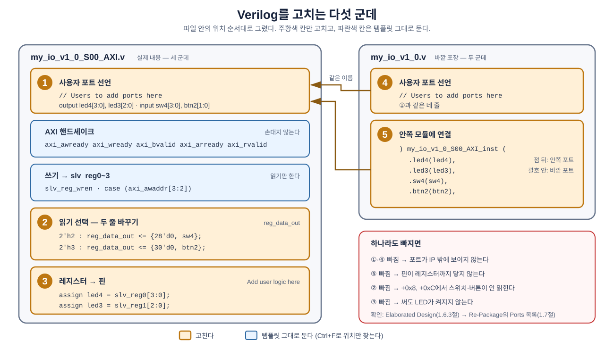

**그림 1-15** 다섯 수정 위치. 왼쪽이 안쪽 파일, 오른쪽이 바깥 포장이며, 파일 안의 위치 순서대로 그렸다.

- 주황 칸 ①~⑤만 고친다. 파란 칸(핸드셰이크, 쓰기)은 `Ctrl+F`로 위치만 확인하고 그대로 둔다.
- 갈색 화살표는 바깥 파일의 ④·⑤가 안쪽 파일 ①의 포트와 이름이 같아야 이어진다는 뜻이다.
- 오른쪽 아래 빨간 상자는 하나를 빠뜨렸을 때 나타나는 증상이다.

### 1.6.1 `my_io_v1_0_S00_AXI.v` — 세 군데

**① 포트 선언.** `Users to add ports here`와 `User ports ends` 사이에 네 줄을 넣는다. 파일 맨 앞 모듈 선언의 포트 목록 안(약 17~19줄)에 있다.

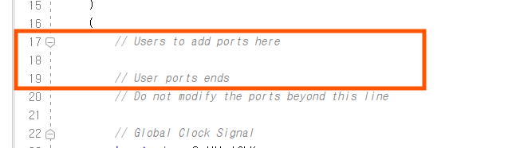

**그림 1-16** 고치기 전에는 두 주석 사이(18줄)가 비어 있다. 이 빈 줄에 아래 네 줄을 넣는다.

```verilog
		// Users to add ports here
		output wire [3:0] led4,		// shield LED      <- slv_reg0
		output wire [2:0] led3,		// RGB LED1        <- slv_reg1
		input  wire [3:0] sw4,		// shield switches -> read at +0x8
		input  wire [1:0] btn2,		// BTN0, BTN1      -> read at +0xC
		// User ports ends
```

**② 읽기 선택.** `reg_data_out`의 `case`에서 `2'h2`와 `2'h3` 두 줄을 바꾼다. 레지스터 대신 **입력 핀 값**을 돌려준다.

```verilog
	        2'h2   : reg_data_out <= {28'd0, sw4};	// +0x8 : switches (was slv_reg2)
	        2'h3   : reg_data_out <= {30'd0, btn2};	// +0xC : buttons  (was slv_reg3)
```

`{28'd0, sw4}`는 4비트 `sw4` 앞에 0을 28개 붙여 32비트로 맞춘 것이다. AXI 데이터는 항상 32비트다.

**③ 레지스터 → 핀.** 파일 끝의 `Add user logic here` 아래에 두 줄을 넣는다.

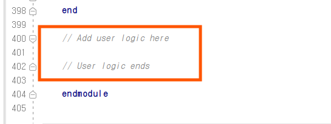

**그림 1-17** 파일 맨 끝, `endmodule` 바로 위(약 400~402줄)에 있다. 고치기 전에는 비어 있다.

```verilog
	// Add user logic here
	assign led4 = slv_reg0[3:0];	// +0x0 : write -> shield LED
	assign led3 = slv_reg1[2:0];	// +0x4 : write -> RGB LED1
	// User logic ends
```

PS가 `+0x0`에 쓴 값은 `slv_reg0`에 저장되고, 그 아래 4비트가 그대로 `led4` 핀으로 나간다.

### 1.6.2 `my_io_v1_0.v` — 두 군데

바깥 포장에도 같은 포트가 있어야 IP 밖으로 나간다.

**④ 포트 선언.** 같은 `Users to add ports here` 자리에 넣는다.

```verilog
		// Users to add ports here
		output wire [3:0] led4,
		output wire [2:0] led3,
		input  wire [3:0] sw4,
		input  wire [1:0] btn2,
		// User ports ends
```

**⑤ 안쪽 모듈에 연결.** `my_io_v1_0_S00_AXI_inst (` 바로 다음 줄에 네 줄을 넣는다.

```verilog
	) my_io_v1_0_S00_AXI_inst (
		.led4(led4),
		.led3(led3),
		.sw4(sw4),
		.btn2(btn2),
		.S_AXI_ACLK(s00_axi_aclk),
		...
```

`.led4(led4)`에서 점 뒤의 `led4`는 안쪽 모듈(`S00_AXI`)의 포트, 괄호 안의 `led4`는 바깥 포장의 포트다.

> **왜 두 파일을 다 고치나.** 안쪽 파일에만 포트를 넣으면 신호가 IP 밖으로 나오지 않고, 바깥 파일에만 넣으면 레지스터까지 닿지 않는다. 다섯 군데 중 하나라도 빠지면 2장에서 핀이 안 보이거나 LED가 안 켜진다.

> **`+0x8`, `+0xC`에 쓰면 어떻게 되나.** 쓰기 부분은 고치지 않았으므로 값은 `slv_reg2`, `slv_reg3`에 저장된다. 하지만 이제 아무도 그 레지스터를 읽지 않는다(읽기는 핀 값을 돌려주므로). 써도 아무 일이 일어나지 않는 **읽기 전용 주소**가 된 것이다.

다섯 군데를 모두 고친 `my_io`의 내부를 경로별로 다시 그리면 다음과 같다.

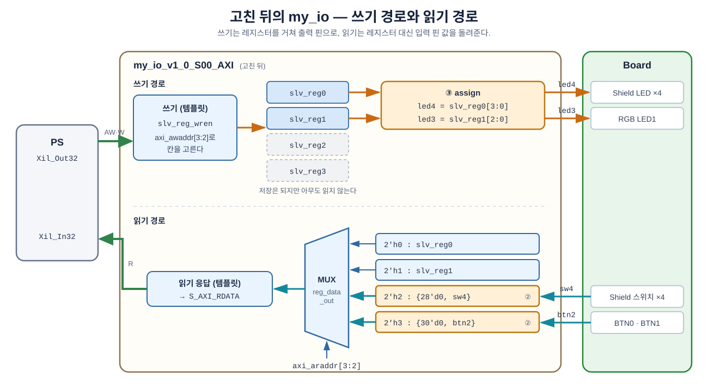

**그림 1-18** 고친 뒤의 쓰기 경로(위)와 읽기 경로(아래).

- 위쪽 주황 화살표: PS가 `+0x0`, `+0x4`에 쓴 값이 `slv_reg0`, `slv_reg1`에 저장되고, ③의 `assign`을 거쳐 `led4`, `led3` 핀으로 나간다.
- 회색 점선 `slv_reg2`, `slv_reg3`: 쓰면 저장은 되지만 이제 읽기 MUX가 이 둘을 보지 않는다. 그래서 `+0x8`, `+0xC`가 읽기 전용 주소가 되었다.
- 아래쪽 청록 화살표: `sw4`, `btn2` 핀 값이 ②에서 바꾼 MUX 입력으로 들어가고, `axi_araddr[3:2]`가 고른 값이 `RDATA`로 PS에 돌아간다.

완성본은 제공 파일 [`LAB01/hdl/`](LAB01/hdl/)(`.../week5/W5_Custom_IP/LAB01/hdl/`)에 있다. 직접 고친 뒤 비교해 본다.

### 1.6.3 패키징 전에 확인 — Elaborated Design

두 파일을 저장하고 `Flow Navigator → RTL ANALYSIS → Open Elaborated Design`을 실행한다. 회로도(Schematic)에서 `my_io_v1_0` 바깥에 `led4[3:0]`, `led3[2:0]`, `sw4[3:0]`, `btn2[1:0]`이 보이고, 안쪽 `my_io_v1_0_S00_AXI_inst`까지 선이 이어져 있으면 된다.


**그림 1-19** 포트 네 개가 바깥에서 안쪽 인스턴스까지 이어진 모습. 이름 오타나 연결 누락이 있으면 여기서 오류가 난다. 📷 *캡처 대기*

---

## 1.7 Re-Package — IP로 다시 묶기

Verilog를 고쳤으면 IP 정보도 새로 고쳐야 한다. 편집용 프로젝트에 열려 있는 **`Package IP - my_io`** 탭으로 간다(닫았다면 `Flow Navigator → PROJECT MANAGER → Edit Packaged IP`).

Verilog를 저장하고 이 탭을 보면 `Packaging Steps`의 몇 칸이 초록 체크 대신 **연필 모양**으로 바뀌어 있다. 파일은 고쳤지만 IP 정보에는 아직 반영되지 않았다는 표시다.

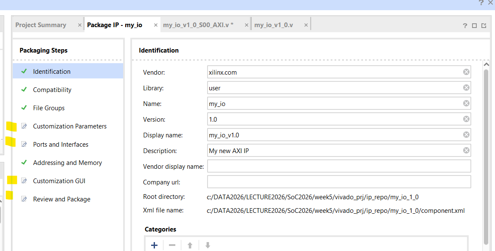

**그림 1-20** `Customization Parameters`, `Ports and Interfaces`, `Customization GUI`, `Review and Package`에 연필 표시가 붙었다. 이 칸들을 차례로 정리해 체크로 바꾼다.

왼쪽 `Packaging Steps`에서 차례로 확인한다.

1. **`File Groups`** — 위에 `Merge changes from File Groups Wizard`가 보이면 누른다.
2. **`Customization Parameters`** — 마찬가지로 `Merge changes …`가 보이면 누른다.
3. **`Ports and Interfaces`** — 목록에 `led4`, `led3`, `sw4`, `btn2`가 새로 들어왔는지 본다.
4. **`Review and Package`** — **`Re-Package IP`** 를 누른다.


**그림 1-21** `Ports and Interfaces`에 새 포트 네 개가 보인다. 여기 없으면 Block Design에서도 보이지 않는다. 📷 *캡처 대기*

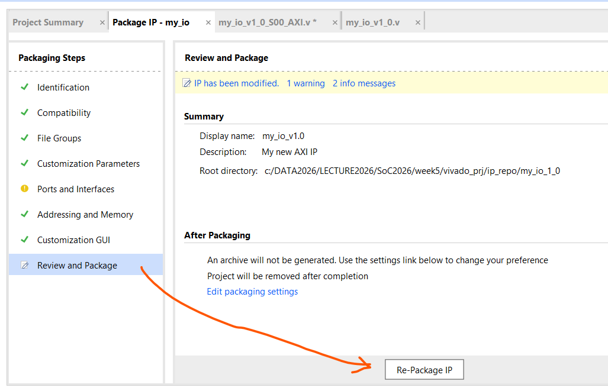

**그림 1-22** Merge가 끝나면 연필 표시가 체크로 바뀐다. `Review and Package`에서 맨 아래 **`Re-Package IP`** 를 누른다. `Ports and Interfaces`의 노란 표시는 위쪽 `1 warning`에 해당하며, Re-Package는 그대로 진행된다.

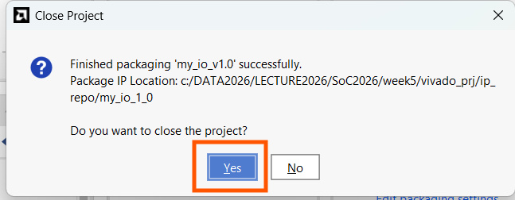

**그림 1-23** 패키징이 끝나면 편집용 프로젝트를 닫을지 묻는다. **`Yes`** 를 누르면 `edit_my_io_v1_0` 창이 닫히고 `custom_ip` 창만 남는다.

> **Merge를 빼먹으면** IP 정보가 Verilog를 고치기 전 상태로 남는다. 2장에서 `my_io`를 넣었는데 포트가 `S00_AXI`뿐이라면 이 단계로 돌아와 Merge → Re-Package를 다시 한다.

### 확인 — IP 저장소와 IP Catalog

`custom_ip` 창에서 이 프로젝트가 IP 저장소를 알고 있는지 먼저 본다. `Flow Navigator → PROJECT MANAGER → Settings → IP → Repository`.

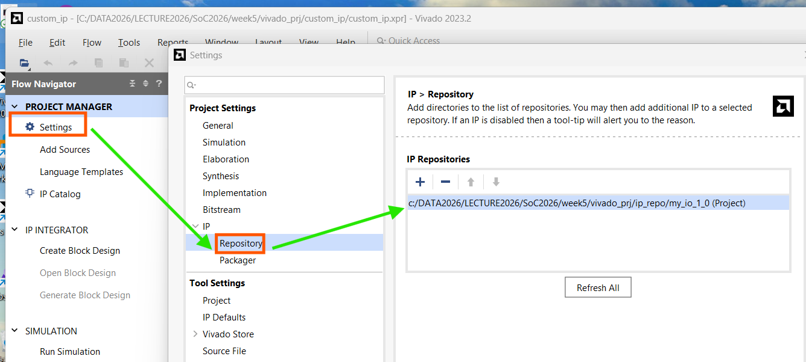

**그림 1-24** `Edit IP`로 만든 IP는 `…/ip_repo/my_io_1_0 (Project)`로 이미 등록되어 있다.

저장소 폴더 전체를 등록해 두려면 `+`를 누르고 `vivado_prj\ip_repo` 폴더를 골라 `Select`를 누른다. 다른 프로젝트에서 `my_io`를 쓰려면 그 프로젝트에서도 같은 방법으로 이 `ip_repo`를 등록하면 된다.

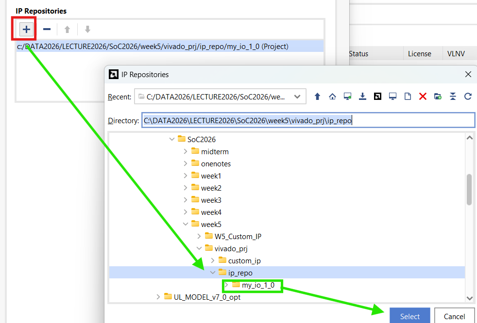

**그림 1-25** `+` → `week5\vivado_prj\ip_repo` 선택 → `Select`. 그 아래 `my_io_1_0` 폴더가 이 저장소에 들어 있는 IP다.

마지막으로 `Flow Navigator → PROJECT MANAGER → IP Catalog`를 열고 검색창에 `my`를 입력한다. **`User Repository → AXI Peripheral → my_io_v1.0`** 이 보이면 이번 장은 끝이다.

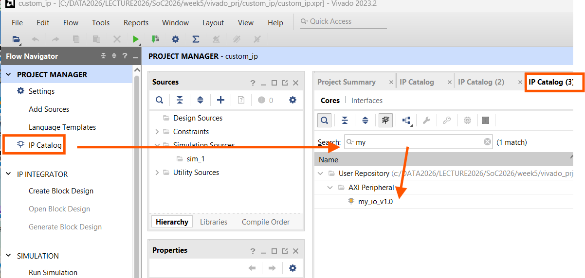

**그림 1-26** 직접 만든 IP가 Xilinx IP들과 같은 목록에 들어왔다. 2장에서 여기서 꺼내 쓴다.

---

## 1.8 정리

| 키워드 | 내용 |
|---|---|
| 사용자 IP | AXI 버스 처리(템플릿)와 레지스터–핀 연결(내가 쓰는 부분)로 나뉜다 |
| 레지스터 맵 | 주소마다 무엇을 읽고 쓰는지를 내가 정한다. `+0x0` led4, `+0x4` led3, `+0x8` sw4, `+0xC` btn2 |
| Create and Package New IP | AXI4-Lite, 레지스터 4개 템플릿을 만들고 `Edit IP`로 편집용 프로젝트를 연다 |
| 두 파일 | `my_io_v1_0.v`(바깥 포장), `my_io_v1_0_S00_AXI.v`(레지스터와 버스 처리) |
| 쓰기 | 템플릿이 `slv_reg0~3`에 저장해 준다. `assign`으로 핀에 연결한다 |
| 읽기 | `reg_data_out`의 `case`에서 레지스터 대신 입력 핀 값을 돌려준다 |
| Re-Package | Merge changes → Ports 확인 → Re-Package IP. 빼먹으면 포트가 안 보인다 |

---

## 과제 — 다음 시간 전까지

1. **레지스터 맵 비교표**: 4주차 AXI GPIO(PG144)의 레지스터 맵과 `my_io`의 레지스터 맵을 나란히 적는다. 어느 쪽에 방향 레지스터가 있고, 왜 `my_io`에는 없어도 되는가?
2. **`+0x0`을 읽으면?** PS가 `+0x0`에 `0x5`를 쓴 뒤 `+0x0`을 읽으면 무엇이 나오는가? `+0x8`에 `0x5`를 쓴 뒤 `+0x8`을 읽으면? `reg_data_out`의 `case`를 보고 답을 적어 온다(3장에서 실제로 확인한다).
3. **레지스터가 8개라면** 1.4.3절에서 `Number of Registers`를 `8`로 했다면 주소는 어디까지 생기는가? `case`의 `2'h0~2'h3`은 어떻게 바뀔까?

## 다음 시간 예고 — 제2장

- 이 `custom_ip` 프로젝트에 Block Design을 만들고, PS와 `my_io`를 연결한다. 이번에는 Address Editor에 **처음 보는 주소**가 나타난다.
- `my_io`의 버스와 핀에 **System ILA**를 붙인다. 2주차에 카운터를 들여다보던 그 도구로, 3장에서 PS가 내 IP에 읽고 쓰는 순간을 파형으로 본다.
- 핀 배정은 4주차·중간고사에서 쓰던 XDC를 그대로 쓴다.

---

*SoC 설계 · 5주차 1교시(W5_S1) | Vivado/Vitis 2023.2 · Windows · Cora Z7-07S*
