# 제2장 사용자 IP (2) — Vivado 프로젝트와 System ILA

**SoC 설계** · 5주차 2교시(W5_S2) | Vivado/Vitis 2023.2 · Windows 11 · Digilent Cora Z7-07S

---

1장에서 만든 `my_io`는 아직 IP Catalog에 들어 있는 부품일 뿐이다. 이번 장에서는 이것을 PS와 연결해 하드웨어를 완성한다. 과정은 4주차 7장(AXI GPIO)과 거의 같다 — **AXI GPIO 자리에 `my_io`가 들어간다**고 생각하면 된다.

새로 하는 일이 하나 있다. `my_io`의 버스와 핀에 **System ILA**를 붙인다. 2주차에 카운터 값을 들여다보던 그 도구다. 3장에서 PS가 `my_io`를 읽고 쓰는 순간을 이 ILA로 본다.

> **4주차 7장과 무엇이 다른가**
> ```text
>   4주차 7장                                  이번 장
>   Add IP → AXI GPIO                          Add IP → my_io (내가 만든 IP)
>   GPIO 인터페이스를 Make External            핀 4개를 하나씩 Make External
>   주소 0x4120_0000                           주소 0x43C0_0000
>   ILA 없음                                   버스와 핀에 System ILA
> ```

이번 장의 흐름은 다음과 같다.

> **Block Design(PS + `my_io`)** → **Connection Automation** → **Make External·이름 정리** → **Address Editor** → **System ILA 붙이기** → **XDC·Bitstream·Export**

이번 장이 끝나면 다음 하드웨어가 완성된다.

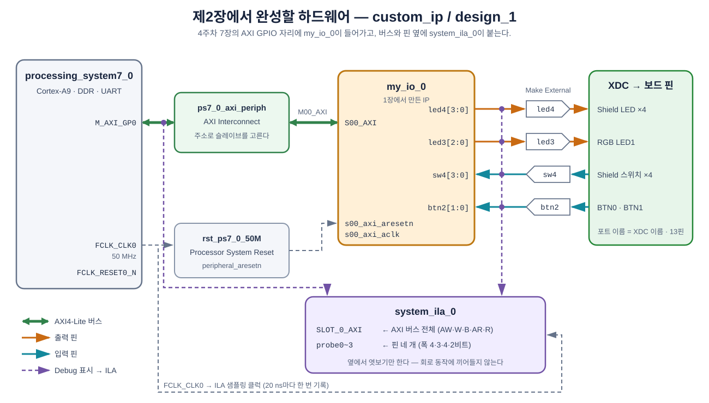

**그림 2-1** 이번 장에서 만들 Block Design을 신호 종류별로 정리한 그림.

- 초록 굵은 선이 AXI4-Lite 버스다. PS의 `M_AXI_GP0`에서 `ps7_0_axi_periph`(AXI Interconnect)를 거쳐 `my_io_0`의 `S00_AXI`로 간다. 2.2절의 Connection Automation이 이 부분을 만든다.
- 주황·청록 선은 1장에서 추가한 핀 네 개다. 2.3절에서 Make External로 바깥 포트를 만들고, XDC가 이 포트를 보드 핀에 배정한다.
- 보라 점선은 2.5절에서 Debug로 표시해 `system_ila_0`으로 보내는 신호다. 버스 전체가 `SLOT_0_AXI`로, 핀 네 개가 `probe0~3`으로 들어간다.
- 회색 점선은 클럭과 리셋이다. 모든 블록이 `FCLK_CLK0`(50 MHz) 하나로 동작하고, ILA도 이 클럭마다 한 번씩 기록한다.

---

## 학습 목표

- 직접 만든 IP를 Block Design에 넣고 PS의 AXI 버스에 연결한다.
- IP의 일반 핀을 Make External 하고, 자동으로 붙는 `_0`을 지워 XDC와 이름을 맞춘다.
- Address Editor에서 사용자 IP에 배정된 주소를 확인하고 AXI GPIO의 주소와 비교한다.
- AXI 버스(인터페이스)와 일반 신호에 Debug를 표시해 System ILA를 넣는다.
- Bitstream과 함께 생성되는 `.ltx` 파일의 역할을 설명한다.

---

## 2.1 Block Design — PS와 `my_io`

1장의 **`custom_ip`** 프로젝트(`.../week5/vivado_prj/custom_ip`)를 그대로 연다. 1.7절에서 IP 저장소(`ip_repo`)를 이미 등록했으므로 `my_io`가 IP Catalog에 들어 있다.

1. `Flow Navigator → IP INTEGRATOR → Create Block Design`, 이름은 `design_1`.
2. `+`(Add IP)로 **ZYNQ7 Processing System**을 넣고, 배너의 **Run Block Automation**을 실행한다(4주차와 같다).
3. 다시 `+`로 **`my_io`** 를 검색해 넣는다. 인스턴스 이름은 `my_io_0`이 된다.

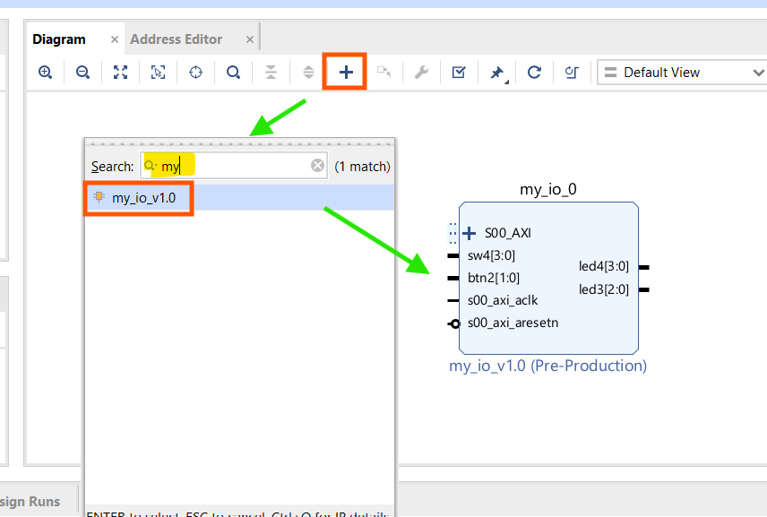

**그림 2-2** `+`(Add IP)에서 `my`로 검색하면 1장에서 만든 `my_io_v1.0` 하나가 나온다. 고르면 `my_io_0` 블록이 들어온다. 보이지 않으면 `ip_repo`가 등록되어 있는지(그림 1-24), 1.7절의 Re-Package가 끝났는지 확인한다.

`my_io_0` 블록에는 `S00_AXI`(버스) 외에 1장에서 추가한 핀 네 개가 보여야 한다. 입력 `sw4[3:0]`, `btn2[1:0]`은 왼쪽, 출력 `led4[3:0]`, `led3[2:0]`은 오른쪽에 있다. `(Pre-Production)` 표시는 직접 만든 IP에 늘 붙는 것이라 신경 쓰지 않는다.

## 2.2 Run Connection Automation

배너의 **Run Connection Automation**을 연다. `my_io_0` 아래에는 **`S00_AXI` 하나만** 있다. 체크하고 `OK`.

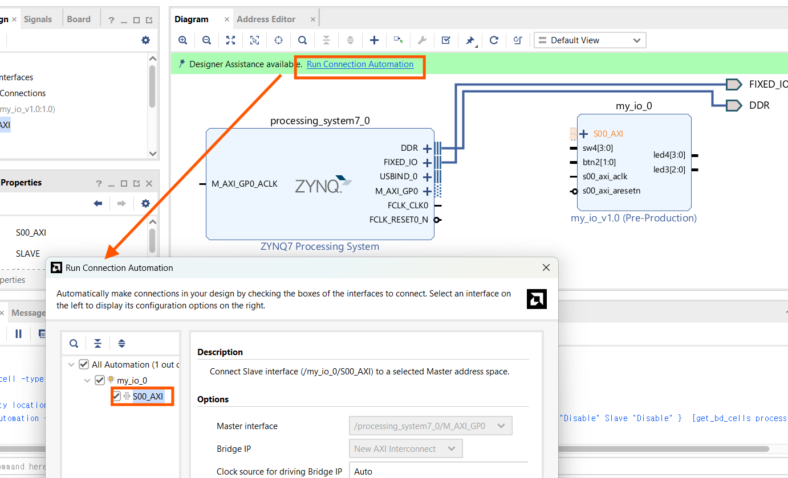

**그림 2-3** 목록에는 `my_io_0/S00_AXI` 하나뿐이다. 오른쪽 Options의 `Master interface`가 `/processing_system7_0/M_AXI_GP0`, `Bridge IP`가 `New AXI Interconnect`이다. 기본값 그대로 `OK`.

4주차와 같이 **AXI Interconnect**(`ps7_0_axi_periph`)와 **Processor System Reset**(`rst_ps7_0_50M`)이 자동으로 들어오고, PS의 `M_AXI_GP0`도 자동으로 켜진다.

> **이번엔 왜 핀이 목록에 없나.** 4주차 AXI GPIO의 `GPIO`는 Xilinx가 정의한 **인터페이스**라서 Vivado가 보드의 버튼·LED 프리셋과 짝을 지어 줄 수 있었다(그래서 체크하지 말라고 했다). `my_io`의 `led4` 같은 핀은 그냥 Verilog 신호라 Vivado가 무엇에 연결할지 알 수 없다. 핀 연결은 다음 절에서 직접 한다.

## 2.3 Make External과 이름 정리

`my_io_0`의 `led4[3:0]` 핀을 우클릭 → **`Make External`**. 바깥에 포트가 생기는데 이름이 **`led4_0`** 이다. 나머지 세 핀도 같은 방법으로 내보낸다.

`_0`을 지워야 한다. 포트를 하나씩 클릭하고, `External Port Properties` 창의 `Name`을 `led4`, `led3`, `sw4`, `btn2`로 고친다.

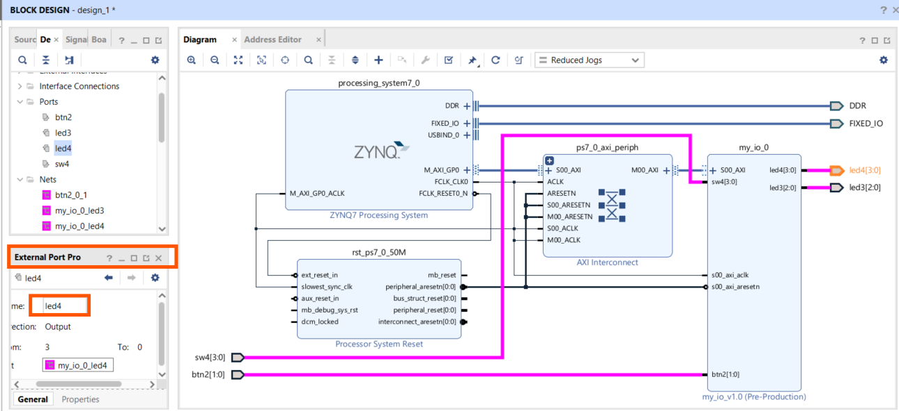

**그림 2-4** 바깥 포트 `led4_0`을 클릭하고 왼쪽 아래 `External Port Properties`의 `Name`을 `led4`로 고친 모습. 왼쪽 `Ports` 목록에 `btn2`, `led3`, `led4`, `sw4` 네 이름이 `_0` 없이 보이면 된다.

| Make External 직후 | 고칠 이름 | XDC가 찾는 이름 |
|---|---|---|
| `led4_0` | `led4` | `led4[0]` … `led4[3]` |
| `led3_0` | `led3` | `led3[0]` … `led3[2]` |
| `sw4_0` | `sw4` | `sw4[0]` … `sw4[3]` |
| `btn2_0` | `btn2` | `btn2[0]`, `btn2[1]` |

> **4주차와 비교.** 4주차 7장에서 `GPIO` **인터페이스**를 내보냈을 때는 `btn_tri_i`처럼 접미사가 붙었고, 8장에서 **멤버 신호**를 내보냈을 때는 이름 그대로였다. `my_io`의 핀은 인터페이스가 아니므로 `_tri_i` 같은 접미사는 붙지 않는다. 대신 Vivado가 이름이 겹치지 않게 `_0`을 붙이므로 이것만 지우면 된다. 이름이 XDC와 다르면 핀 배정이 되지 않는다는 원칙은 늘 같다.

## 2.4 Address Editor — 처음 보는 주소

`Address Editor` 탭을 연다.

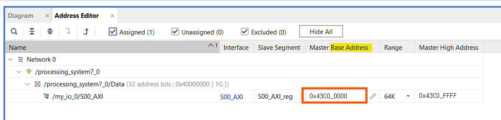

**그림 2-5** `my_io_0`의 `S00_AXI`가 **`0x43C0_0000`** 번지(Range 64K, 끝 주소 `0x43C0_FFFF`)에 배정된다.

4주차의 AXI GPIO는 `0x4120_0000`이었다. 둘 다 PS의 `M_AXI_GP0`이 맡는 영역(`0x4000_0000`~`0x7FFF_FFFF`) 안이지만, Vivado는 IP 종류에 따라 시작 위치를 다르게 잡는다 — Xilinx의 AXI GPIO는 `0x4120_0000`부터, 직접 만든 IP는 `0x43C0_0000`부터다. **주소는 외워 두는 것이 아니라 Address Editor에서 확인하는 것**이다. 3장의 C 코드는 이 주소를 직접 쓰지 않고 `xparameters.h`의 매크로를 쓴다.

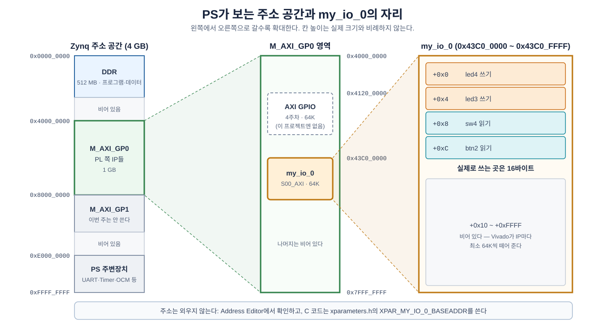

**그림 2-6** PS의 주소 공간에서 `my_io_0`이 놓인 자리를 단계별로 확대한 그림.

- 왼쪽은 PS가 보는 4 GB 주소 공간이다. `0x4000_0000`~`0x7FFF_FFFF`의 1 GB가 `M_AXI_GP0`, 즉 PL 쪽 IP들이 놓이는 자리다.
- 가운데는 그 1 GB 안이다. AXI GPIO(4주차)는 `0x4120_0000`, `my_io_0`은 `0x43C0_0000`에 놓인다.
- 오른쪽은 `my_io_0`이 받은 64K다. 실제로 쓰는 곳은 앞의 16바이트, 즉 1장에서 정한 레지스터 네 칸뿐이다.

> **레지스터는 16바이트뿐인데 Range는 64K다.** `my_io`가 실제로 쓰는 주소는 `+0x0`~`+0xF`(16바이트)뿐이다. Vivado는 IP마다 최소 64K씩 주소 구간을 떼어 준다. 그 나머지 주소는 비어 있다.

## 2.5 System ILA 붙이기

이제 ILA를 넣는다. 2주차 3.6절과 같이 **선을 우클릭해 Debug로 표시**하는 방식이다. 이번에는 두 종류를 표시한다.

### 2.5.1 Debug 표시

1. **AXI 버스** — `processing_system7_0`의 `M_AXI_GP0`과 `ps7_0_axi_periph`의 `S00_AXI`를 잇는 굵은 선(PS 바로 옆)을 우클릭 → **`Debug`**. PS가 내보내는 버스를 그대로 보므로, 3장 파형의 주소가 C 코드와 같은 32비트 주소(`0x43C0_0008` 등)로 나온다.
2. **핀 네 개** — `led4`, `led3`, `sw4`, `btn2` 선을 각각 우클릭 → **`Debug`**.

표시한 선에는 작은 벌레 모양 아이콘이 붙는다.

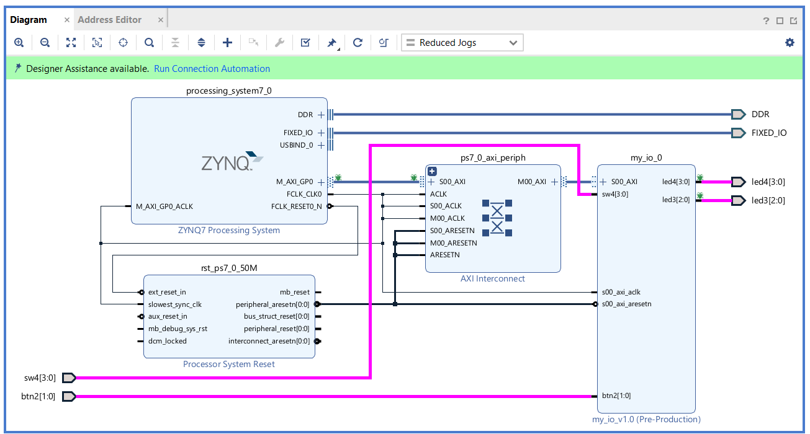

**그림 2-7** AXI 버스와 핀 선에 Debug 표시를 한 모습. PS의 `M_AXI_GP0`과 Interconnect의 `S00_AXI` 양쪽 끝, `led4`·`led3` 선 끝에 초록 벌레 아이콘이 붙고, 배너에 다시 `Run Connection Automation`이 나타난다.

> **버스 전체를 한 번에 본다.** 굵은 선은 신호 하나가 아니라 AXI의 다섯 채널(쓰기 주소·쓰기 데이터·쓰기 응답·읽기 주소·읽기 데이터)을 묶은 **인터페이스**다. 이 선에 Debug를 표시하면 ILA가 AXI 신호를 전부 잡고, 3장에서 Hardware Manager가 "읽기 한 번", "쓰기 한 번" 단위로 묶어 보여 준다.

### 2.5.2 Run Connection Automation (Debug)

배너에 다시 **Run Connection Automation**이 나타난다. 이번에는 Debug 표시한 선들이 목록에 있다. **모두 체크**하고, 클럭(`Clock Source`)이 **`/processing_system7_0/FCLK_CLK0`** 인지 확인한 뒤 `OK`.

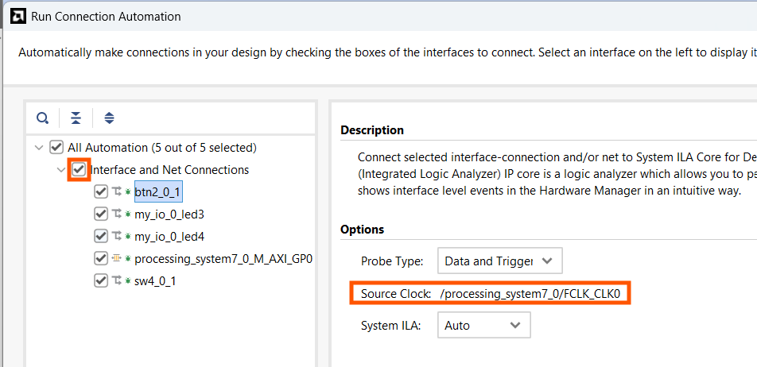

**그림 2-8** `Interface and Net Connections`를 체크하면 아래 5개(AXI 버스 `processing_system7_0_M_AXI_GP0` 1개, 핀 선 4개)가 모두 체크된다. 오른쪽 `Source Clock`이 `/processing_system7_0/FCLK_CLK0`(50 MHz)인지 확인한다.

`system_ila_0` 블록이 생긴다. 왼쪽에 AXI 버스를 받는 **`SLOT_0_AXI`** 하나와, 핀을 받는 **`probe0`~`probe3`** 네 개가 있다.

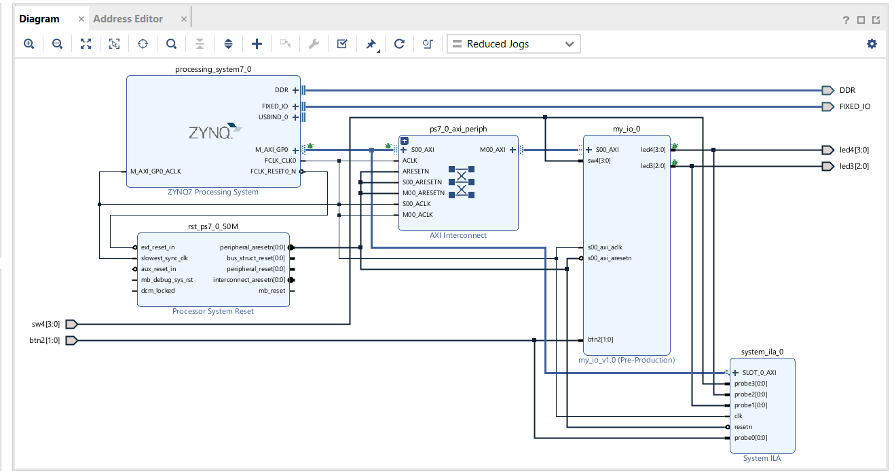

**그림 2-9** 이번 주의 최종 하드웨어(그림 2-1과 비교해 본다). 오른쪽 아래에 `system_ila_0`이 생겼고, PS 옆의 버스와 핀 선이 이 블록으로도 갈라져 들어간다. `system_ila_0`은 회로의 동작에는 끼어들지 않고 옆에서 신호를 **엿보기만** 한다.

> **`probe0`~`probe3`이 각각 어느 핀인지 적어 둔다.** `system_ila_0`의 `probe` 핀을 클릭하면 어느 선과 이어졌는지 강조된다. 선 이름을 그대로 두면 3장의 Hardware Manager는 이 핀들을 `probe0_1`처럼 번호로만 보여 주므로, 여기서 `probe0 = btn2`처럼 짝을 적어 두거나, 아래처럼 선 이름을 고쳐 둔다. 폭으로도 구분된다 — 3비트는 `led3`, 2비트는 `btn2`, 4비트 둘이 `led4`와 `sw4`다.

자동으로 붙은 선(net) 이름은 `btn2_0_1`, `my_io_0_led3`처럼 알아보기 어렵다. 선을 클릭하고 `System Net` 창의 `Name`을 고쳐 두면 어느 신호인지 바로 알 수 있다.

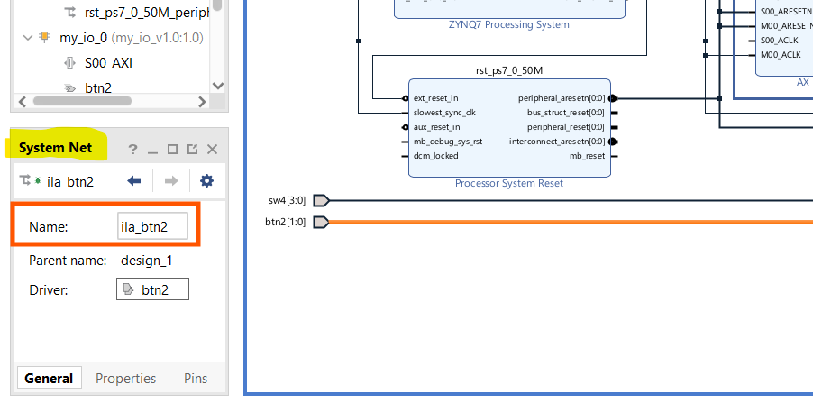

**그림 2-10** `btn2` 포트에서 나오는 선을 클릭하고 `Name`을 `ila_btn2`로 고친 모습. 나머지 세 선도 `ila_led4`, `ila_led3`, `ila_sw4`처럼 고친다. 바깥 포트 이름(`btn2`)은 그대로이므로 XDC와는 상관없다. 고친 이름은 `.ltx`에 들어가므로, 3장 Hardware Manager의 파형 창에 `ila_btn2`처럼 이 이름이 그대로 나온다(이 설계에서는 `probe0`=`ila_btn2`, `probe1`=`ila_led3`, `probe2`=`ila_led4`, `probe3`=`ila_sw4`).

> **ILA의 크기.** 기본 설정은 **깊이 1024**다. 50 MHz로 1024개를 담으므로 한 번에 약 **20 µs**를 기록한다. 3장의 프로그램은 0.2초마다 한 번씩 읽고 쓰므로, 20 µs 창을 그 순간에 정확히 맞추는 것이 **트리거**의 역할이다.

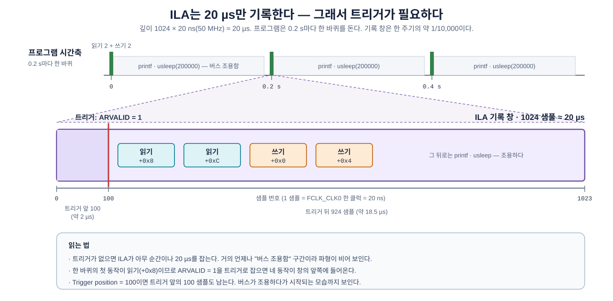

**그림 2-11** 0.2 s 주기의 프로그램과 20 µs짜리 ILA 기록 창의 관계.

- 위쪽 초록 막대가 프로그램 한 바퀴의 읽기 2번·쓰기 2번이다. 그 사이 0.2초 동안 버스는 조용하다.
- 아래쪽 보라 상자가 ILA가 한 번에 기록하는 1024 샘플(약 20 µs)이다. 빨간 선(트리거)을 기준으로 앞 100 샘플, 뒤 924 샘플을 남긴다.
- 3장에서 트리거를 `ARVALID = 1`로, `Trigger position`을 `100`으로 잡는 이유가 이 그림에 있다.

## 2.6 XDC·Bitstream·Export

1. 캔버스 우클릭 → `Validate Design`(F6) → 저장(`Ctrl+S`).
2. `Sources → design_1` 우클릭 → `Create HDL Wrapper…`(Let Vivado manage).
3. `Add Sources → Add or create constraints → Add Files`로 제공 파일 [`LAB02/xdc/cora_z7_07s_week05.xdc`](LAB02/xdc/cora_z7_07s_week05.xdc)(`.../week5/W5_Custom_IP/LAB02/xdc/`)를 추가한다. 4주차·중간고사와 같은 핀이고, 포트 이름 네 개(`led4`, `led3`, `sw4`, `btn2`)만 들어 있다.

   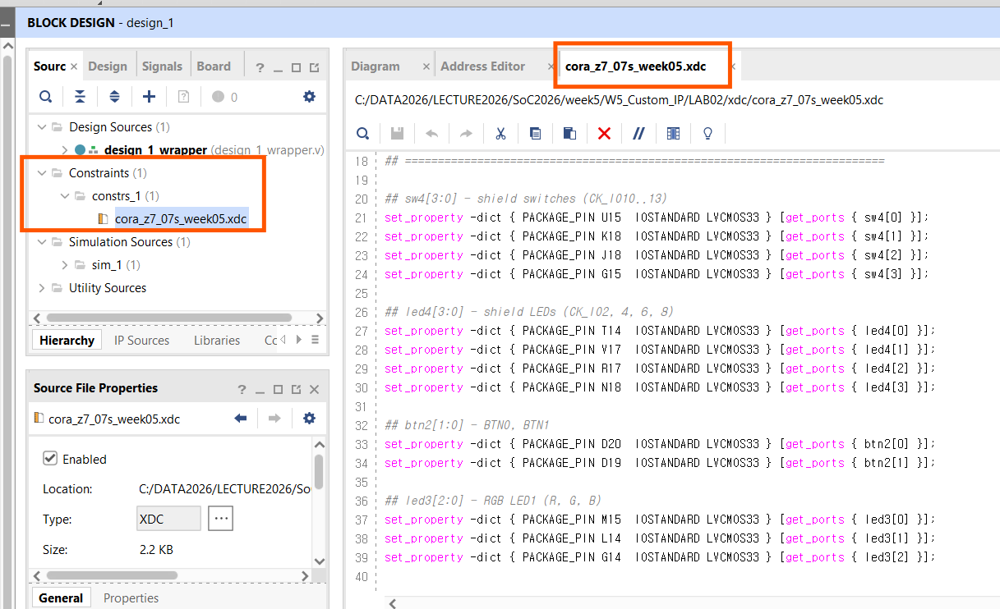

   **그림 2-12** `Constraints → constrs_1` 아래에 XDC가 들어왔다. 위쪽 경로에서 보듯 프로젝트는 `W5_Custom_IP/LAB02/xdc/`의 제공 파일을 그대로 가리킨다. 이 파일은 고치지 않는다.

4. `Run Synthesis` → `Open Synthesized Design` → `Layout → I/O Planning`에서 핀 13개가 모두 배정됐는지 본다.
5. `Generate Bitstream`.
6. `File → Export → Export Hardware…` → **`Include bitstream`** → `design_1_wrapper.xsa`.

   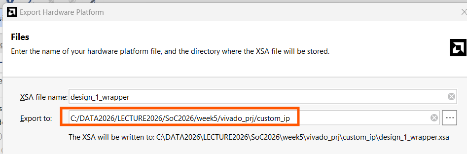

   **그림 2-13** `Export to`는 기본값인 프로젝트 폴더(`.../week5/vivado_prj/custom_ip`) 그대로 둔다. 아래 줄에 `.xsa`가 저장될 전체 경로가 나온다.

Bitstream이 끝나면 `.../vivado_prj/custom_ip/custom_ip.runs/impl_1/` 아래에 `.bit`와 함께 **`design_1_wrapper.ltx`** 가 생긴다.

| 파일 | 내용 | 쓰는 곳 |
|---|---|---|
| `design_1_wrapper.bit` | 하드웨어(`my_io`, ILA 포함) | 보드에 프로그래밍 (`.xsa` 안에도 들어 있다) |
| `design_1_wrapper.ltx` | ILA가 어느 신호를 몇 비트로 잡는지 적힌 **프로브 정보** | 3장 Hardware Manager에서 파형 이름을 붙일 때 |
| `design_1_wrapper.xsa` | 하드웨어 사양 + `.bit` | 3장 Vitis Platform |

> **`.ltx`의 위치를 적어 둔다.** 3장에서 Hardware Manager에 직접 지정해야 한다. 2주차 4.4절에서 본 것과 같은 파일이다.

참고: 1·2장의 결과를 한 번에 만드는 스크립트가 [`LAB02/build_lab05_reference.tcl`](LAB02/build_lab05_reference.tcl)에 있다. 수업에서는 손으로 만드는 것이 연습이므로, 설계가 망가져 시간 안에 되돌리기 어려울 때만 쓴다. 학생이 만든 `vivado_prj`를 덮어쓰지 않도록 결과는 스크립트 옆 `.../week5/W5_Custom_IP/LAB02/build/`에 따로 생긴다. 이때 3장에서 쓰는 `.xsa`·`.ltx`는 `build/vivado_prj/lab05/` 아래의 것이다(스크립트는 프로젝트 이름을 `lab05`로 만든다).

## 2.7 참고 — 만들어진 파일 위치 확인

2교시를 마치기 전에 탐색기로 이번 주 폴더를 한 번 열어 본다. 3장에서 `.xsa`와 `.ltx`를 직접 찾아 지정해야 하므로, 어디에 무엇이 생겼는지 눈으로 확인해 두는 것이다.

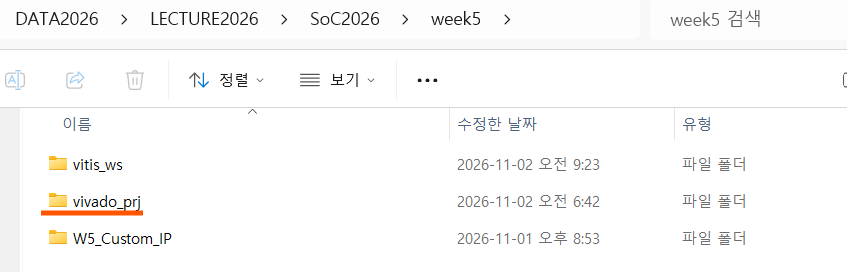

**그림 2-14** `week5` 폴더에는 세 폴더만 있다. 1·2장의 Vivado 작업은 모두 `vivado_prj` 안에 있고, `vitis_ws`는 3장에서 쓴다. `W5_Custom_IP`는 제공 파일이다.

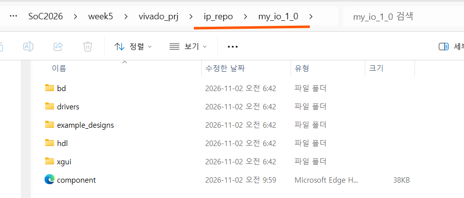

**그림 2-15** `vivado_prj/ip_repo/my_io_1_0`이 1장에서 만든 IP다. `hdl`에 1.6절에서 고친 Verilog 두 개가, `component.xml`에 1.7절 Re-Package의 결과(포트·인터페이스 목록)가 들어 있다. `drivers`는 IP와 함께 생긴 C 드라이버 틀이다(이번 주에는 쓰지 않는다).

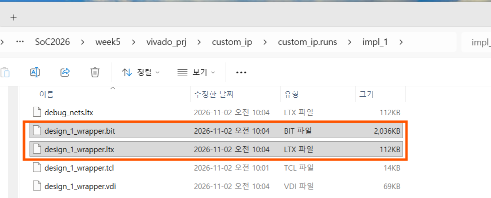

**그림 2-16** `vivado_prj/custom_ip/custom_ip.runs/impl_1`에 Bitstream(`design_1_wrapper.bit`)과 프로브 파일(`design_1_wrapper.ltx`)이 같은 시각에 생겼다. 3장 Hardware Manager에서는 **`design_1_wrapper.ltx`** 를 지정한다. 옆의 `debug_nets.ltx`는 Vivado가 함께 만드는 파일로, 쓰지 않는다.

| 파일 | 위치 (`.../week5/vivado_prj/` 아래) | 쓰는 곳 |
|---|---|---|
| `my_io` IP | `ip_repo/my_io_1_0/` | 2장 Add IP |
| `design_1_wrapper.xsa` | `custom_ip/` | 3장 Vitis Platform |
| `design_1_wrapper.bit` | `custom_ip/custom_ip.runs/impl_1/` | (`.xsa` 안에 들어 있다) |
| `design_1_wrapper.ltx` | `custom_ip/custom_ip.runs/impl_1/` | 3장 Hardware Manager |

---

## 2.8 정리

| 키워드 | 내용 |
|---|---|
| 사용자 IP 넣기 | IP Catalog의 `my_io`를 Add IP → Connection Automation은 `S00_AXI`만 |
| 일반 핀 Make External | 접미사 대신 `_0`이 붙는다. 지우고 XDC 이름과 맞춘다 |
| 사용자 IP 주소 | `0x43C0_0000`(AXI GPIO는 `0x4120_0000`). 주소는 Address Editor에서 확인한다 |
| Debug 표시 | 인터페이스(굵은 선)는 AXI 채널 전체, 일반 선은 그 신호 하나 |
| `system_ila_0` | `SLOT_0_AXI` 하나 + `probe0~3`, 깊이 1024(50 MHz에서 약 20 µs) |
| `.ltx` | ILA 프로브 정보. Bitstream과 함께 생성되고 Hardware Manager에서 쓴다 |

---

## 과제 — 다음 시간 전까지

1. **`probe` 짝 적기**: 내 Block Design에서 `system_ila_0`의 `probe0`~`probe3`이 각각 어느 핀에 이어졌는지 적어 온다(3장에서 바로 쓴다).
2. **주소 두 개**: 이 프로젝트에 4주차의 AXI GPIO를 하나 더 넣으면 Address Editor에 주소가 어떻게 나올지 예상해 본다. 여유가 있으면 실제로 넣어 보고 확인한다(확인한 뒤에는 지운다).
3. **ILA가 차지하는 자원**: Implementation 후 `Report Utilization`에서 `system_ila_0`과 `my_io_0`이 쓰는 LUT·FF·BRAM을 비교한다. 어느 쪽이 더 큰가?

## 다음 시간 예고 — 제3장

- Vitis에서 Platform·Application을 만들고, 4주차 7장처럼 `Xil_Out32`·`Xil_In32`로 `my_io`를 읽고 쓴다.
- 프로그램을 돌려 둔 채로 Vivado **Hardware Manager**를 열어, PS가 `my_io`에 보내는 **읽기·쓰기를 ILA 파형으로** 잡는다.
- 4주차 9장의 디버거와 함께 쓰면, `Xil_Out32` **한 줄이 만든 버스 동작만** 골라서 볼 수 있다.

---

*SoC 설계 · 5주차 2교시(W5_S2) | Vivado/Vitis 2023.2 · Windows · Cora Z7-07S*
