# 제3장 사용자 IP (3) — Vitis로 읽고 쓰고, ILA로 보기

**SoC 설계** · 5주차 3교시(W5_S3) | Vivado/Vitis 2023.2 · Windows 11 · Digilent Cora Z7-07S

---

하드웨어는 2장에서 완성했다. 이번 장에서는 PS 프로그램으로 `my_io`를 읽고 쓴다. 코드는 4주차 7장과 거의 같다 — 주소와 레지스터 맵만 `my_io`의 것으로 바뀐다.

그다음, 프로그램을 돌려 둔 채로 **ILA로 버스를 들여다본다.** 4주차 9장에서는 디버거로 "레지스터에 지금 무슨 값이 있는가"를 봤다. 이번에는 PS가 `Xil_Out32()`를 실행한 그 순간, **버스 위에서 주소와 데이터가 어떻게 오가고, 그 결과 핀이 언제 바뀌는지**를 시간축으로 본다.

> **4주차와 무엇이 다른가**
> ```text
>   4주차 9장 (Vitis 디버거)                 이번 장 (System ILA)
>   CPU를 멈추고 레지스터 값을 본다          CPU는 그대로 돌고, 버스 신호를 20 ns마다 기록한다
>   "지금 값이 얼마인가"                     "언제, 어떤 순서로 바뀌었나"
> ```

이번 장의 흐름은 다음과 같다.

> **Platform·Application** → **`xparameters.h` 확인** → **코드 작성·실행** → **Hardware Manager 연결** → **ILA로 한 바퀴 잡기** → **디버거와 함께 한 줄 잡기**

---

## 학습 목표

- 사용자 IP의 베이스 주소 매크로를 `xparameters.h`에서 찾아 코드에 쓴다.
- `Xil_Out32`/`Xil_In32`로 직접 정한 레지스터 맵에 따라 IP를 읽고 쓴다.
- 프로그램이 실행 중인 보드에 Hardware Manager를 연결하고 `.ltx`로 ILA를 띄운다.
- AXI 읽기·쓰기 한 번이 주소·데이터·응답 신호로 어떻게 나타나는지 파형에서 읽는다.
- `Xil_Out32()` 한 줄이 핀을 바꾸기까지의 경로를 파형으로 확인한다.

---

## 3.1 Platform과 Application

4주차와 같은 Vitis Unified IDE 흐름이다.

1. `Open Workspace`로 **`.../week5/vitis_ws`** 폴더를 연다.

   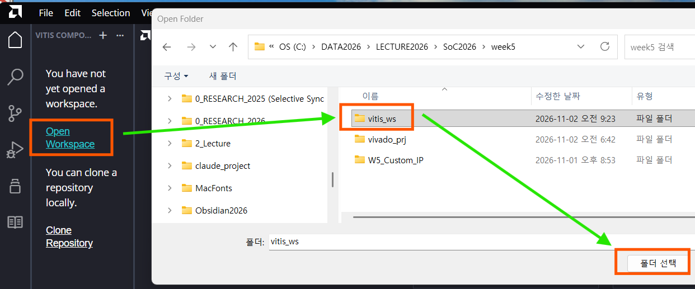

   **그림 3-1** Vitis 첫 화면의 `Open Workspace` → `week5` 안의 `vitis_ws`를 고르고 `폴더 선택`. 2장 그림 2-14에서 본 세 폴더 중 하나다.

2. `Create Platform Component` — 이름 **`platform`**, Flow는 `Hardware Design`, XSA는 2장에서 Export한 `.../week5/vivado_prj/custom_ip/design_1_wrapper.xsa`, OS `standalone`, Processor `ps7_cortexa9_0`. 완료 후 `FLOW → Build`.
3. `Create Embedded Application` → `Empty Application (C)` — 이름 **`app_component`**, Platform은 `platform`.
4. `Sources → src` 우클릭 → `Import → Files…` → 제공 파일 [`LAB03/src/my_io_test.c`](LAB03/src/my_io_test.c)(`.../week5/W5_Custom_IP/LAB03/src/`). Import는 파일을 `vitis_ws` 안으로 복사하므로, 고치는 것은 복사본이다.

   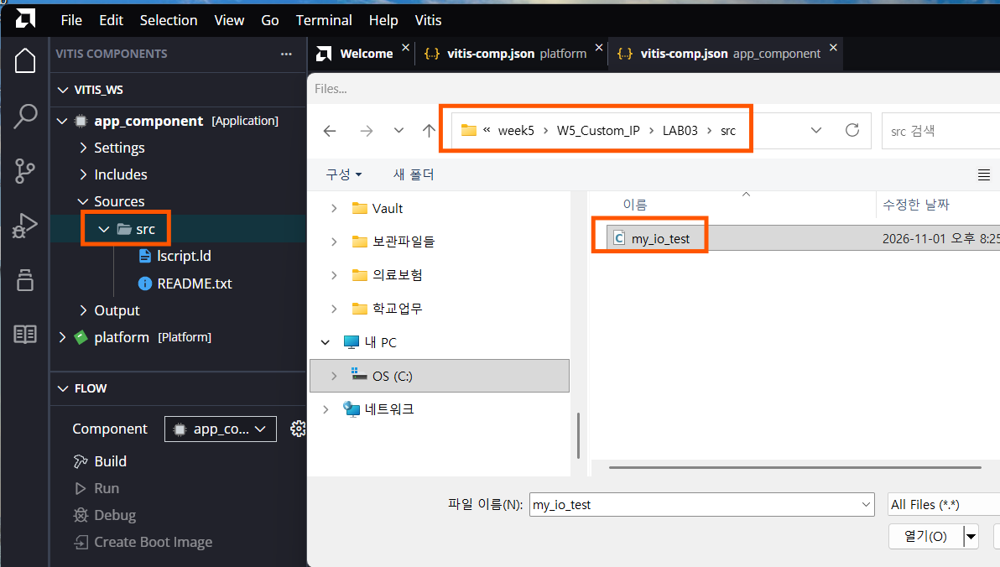

   **그림 3-2** 왼쪽 `app_component → Sources → src`에서 Import를 열고, 제공 파일 폴더 `week5\W5_Custom_IP\LAB03\src`의 `my_io_test.c`를 고른다. 처음 `src`에는 `lscript.ld`와 `README.txt`만 있다.

## 3.2 `xparameters.h` — `my_io`의 주소

Platform을 빌드하면 BSP의 `xparameters.h`에 `my_io_0`의 주소가 들어간다.

```c
/* Definitions for peripheral MY_IO_0 */
#define XPAR_MY_IO_0_BASEADDR 0x43c00000
#define XPAR_MY_IO_0_HIGHADDR 0x43c0ffff
```

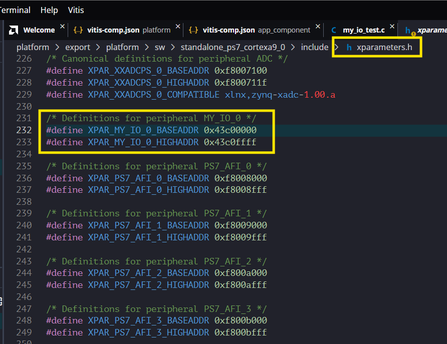

**그림 3-3** `platform → export → platform → sw → standalone_ps7_cortexa9_0 → include → xparameters.h`. 231~233줄에 `MY_IO_0`이 있다. 2장 Address Editor에서 본 `0x43C0_0000`이 그대로 들어 있다. 매크로 이름은 4주차와 같은 규칙(인스턴스 이름 `my_io_0`을 대문자로)이다. 위아래의 `XADCPS`, `PS7_AFI`처럼 PS 안의 장치도 같은 모양으로 적혀 있다.

### 3.2.1 `xparameters.h` 세 줄 읽기

`#define 이름 값`은 C 컴파일러에게 **"앞으로 `이름`이 나오면 `값`으로 바꿔 읽어라"** 라고 알려 주는 줄이다. 함수도 변수도 아니고, 글자를 바꿔 끼우는 것뿐이다.

| 줄 | 뜻 |
|---|---|
| `/* Definitions for peripheral MY_IO_0 */` | 주석. 아래 줄들이 `my_io_0`에 관한 것이라는 표시 |
| `#define XPAR_MY_IO_0_BASEADDR 0x43c00000` | `my_io_0`이 차지한 주소 구간의 **시작**(Base). 레지스터 `+0x0`이 바로 이 주소다 |
| `#define XPAR_MY_IO_0_HIGHADDR 0x43c0ffff` | 같은 구간의 **끝**(High). `0x43c0ffff − 0x43c00000 + 1 = 0x10000` = 64K, 2장 Address Editor의 Range와 같다 |

이 숫자는 누가 적었나? 우리가 아니다. 흐름은 다음과 같다.

```text
2장 Address Editor           2장 Export Hardware        3장 Platform Build
my_io_0 → 0x43C0_0000   →    design_1_wrapper.xsa  →    xparameters.h 에
(Vivado가 배정)              (주소 정보가 들어 있다)      #define 으로 적힘
```

그래서 코드에는 `0x43c00000`이라는 숫자 대신 **`XPAR_MY_IO_0_BASEADDR`라는 이름을 쓴다.** 나중에 Vivado에서 주소가 바뀌어도 `.xsa`로 Platform을 다시 빌드하면 이 줄이 새 주소로 바뀌고, C 코드는 한 글자도 고칠 필요가 없다.

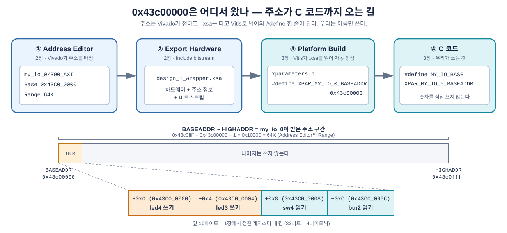

**그림 3-4** 주소가 C 코드까지 오는 길과, BASEADDR~HIGHADDR 구간의 모양.

- 위쪽 ①→④가 주소가 넘어오는 순서다. ①②는 2장에서 Vivado가, ③은 Vitis가 자동으로 한다. 우리가 손으로 쓰는 것은 ④의 이름 하나뿐이다.
- 아래쪽 막대가 `my_io_0`이 받은 64K 구간이다. 왼쪽 끝이 `BASEADDR`, 오른쪽 끝이 `HIGHADDR`다.
- 실제로 쓰는 곳은 맨 앞 16바이트, 즉 1장에서 정한 레지스터 네 칸뿐이다. 주황은 쓰는 칸, 청록은 읽는 칸이다.

> **`my_io`용 드라이버는 없다.** 1장에서 IP를 만들 때 Vivado가 `MY_IO_mWriteReg()` 같은 매크로가 든 드라이버 파일도 함께 만들었지만, Vitis 2023.2의 Platform은 이 파일을 BSP에 넣지 않는다. 그래서 4주차 8장의 `XGpio`처럼 함수를 부르는 방식은 쓸 수 없고, 4주차 7장의 **`Xil_Out32`/`Xil_In32`로 주소에 직접 읽고 쓴다.** 레지스터 맵을 직접 정했으니 이 방식이 오히려 자연스럽다.

## 3.3 코드

```c
#include "xparameters.h"
#include "xil_io.h"
#include "xil_printf.h"
#include "sleep.h"

#define MY_IO_BASE   XPAR_MY_IO_0_BASEADDR   /* Address Editor 에서 본 my_io_0 의 주소 */

/* my_io 레지스터 맵 - 우리가 직접 정했다 (1.2절) */
#define REG_LED4     (MY_IO_BASE + 0x0)      /* 쓰기: shield LED  [3:0] */
#define REG_LED3     (MY_IO_BASE + 0x4)      /* 쓰기: RGB LED1    [2:0] */
#define REG_SW4      (MY_IO_BASE + 0x8)      /* 읽기: shield 스위치 [3:0] */
#define REG_BTN2     (MY_IO_BASE + 0xC)      /* 읽기: BTN0, BTN1  [1:0] */

int main(void)
{
    u32 sw, btn;

    print("my_io start\n\r");

    while (1) {
        sw  = Xil_In32(REG_SW4);
        btn = Xil_In32(REG_BTN2);

        Xil_Out32(REG_LED4, sw);    /* 스위치 -> shield LED */
        Xil_Out32(REG_LED3, btn);   /* BTN0 -> R, BTN1 -> G */

        xil_printf("sw = %d  btn = %d\n\r", sw, btn);
        usleep(200000);
    }

    return 0;
}
```

### 3.3.1 주소 만들기 — `REG_…` 네 줄

`REG_LED4` 같은 이름도 `#define`이다. 시작 주소에 1장 레지스터 맵의 오프셋을 더한 값이다. 컴파일러가 바꿔 끼운 결과를 계산해 보면 다음과 같다.

| 이름 | 식 | 실제 주소 | `my_io` 안에서 | 방향 |
|---|---|---|---|---|
| `REG_LED4` | `0x43C00000 + 0x0` | `0x43C0_0000` | `slv_reg0` → `led4` 핀 | 쓰기 |
| `REG_LED3` | `0x43C00000 + 0x4` | `0x43C0_0004` | `slv_reg1` → `led3` 핀 | 쓰기 |
| `REG_SW4` | `0x43C00000 + 0x8` | `0x43C0_0008` | `sw4` 핀 값 | 읽기 |
| `REG_BTN2` | `0x43C00000 + 0xC` | `0x43C0_000C` | `btn2` 핀 값 | 읽기 |

오프셋이 4씩 늘어나는 것은 레지스터 하나가 32비트 = 4바이트이기 때문이다(1.2절).

### 3.3.2 `Xil_In32`와 `Xil_Out32`

두 함수는 `xil_io.h`에 들어 있다. 하는 일은 딱 하나씩이다.

| 함수 | 하는 일 | 버스에서 |
|---|---|---|
| `값 = Xil_In32(주소);` | 그 주소에서 32비트를 **읽어** 돌려준다 | 읽기 한 번 (AR → R) |
| `Xil_Out32(주소, 값);` | 그 주소에 32비트 `값`을 **쓴다** | 쓰기 한 번 (AW·W → B) |

PS 입장에서 `0x43C0_0008`은 메모리 주소와 똑같이 보인다. 다만 그 주소에 DDR 메모리가 아니라 **우리가 만든 `my_io`가 대답한다**는 점만 다르다. 이렇게 주소로 하드웨어를 다루는 방식을 **메모리 맵 I/O**(Memory-Mapped I/O)라고 한다. `u32`는 "부호 없는 32비트 정수"라는 뜻의 자료형이다.

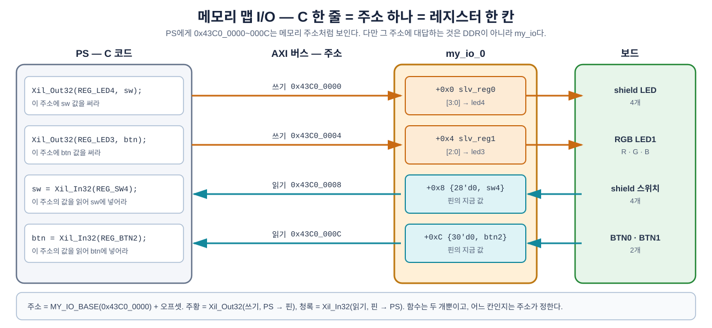

**그림 3-5** 코드의 네 줄이 각각 어느 주소로, 어느 칸으로, 어느 핀으로 가는지.

- 위 두 줄(주황)은 `Xil_Out32`다. PS에서 `my_io`의 `slv_reg0`, `slv_reg1`로 값을 쓰고, 그 값의 아래 비트가 LED 핀으로 나간다.
- 아래 두 줄(청록)은 `Xil_In32`다. 스위치·버튼 핀의 지금 값이 `my_io`를 거쳐 PS의 변수로 들어온다.
- 함수는 두 개뿐이다. **어느 칸을 읽고 쓸지는 함수가 아니라 주소가 정한다.**

### 3.3.3 `while` 한 바퀴 따라가기

**shield 스위치 `sw4[3:0]` = `0101`, `BTN0`만 누름**이라고 하고 루프 한 바퀴를 따라가 보자.

| 줄 | PS가 하는 일 | `my_io` 안에서 (1장 Verilog) | 결과 |
|---|---|---|---|
| `sw = Xil_In32(REG_SW4);` | `0x43C0_0008` 읽기 | `2'h2 : reg_data_out <= {28'd0, sw4};` | `sw` = `0x00000005` |
| `btn = Xil_In32(REG_BTN2);` | `0x43C0_000C` 읽기 | `2'h3 : reg_data_out <= {30'd0, btn2};` | `btn` = `0x00000001` |
| `Xil_Out32(REG_LED4, sw);` | `0x43C0_0000`에 `5` 쓰기 | `slv_reg0 ← 5`, `assign led4 = slv_reg0[3:0];` | `led4` = `0101` → `led4[0]`, `led4[2]` 자리 LED 켜짐 |
| `Xil_Out32(REG_LED3, btn);` | `0x43C0_0004`에 `1` 쓰기 | `slv_reg1 ← 1`, `assign led3 = slv_reg1[2:0];` | `led3` = `001` → 빨강 |
| `xil_printf(…)` | PuTTY에 `sw = 5  btn = 1` | — | — |
| `usleep(200000);` | 0.2초 쉬기 | — | 그 사이 버스는 조용하다 |

즉 **스위치 → (읽기) → 변수 → (쓰기) → LED** 로, 값이 PS를 한 번 거쳐 돌아 나온다. 스위치와 LED가 PL 안에서 직접 이어진 것이 아니다. PS가 0.2초마다 옮겨 주는 것이다. 그래서 스위치를 바꾸면 LED가 아주 조금(최대 0.2초) 늦게 따라온다.

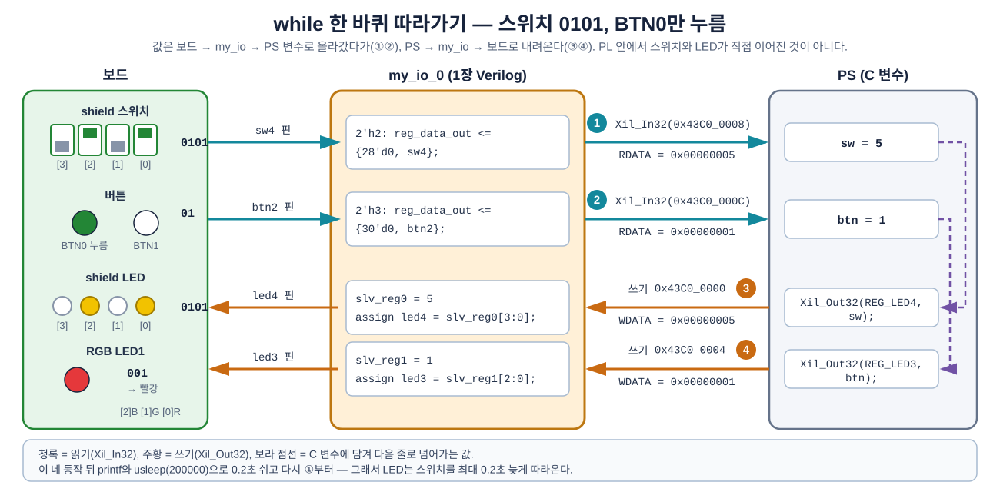

**그림 3-6** 위 표를 그림으로 옮긴 것. 번호 ①~④가 코드의 실행 순서다.

- ①② 청록 화살표: 보드의 스위치(`0101`)와 버튼(`01`)이 `my_io`의 읽기 `case`를 거쳐 PS의 변수 `sw = 5`, `btn = 1`이 된다.
- 보라 점선: 그 변수가 다음 줄 `Xil_Out32`의 값으로 넘어간다. 값이 PS 안의 변수에 잠시 머문다는 뜻이다.
- ③④ 주황 화살표: PS가 쓴 값이 `slv_reg0`, `slv_reg1`에 저장되고, `assign`을 거쳐 shield LED `0101`과 RGB 빨강이 된다.

`led3`의 세 비트는 XDC에서 RGB LED1의 R, G, B 순서로 연결했다(`led3[0]`=R, `led3[1]`=G, `led3[2]`=B). 그래서 버튼 값이 곧 색이 된다.

| 누른 버튼 | `btn` (2진수) | `led3` = `slv_reg1[2:0]` | 켜지는 색 |
|---|---|---|---|
| 없음 | `00` | `000` | 꺼짐 |
| `BTN0` | `01` | `001` (R) | 빨강 |
| `BTN1` | `10` | `010` (G) | 초록 |
| 둘 다 | `11` | `011` (R+G) | 노랑 |

> **32비트를 썼는데 핀은 4비트·3비트다.** `Xil_Out32`는 늘 32비트를 쓴다. `slv_reg0`에는 32비트가 모두 저장되지만, 1장에서 `led4`에 연결한 것은 아래 4비트(`[3:0]`)뿐이라 나머지 28비트는 핀으로 나가지 않는다. 반대로 읽을 때는 `{28'd0, sw4}`처럼 윗자리를 0으로 채워 돌려주므로, `sw`는 0~15 사이 값만 나온다.

4주차 7장 코드와 나란히 놓으면 바뀐 것은 **주소와 레지스터 맵뿐**이다.

| | 4주차 7장 (AXI GPIO) | 이번 장 (`my_io`) |
|---|---|---|
| 베이스 주소 | `0x4120_0000` | `0x43C0_0000` (`XPAR_MY_IO_0_BASEADDR`) |
| 방향 설정 | `GPIO_TRI`, `GPIO2_TRI`에 써야 했다 | 없다 (Verilog에서 이미 정했다) |
| 스위치 읽기 | `GPIO_DATA`(`+0x0`) — 채널 1 | `+0x8` |
| LED 쓰기 | `GPIO2_DATA`(`+0x8`) — 채널 2 | `+0x0`(shield), `+0x4`(RGB) |
| 레지스터 맵을 정한 쪽 | Xilinx(PG144) | **나**(1.2절) |

다음 그림은 코드의 실행 순서와, 각 줄이 버스와 핀에서 만드는 동작을 함께 보여 준다.

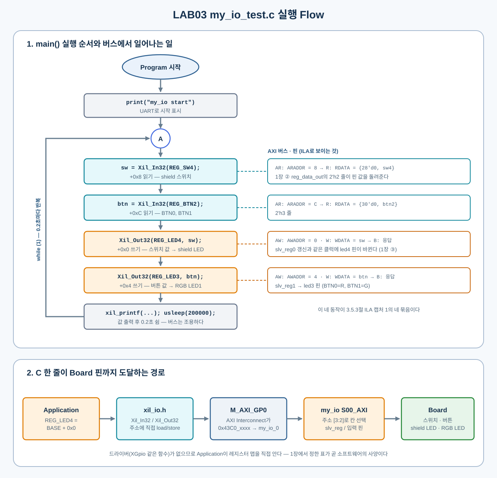

**그림 3-7** `my_io_test.c`의 실행 순서(위)와, C 한 줄이 보드 핀까지 가는 경로(아래).

- 왼쪽 Flow는 `main()`의 순서다. 시작 표시를 한 뒤 연결점 A에서 `while (1)`이 돌며, 한 바퀴마다 읽기 2번 → 쓰기 2번 → 출력·대기를 반복한다.
- 오른쪽 칸은 각 줄이 버스에서 만드는 동작이다. 청록은 읽기(AR → R), 주황은 쓰기(AW·W → B)다. 3.5절에서 ILA로 이 네 동작을 직접 본다.
- 아래쪽은 C 한 줄이 보드 핀까지 가는 경로다. 드라이버 없이 `Xil_In32/Out32`가 주소에 바로 읽고 쓰므로, 1.2절의 레지스터 맵이 곧 소프트웨어의 사양이 된다.

## 3.4 빌드와 실행

`FLOW → Build` → 보드 연결 → `FLOW → Run`. PuTTY(115200)를 열어 둔다.

> **`Run` 할 때 노란 WARNING이 수십 줄 나와도 괜찮다.** Vitis 출력 창에 `WARNING: [Common 17-673] Cannot get value of property 'CONFIG.C_BASEADDR' …`가 반복해서 찍힌다. Vitis가 `.xsa` 안의 블록마다 주소(`C_BASEADDR`)를 물어보는데, 주소가 없는 블록(`system_ila_0`, Interconnect 등)에서 "그런 값은 없다"고 답하는 것이다. **오류(ERROR)가 아니며 동작에 영향이 없다.** 끝부분에 `100%  1MB …`가 보이면 비트스트림이 보드에 올라간 것이다. 성공 여부는 PuTTY에 `my_io start`가 찍히는지로 판단한다.

> **`invalid command name "ps7_init"` 오류가 나면** — 이것은 진짜 오류다. 설계나 코드가 틀린 것이 아니라 **Vitis 2023.2의 버그**로, 사용자 IP가 처음 들어간 이번 주부터 나타난다.
>
> `Run`은 프로그램을 올리기 전에 `ps7_init.tcl`을 실행해 PS(클럭·DDR 등)를 초기화한다. 그런데 `.xsa` 안에는 `.tcl` 파일이 두 개 있다. 하나는 `ps7_init.tcl`, 다른 하나는 1장에서 IP와 함께 생긴 드라이버 파일 `my_io.tcl`이다. Vitis 2023.2가 이 중 **`my_io.tcl`을 초기화 파일로 잘못 골라서**, `ps7_init`이라는 명령을 찾지 못하는 것이다.
>
> 고치는 법: `app_component` → `Settings` → `launch.json`을 연다. **`Initialization file`** 의 경로 끝 `…\_ide\psinit\my_io.tcl`을 **`…\_ide\psinit\ps7_init.tcl`** 로 바꾸고 저장한 뒤 다시 `Run`. 같은 폴더에 `ps7_init.tcl`이 이미 들어 있다. 4주차까지는 사용자 IP가 없어서 이 문제가 없었다.
>
> 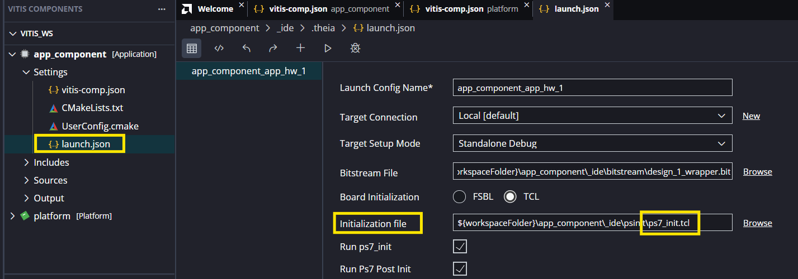
>
> **그림 3-8** `Settings → launch.json`의 설정 화면. `Board Initialization`은 `TCL`, `Initialization file` 끝이 `ps7_init.tcl`, 아래 `Run ps7_init`과 `Run Ps7 Post Init`이 체크되어 있으면 된다.

- shield 스위치를 올리면 같은 자리의 shield LED가 켜지고, PuTTY의 `sw` 값이 바뀐다.
- `BTN0`을 누르면 RGB LED1이 빨강, `BTN1`이면 초록, 둘 다 누르면 노랑이 된다.

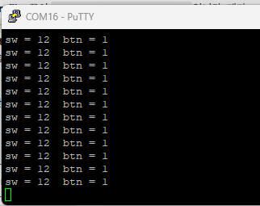

**그림 3-9** 0.2초마다 한 줄씩 찍힌다. 이 화면은 스위치 `1100`(= 12), `BTN0`을 누른 상태다. 이때 shield LED는 `led4[3]`, `led4[2]` 자리가 켜지고 RGB LED1은 빨강이다. 스위치를 바꾸면 `sw` 값이 바로 따라 바뀐다.

**프로그램을 멈추지 말고 그대로 둔다.** 다음 절에서 이 상태로 ILA를 연결한다.

---

## 3.5 ILA로 버스 보기

### 3.5.1 Hardware Manager 연결

Vitis는 그대로 두고, **Vivado의 `custom_ip` 프로젝트**로 간다.

1. `Flow Navigator → PROGRAM AND DEBUG → Open Hardware Manager` → 위쪽 초록 띠의 **`Open target` → `Auto Connect`**.

   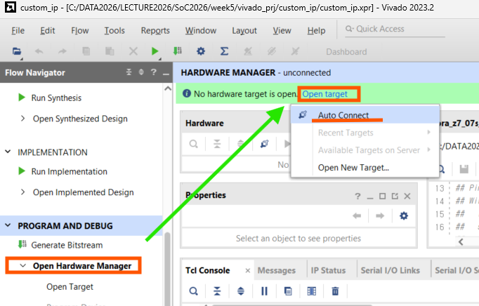

   **그림 3-10** `custom_ip` 프로젝트의 Flow Navigator 맨 아래 `Open Hardware Manager`를 누르면 `HARDWARE MANAGER - unconnected`가 열린다. `Open target → Auto Connect`로 보드에 연결한다.

2. **`Program Device`는 누르지 않는다.** 보드에는 Vitis가 이미 같은 비트스트림을 올려 두었다. 다시 프로그래밍하면 PL이 처음 상태로 돌아가 `my_io`의 레지스터도 0으로 지워진다.
3. `Hardware` 창에서 `xc7z007s_1`을 고르고, 아래 `Hardware Device Properties`의 **`Probes file`** 에 2장에서 생긴 `.ltx`를 지정한다.
4. `hw_ila_1`이 나타나고 ILA 창(Waveform)이 열린다. 열리지 않으면 장치를 우클릭 → **`Refresh Device`**.

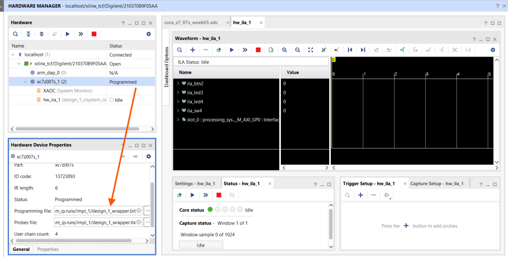

**그림 3-11** 보드에 연결되고 ILA가 열린 Hardware Manager.

- **왼쪽 위 `Hardware`**: `xc7z007s_1`이 `Programmed` 상태다. Vitis가 이미 비트스트림을 올렸다는 뜻이다. 그 아래 `hw_ila_1`이 2장에서 넣은 `system_ila_0`이다(`design_1_i/system_ila…`).
- **왼쪽 아래 `Hardware Device Properties`**: 파일 두 개가 지정되어 있다(주황 화살표). 둘 다 2장 그림 2-16의 폴더 `vivado_prj/custom_ip/custom_ip.runs/impl_1/`에 있다.
- **오른쪽 `Waveform`**: `.ltx`에 적힌 이름 그대로 `ila_btn2`, `ila_led3`, `ila_led4`, `ila_sw4`와 AXI 슬롯 `slot_0 : processing_sys…_M_AXI_GP0`이 보인다. 아직 트리거를 걸지 않아 비어 있다(`ILA Status: Idle`).

두 파일의 차이를 정리하면 다음과 같다.

| 칸 | 파일 | 담긴 것 | 여기서 하는 일 |
|---|---|---|---|
| `Programming file` | `design_1_wrapper.bit` | PL 회로 전체(`my_io`, ILA 포함) | `Program Device`를 누를 때만 쓴다. 이번에는 Vitis가 `.xsa` 안의 같은 `.bit`로 이미 올렸으므로 **쓰지 않는다** |
| `Probes file` | `design_1_wrapper.ltx` | ILA가 잡는 신호의 **이름표**: 어느 선이 몇 번 프로브이고 몇 비트인지 | 이것이 있어야 파형에 `ila_led4`, `ARADDR` 같은 이름이 붙는다. **반드시 지정한다** |

> **`.bit`와 `.ltx`는 짝이다.** 둘 다 2장의 같은 `Generate Bitstream`에서 같은 시각에 생긴다(그림 2-16). 2장으로 돌아가 Block Design을 고치고 Bitstream을 다시 만들었다면 `.bit`, `.ltx`, `.xsa`가 모두 바뀐다. 이때는 Vitis Platform도 새 `.xsa`로 다시 빌드해야 보드의 회로와 `.ltx`가 맞는다.

> **ILA가 안 보이면** `Probes file`이 이번 Bitstream과 함께 만들어진 `.ltx`인지 확인한다. 같은 폴더의 `debug_nets.ltx`가 아니라 `design_1_wrapper.ltx`다.

### 3.5.2 파형 창 준비

`Waveform` 창에는 두 묶음이 보인다.

- **`slot_0 : processing_system7_0_M_AXI_GP0`** — PS가 내보내는 AXI 버스. 펼치면 쓰기 주소(`AW…`), 쓰기 데이터(`W…`), 쓰기 응답(`B…`), 읽기 주소(`AR…`), 읽기 데이터(`R…`) 다섯 채널이 있다. 주소(`AWADDR`, `ARADDR`)는 **32비트**라서 C 코드의 주소가 그대로 **`43c00008`** 처럼 보인다. 끝 자리(`0`, `4`, `8`, `c`)가 레지스터 맵의 오프셋이다. PS 쪽 버스는 AXI3이라 `ARLEN`, `WLAST`, `ID` 같은 신호도 함께 있는데, 이번 주에는 보지 않는다.
- **`ila_btn2`, `ila_led3`, `ila_led4`, `ila_sw4`** — 핀 네 개. 2장(그림 2-10)에서 고친 선 이름이 그대로 보인다. 선 이름을 고치지 않았다면 `probe0_1`처럼 번호로 보이므로, 2장에서 적어 둔 짝대로 이름을 우클릭 → `Rename`으로 바꿔 둔다.

슬롯을 펼치면 신호가 많다. 이번 주에 볼 것은 `ARVALID`, `ARADDR`, `RVALID`, `RDATA`, `AWVALID`, `AWADDR`, `WVALID`, `WDATA`, `BVALID` 아홉 개다. 나머지는 `−`로 지워도 된다.

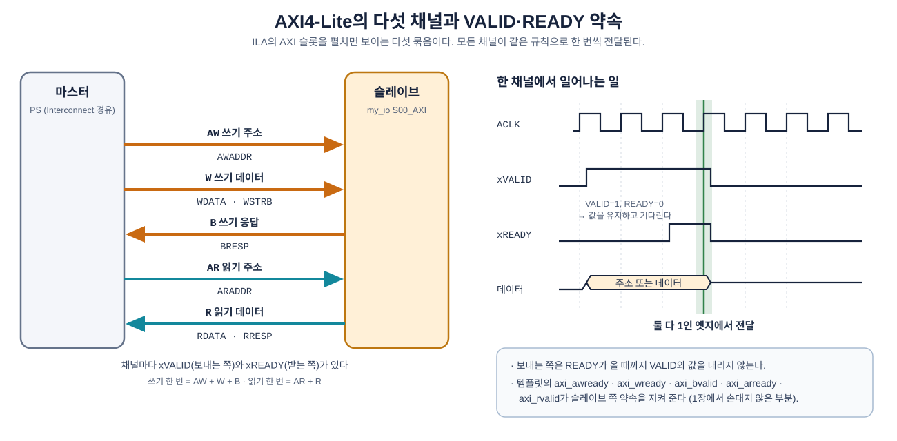

**그림 3-12** AXI 슬롯을 펼치면 보이는 다섯 채널(왼쪽)과, 한 채널에서 값이 전달되는 규칙(오른쪽).

- 주황 화살표 세 개(AW·W·B)가 쓰기 한 번, 청록 화살표 두 개(AR·R)가 읽기 한 번이다. B와 R은 슬레이브가 마스터에게 돌려주는 방향이다.
- 오른쪽 파형에서 `xVALID`가 먼저 1이 되어도 `xREADY`가 1이 될 때까지 기다린다. 둘 다 1인 클럭 엣지(초록 띠)에서 한 번 전달된다.

### 3.5.3 캡처 1 — 프로그램 한 바퀴 잡기

프로그램은 0.2초마다 한 바퀴를 돈다. 한 바퀴의 첫 동작은 `Xil_In32(REG_SW4)`, 즉 **읽기**다. 그래서 "읽기 주소가 나타나는 순간"을 트리거로 잡는다.

1. `Trigger Setup` 창에서 `+`를 눌러 AXI 슬롯의 **`ARVALID`** 를 추가하고, `Value`를 **`R`**(Rising, 0→1로 바뀌는 순간)로 둔다. `1`로 두어도 결과는 같다.

   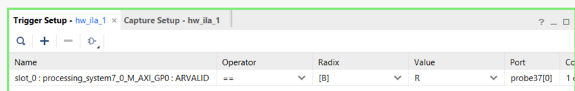

   **그림 3-13** `slot_0 : processing_system7_0_M_AXI_GP0 : ARVALID`, Operator `==`, Value `R`. 오른쪽 `Port` 칸의 `probe37[0]`은 ILA 안에서 이 신호가 몇 번 프로브인지다(`.ltx`가 알려 준다).

2. `Trigger position`은 기본값(가운데, 512)으로 두어도 네 동작이 모두 들어온다. 트리거 앞쪽을 줄이고 싶으면 `100`으로 줄인다.
3. **`Run Trigger`**(▶). 0.2초 안에 트리거가 걸리고 파형이 채워진다.

캡처를 보기 전에, 나와야 할 파형을 먼저 그려 보면 다음과 같다.

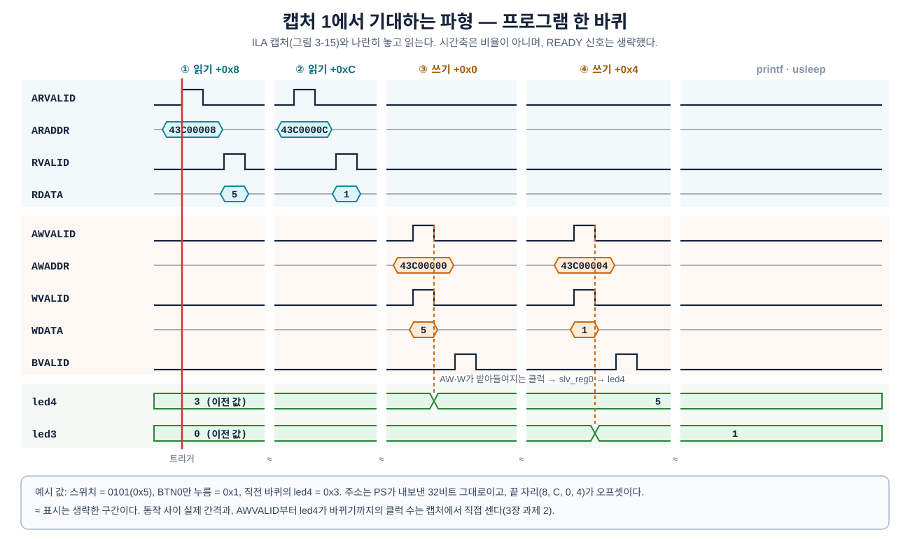

**그림 3-14** 프로그램 한 바퀴의 이상적인 파형. 스위치 = `0101`, BTN0만 누른 경우다. 시간축은 비율이 아니다.

- 청록 띠(위 네 줄)가 읽기 두 번이다. `ARADDR = 43C00008`이 나가고 잠시 뒤 `RDATA`로 스위치 값이, 이어서 `ARADDR = 43C0000C`와 버튼 값이 돌아온다.
- 주황 띠(가운데 다섯 줄)가 쓰기 두 번이다. 주소(`AWADDR`)와 데이터(`WDATA`)가 함께 나가고, 그 뒤 `BVALID`로 응답이 돌아온다.
- 초록 띠(아래 두 줄)가 핀이다. 주황 점선, 즉 쓰기가 받아들여지는 클럭에 `led4`, `led3`이 새 값으로 바뀐다.

실제 캡처는 다음과 같다.

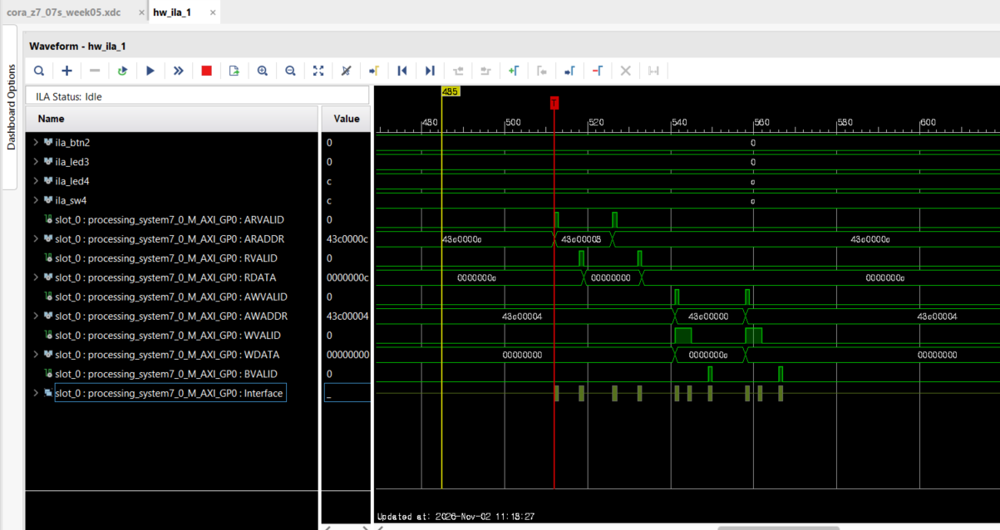

**그림 3-15** 실제로 잡은 한 바퀴(스위치 `1100` = `c`, 버튼 안 누름). 빨간 `T`가 트리거, 즉 첫 `ARVALID`다.

- `ARVALID` 펄스 두 개 → `ARADDR`가 `43c00008`, `43c0000c`. 각각 조금 뒤 `RVALID`와 함께 `RDATA`가 `0000000c`(스위치), `00000000`(버튼)으로 돌아온다.
- 이어서 `AWVALID`·`WVALID` 두 번 → `AWADDR`가 `43c00000`, `43c00004`, `WDATA`가 `0000000c`, `00000000`. 각각 뒤에 `BVALID`(응답)가 온다.
- 네 동작이 샘플 510~570, 약 60 클럭(1.2 µs) 안에 모두 끝난다. 나머지 0.2초 동안 버스는 조용하다.
- `ila_led4`는 처음부터 `c`다. 직전 바퀴에서 이미 `c`를 써 두었기 때문이다. 핀이 **바뀌는** 순간을 보려면 스위치를 바꾼 직후에 `Run Trigger`를 누른다.

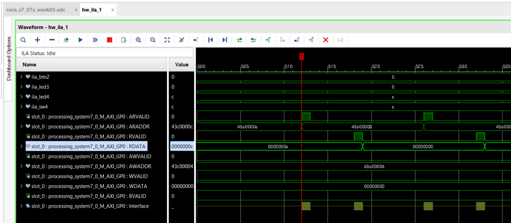

**그림 3-16** 그림 3-15의 앞부분(읽기 두 번)을 확대한 것. `ARVALID`가 1인 클럭에 `ARADDR`가 `43c00008`로 바뀌고, 약 6클럭 뒤 `RVALID`가 1인 클럭에 `RDATA = 0000000c`가 실려 온다. 두 번째 읽기(`43c0000c`)도 같은 모양이다.

> **VALID가 1인 순간의 값만 본다.** `ARADDR`나 `AWADDR`는 VALID가 0일 때도 마지막 값(`43c0000c`, `43c00004` 등)을 그대로 들고 있다. 그 값은 의미가 없다. 주소와 데이터는 **같은 채널의 VALID가 1인 클럭**에서만 읽는다.

파형을 왼쪽부터 읽으면 C 코드의 네 줄이 차례로 보인다.

| 순서 | C 코드 | 버스에 보이는 것 |
|---|---|---|
| 1 | `Xil_In32(REG_SW4)` | `ARADDR = 43c00008` → 잠시 뒤 `RDATA` = 스위치 값 |
| 2 | `Xil_In32(REG_BTN2)` | `ARADDR = 43c0000c` → `RDATA` = 버튼 값 |
| 3 | `Xil_Out32(REG_LED4, sw)` | `AWADDR = 43c00000`, `WDATA` = 스위치 값 → **`led4` 핀이 바뀐다** → `BVALID`(응답) |
| 4 | `Xil_Out32(REG_LED3, btn)` | `AWADDR = 43c00004`, `WDATA` = 버튼 값 → `led3` 핀이 바뀐다 |

쓰기만 따로 보고 싶으면 트리거를 바꾼다. `ARVALID`의 Value를 `X`(상관없음)로 두고, `+`로 **`WVALID`** 를 추가해 `1`로 둔다.

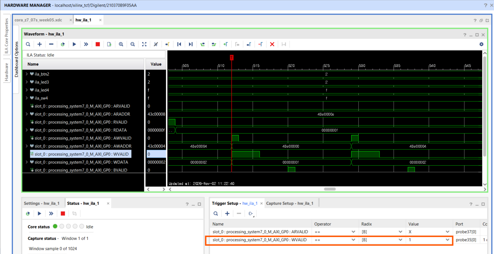

**그림 3-17** `WVALID == 1`로 잡은 쓰기 두 번(스위치 `1111` = `f`, `BTN1` = `2`). 트리거 지점에서 `AWADDR = 43c00000`, `WDATA = 0000000f`, 이어서 `43c00004`, `00000002`. `ila_led4 = f`, `ila_led3 = 2`(초록)로 C 코드가 쓴 값과 같다.

- `AWVALID`는 한 클럭짜리 펄스인데, `WVALID`는 몇 클럭 동안 1로 머문다. AW(주소)와 W(데이터)는 서로 다른 채널이라 따로 움직인다. 템플릿은 둘 다 받아들여진 클럭(`slv_reg_wren`)에 레지스터를 쓴다(1.5절).

> **1장의 Verilog가 여기 다 있다.** 1번의 `RDATA`는 1.6절 ②에서 바꾼 `2'h2 : reg_data_out <= {28'd0, sw4};`가 돌려준 값이다. 3번에서 `led4`가 바뀌는 것은 ③ `assign led4 = slv_reg0[3:0];` 때문이다. 쓰기 주소와 데이터가 **둘 다 받아들여지는 클럭**(템플릿의 `slv_reg_wren`)에 `slv_reg0`이 바뀌고, `led4`도 바로 그때 바뀐다. 응답(`BVALID`)은 그 뒤에 나간다. 소프트웨어 한 줄이 하드웨어 핀이 되기까지 몇 클럭(20 ns 단위)이 걸리는지 파형에서 세어 볼 수 있다.

> **AXI 핸드셰이크(그림 3-12).** 각 채널은 `VALID`(보내는 쪽: "데이터 있다")와 `READY`(받는 쪽: "받을 수 있다")가 **둘 다 1인 클럭**에 한 번 전달된다. 1장에서 "손대지 않는다"고 했던 `axi_awready`, `axi_rvalid` 같은 신호가 바로 이것이다. 템플릿이 이 약속을 지켜 주었기 때문에 우리는 레지스터와 핀만 연결하면 됐다.

### 3.5.4 캡처 2 — 디버거와 함께, 한 줄만 잡기

4주차 9장의 디버거를 같이 쓰면 **C 코드 한 줄이 만든 버스 동작만** 골라 볼 수 있다.

1. **실행 중인 프로그램을 멈춘다.** Vitis 왼쪽의 Debug 아이콘(벌레 모양)을 눌러 Debug 보기로 바꾸고, 위쪽의 **□(Stop)** 를 누른다.

   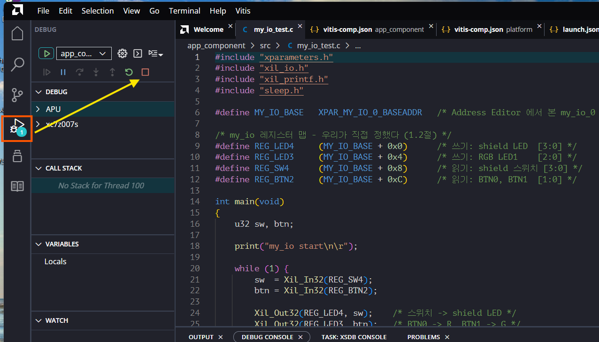

   **그림 3-18** 왼쪽 Debug 아이콘(주황 상자)을 누르면 `DEBUG` 창이 열린다. 3.4절의 `Run`으로 돌고 있던 프로그램을 □(Stop)로 멈춘다.

2. 위쪽 **▷(Debug)** 로 다시 시작한다. 프로그램이 보드에 다시 올라가고 `main`의 첫 줄에서 멈춘다.

   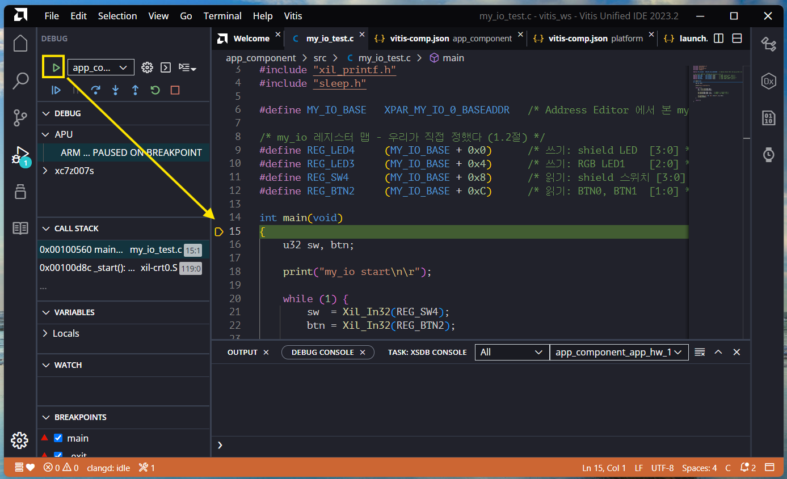

   **그림 3-19** ▷(노란 상자)를 누르면 `APU`가 `PAUSED ON BREAKPOINT`가 되고, 편집 창 15줄(`main`의 `{`)에 노란 화살표가 선다. 아래 `BREAKPOINTS`에 `main`이 체크되어 있어서 여기서 멈춘 것이다.

3. Debug를 시작하면서 보드가 다시 프로그래밍되었으므로, Hardware Manager에서 장치를 한 번 더 **`Refresh Device`** 한다.
4. ILA 트리거를 **`AWVALID = 1`** 로 바꾸고 `Run Trigger`. CPU가 멈춰 있어서 버스가 조용하므로 ILA는 `Waiting for Trigger` 상태로 기다린다.
5. Vitis에서 **Step Over**(↷)를 눌러 한 줄씩 진행한다.

   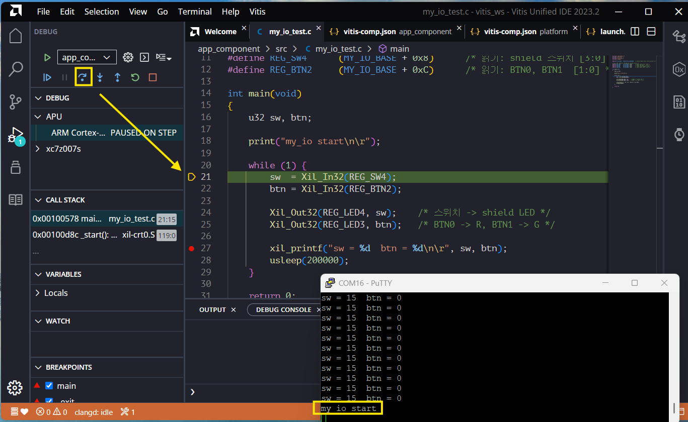

   **그림 3-20** Step Over(노란 상자)를 몇 번 누르면 화살표가 21줄 `sw = Xil_In32(REG_SW4);`로 내려온다(`PAUSED ON STEP`). 그 사이 18줄 `print`가 실행되어 PuTTY 맨 아래에 `my io start`가 새로 찍혔다. 위쪽 `sw = 15 btn = 0` 줄들은 멈추기 전 `Run`이 남긴 것이다.

6. 24줄 `Xil_Out32(REG_LED4, sw);`에 화살표가 오면 Step Over를 **한 번** 더 누른다. 이 순간 ILA가 트리거된다.


**그림 3-21** `Step Over` 한 번에 ILA가 트리거되고, 정확히 그 한 줄의 쓰기 하나만 기록된다. 📷 *캡처 대기*

`Step Over`를 누른 순간 ILA가 트리거되고, 파형에는 **쓰기 하나**(`AWADDR = 43c00000`)만 보인다. 앞뒤 줄의 읽기와 쓰기는 CPU가 멈춰 있어서 나타나지 않는다. 4주차 9장에서는 "레지스터 값이 바뀌었다"는 결과만 봤다면, 이번에는 **그 값이 버스를 타고 가서 핀을 바꾸는 과정**을 본 것이다.

---

## 3.6 참고 — 프로젝트 없이 Hardware Manager만 열어 ILA 보기

3.5절에서는 `custom_ip` 프로젝트 안에서 Hardware Manager를 열었다. 그런데 ILA를 보는 데 프로젝트는 필요 없다. **보드에 회로가 올라가 있고, 그 회로의 `.ltx`만 있으면 된다.** 프로젝트를 여는 데 걸리는 시간을 아낄 수 있고, 다른 PC에서 `.ltx` 파일 하나만 가져가서 볼 수도 있다.

1. Vivado를 실행하고, 시작 화면의 `Tasks → Open Hardware Manager`를 누른다.

   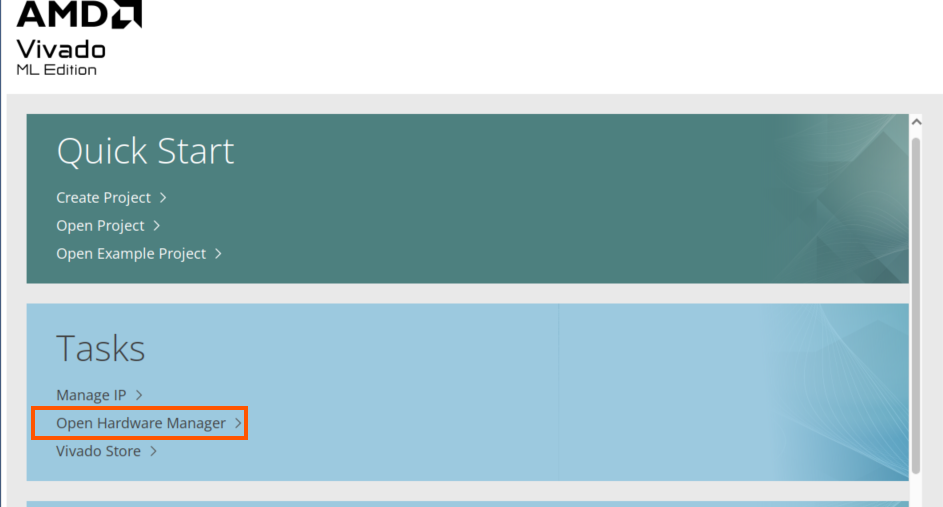

   **그림 3-22** 프로젝트를 열지 않는다. 시작 화면 `Tasks` 아래 `Open Hardware Manager`.

2. `Open target → Auto Connect`.

   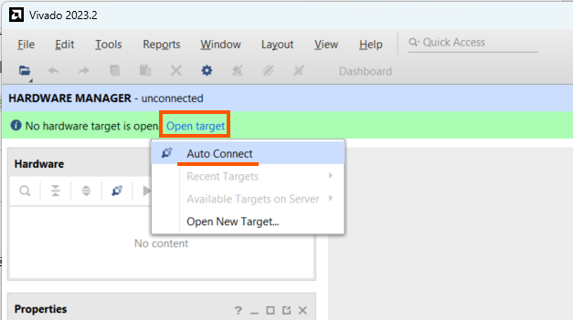

   **그림 3-23** 창 제목이 `Vivado 2023.2`뿐이고 프로젝트 이름이 없다. 연결하는 방법은 그림 3-10과 같다.

3. `xc7z007s_1`을 고르고, `Hardware Device Properties`의 **`Probes file`** 칸 오른쪽 `…`을 눌러 `.ltx`를 고른다.

   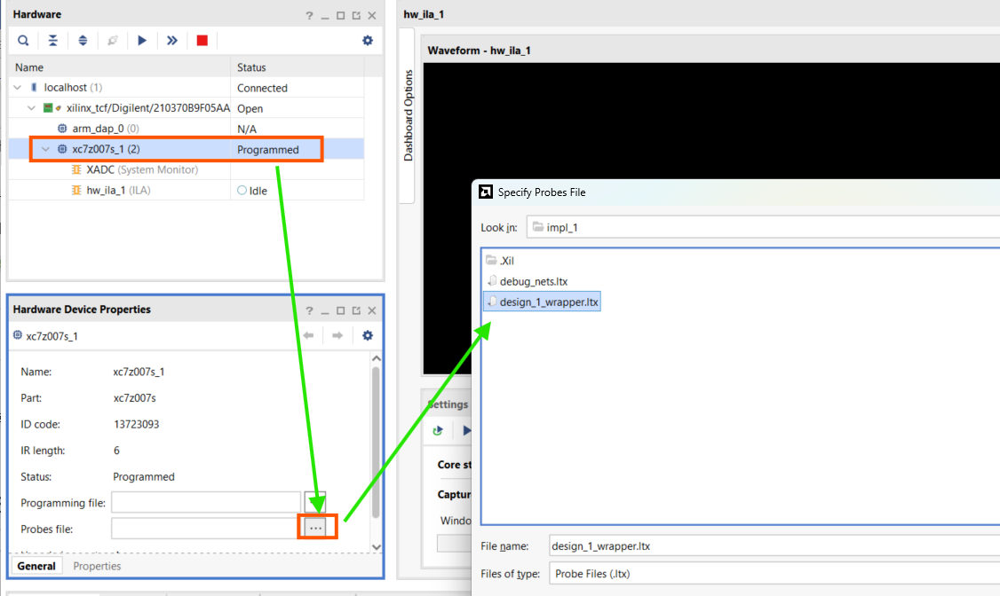

   **그림 3-24** 장치는 이미 `Programmed`이고 `hw_ila_1 (ILA)`도 보인다. 하지만 `.ltx`가 없어 신호 이름을 모른다. `Probes file`의 `…` → `custom_ip.runs/impl_1/design_1_wrapper.ltx`. `Programming file`은 비워 둔다. 회로는 Vitis가 이미 올렸다.

4. 지정하면 Waveform 창이 열린다. 이후는 3.5.2절부터와 같다.

   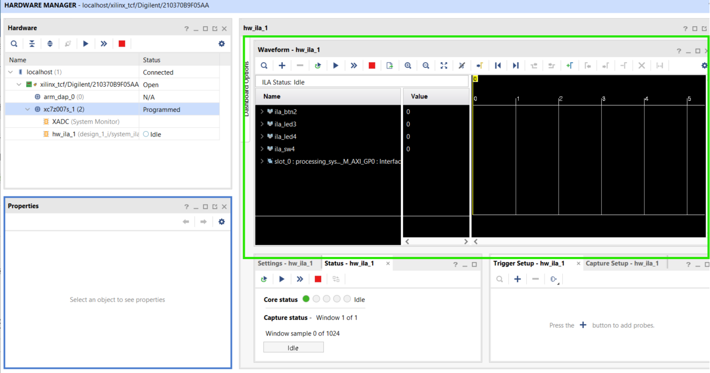

   **그림 3-25** 그림 3-11과 같은 화면이 프로젝트 없이 열렸다. 신호 이름이 모두 `.ltx`에서 왔다는 것을 확인할 수 있다.

> **`.ltx`가 없으면?** `hw_ila_1`은 보이지만 신호가 `probe0`, `probe1`… 번호로만 나오고, AXI 슬롯도 묶이지 않은 비트 덩어리로 보인다. ILA 회로는 보드 안에 있지만, **어느 비트가 무슨 신호인지 적힌 이름표가 `.ltx`** 라는 뜻이다. 그래서 2장에서 Bitstream을 만들 때마다 `.ltx`의 위치를 확인해 두라고 한 것이다.

---

## 3.7 AXI GPIO로 해도 되지 않나?

이번 주에 만든 `my_io`는 4주차 AXI GPIO와 하는 일이 같다. 솔직히 말해 **이 정도 입출력이라면 AXI GPIO가 더 편하다** — 설정만 하면 되고, 드라이버도 있다.

그래도 직접 만들어 본 이유는 다음 단계 때문이다. AXI GPIO는 레지스터 값을 **그대로 핀에 내보내는 것**밖에 못 한다. `my_io`는 1.6절 ③의 `assign` 자리에 **무엇이든 넣을 수 있다.** 레지스터 값으로 LED 밝기를 조절하는 회로, 숫자를 세는 회로, 계산하는 회로 — PS는 여전히 `Xil_Out32` 한 줄로 명령만 내리고, 일은 내 Verilog가 한다. 6주차에 이 자리에 **PWM**을 넣는다.

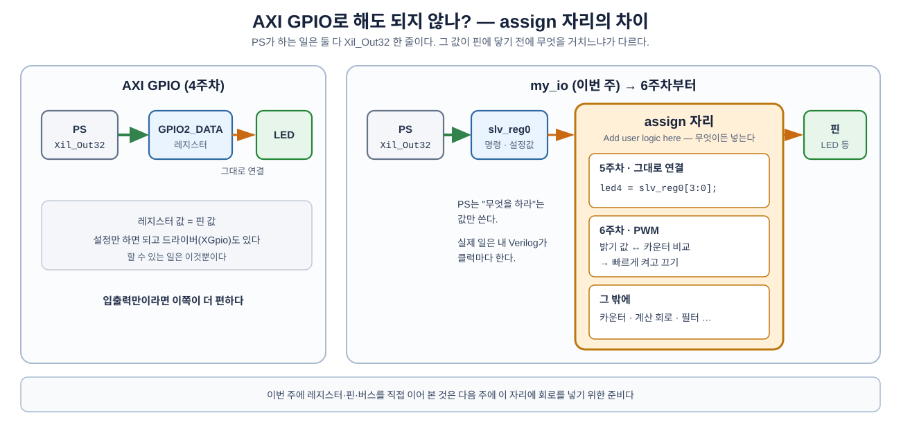

**그림 3-26** 왼쪽 AXI GPIO는 레지스터 값이 그대로 핀이 된다. 오른쪽 `my_io`는 레지스터와 핀 사이의 `assign` 자리에 회로를 넣을 수 있다.

- 두 경우 모두 PS는 `Xil_Out32` 한 줄로 값을 쓸 뿐이다(초록 화살표).
- 주황 상자 안의 세 칸이 그 자리에 들어갈 수 있는 것들이다. 이번 주는 맨 위(그대로 연결), 6주차는 가운데(PWM)다.

---

## 3.8 정리

| 키워드 | 내용 |
|---|---|
| `XPAR_MY_IO_0_BASEADDR` | 사용자 IP의 주소 매크로. 인스턴스 이름 규칙은 4주차와 같다 |
| 사용자 IP 드라이버 | 2023.2 Platform에는 들어가지 않는다 → `Xil_Out32`/`Xil_In32` |
| Hardware Manager 연결 | Vitis로 실행한 뒤 Auto Connect → `.ltx` 지정 → Refresh. `Program Device`는 누르지 않는다 |
| AXI 슬롯 파형 | AW·W·B·AR·R 다섯 채널. PS 쪽 버스라 주소가 32비트(`43C00008`)로 보인다 |
| `VALID`/`READY` | 둘 다 1인 클럭에 한 번 전달된다. 템플릿이 처리해 준 부분 |
| 트리거 | `ARVALID = R`로 한 바퀴, `WVALID = 1`로 쓰기만, 디버거 + `AWVALID = 1`로 한 줄 |
| `.bit` / `.ltx` | `.bit`는 회로(Vitis가 이미 올림), `.ltx`는 ILA 신호 이름표(반드시 지정). 둘 다 `custom_ip.runs/impl_1/` |
| 프로젝트 없이 ILA | 시작 화면 `Open Hardware Manager` → Auto Connect → `.ltx` 지정 |
| 쓰기 → 핀 | 쓰기 주소·데이터가 받아들여지는 클럭에 `slv_reg0`과 `led4`가 함께 바뀐다 |

---

## 과제 — 다음 시간 전까지

1. **1장 과제 2번을 확인한다.** 코드를 고쳐 `+0x0`에 `0x5`를 쓴 뒤 `+0x0`을 읽어 출력하고, `+0x8`에 `0x5`를 쓴 뒤 `+0x8`을 읽어 출력한다. 예상과 같은가? ILA로 `+0x8` 쓰기를 잡아 보면 `WDATA`는 분명 `5`인데 왜 읽으면 스위치 값이 나오는가?
2. **몇 클럭 걸리나.** 캡처 1에서 `AWVALID`가 처음 1이 된 클럭부터 `led4`가 바뀐 클럭까지 몇 클럭인지 센다. 50 MHz이므로 몇 ns인가?
3. **바퀴 사이 간격.** 트리거 위치를 바꾸거나 다시 잡아 보며, 한 바퀴의 네 동작이 끝난 뒤 다음 읽기까지 왜 ILA 창(약 20 µs) 안에 들어오지 않는지 코드를 보고 설명한다.

## 다음 주 예고 — 6주차: PWM

- `my_io`를 다시 열어(`Edit in IP Packager`) RGB LED의 **밝기**를 조절하는 PWM 회로를 넣는다.
- PS는 "밝기 값"이라는 **명령**을 레지스터에 쓰고, 실제 깜빡임은 내 Verilog가 만든다. AXI GPIO로는 할 수 없는 일이다.
- 이번 주에 쓴 ILA로 PWM 파형도 직접 본다.

---

*SoC 설계 · 5주차 3교시(W5_S3) | Vivado/Vitis 2023.2 · Windows · Cora Z7-07S*
