# 제1장 PWM IP (1) — PWM 원리와 `my_pwm` 만들기

**SoC 설계** · 6주차 1교시(W6_S1) | Vivado/Vitis 2023.2 · Windows 11 · Digilent Cora Z7-07S

---

5주차에 만든 `my_io`는 PS가 레지스터에 쓴 값을 **그대로** 핀으로 내보냈다. `+0x0`에 `0101`을 쓰면 LED 두 개가 켜지고 두 개가 꺼졌다. LED는 켜지거나 꺼지거나, 둘 중 하나였다.

이번 주에는 LED의 **밝기**를 조절한다. 그런데 디지털 핀은 1 아니면 0이다. "반쯤 켜짐"은 없다. 방법은 하나다. **아주 빠르게 켜고 끄기를 반복하고, 켜져 있는 시간의 비율을 바꾼다.** 이것이 **PWM**(Pulse Width Modulation, 펄스 폭 변조)이다.

이 깜빡임은 1초에 수천 번이라 CPU가 `Xil_Out32`로 하나하나 만들 수 없다. 그래서 **깜빡임은 PL의 Verilog가 만들고, PS는 "주기는 얼마, 켜진 시간은 얼마"라는 명령만 레지스터에 쓴다.** 이번 주에 만들 IP의 이름은 `my_pwm`이다.

> **5주차와 무엇이 다른가**
> ```text
>   my_io (5주차)                            my_pwm (이번 주)
>   레지스터 값이 그대로 핀이 된다           레지스터 값은 "명령"이다
>   Verilog: assign led4 = slv_reg0;         Verilog: 카운터 + 비교기가 파형을 만든다
>   LED: 켜짐 / 꺼짐                         LED: 밝기 0 ~ 100 %
>   IP 만드는 절차를 처음 배웠다             같은 절차를 한 번 더 — 이번엔 user logic에 집중
> ```

이번 주도 세 교시에 걸쳐 IP 하나를 끝까지 써 본다. 진행 순서는 5주차와 같다.

| 교시 | 장 | 하는 일 |
|---|---|---|
| 1교시 | 제1장 (이 장) | PWM 원리, 레지스터 맵 설계, `my_pwm` 만들기 — Verilog 수정, 패키징 |
| 2교시 | 제2장 | Vivado 프로젝트 — Block Design에 넣고, System ILA를 붙여 Bitstream까지 |
| 3교시 | 제3장 | Vitis 프로젝트 — C로 밝기를 바꾸고, ILA로 PWM 파형 보기 |

이번 장의 흐름은 다음과 같다.

> **PWM 원리** → **카운터와 비교기** → **레지스터 맵 정하기** → **Create and Package New IP** → **Verilog 네 군데 고치기** → **Re-Package**

---

## 학습 목표

- PWM의 주기(period)와 듀티(duty)가 무엇이고, LED 밝기와 어떻게 연결되는지 설명한다.
- 카운터 하나와 비교기 하나로 PWM 파형을 만드는 원리를 설명한다.
- "명령"을 담는 레지스터 맵(`CTRL`, `PERIOD`, `DUTY`)을 정한다.
- 5주차와 같은 절차로 AXI4-Lite IP `my_pwm`을 만들고, user logic에 PWM 회로를 넣는다.

---

## 1.1 PWM — 빠르게 깜빡여서 밝기를 만든다

LED를 1초에 1000번 켜고 끄면 눈은 깜빡임을 따라가지 못하고 **평균 밝기**만 느낀다. 한 번 깜빡이는 동안 켜져 있는 시간이 길면 밝게, 짧으면 어둡게 보인다.

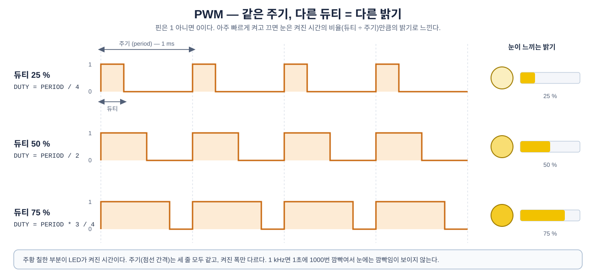

**그림 1-1** 세 파형은 주기가 모두 같고, 한 주기 안에서 켜져 있는 시간(듀티)만 다르다.

- **주기(period)** 는 켜짐–꺼짐 한 번이 걸리는 시간이다. 세 파형 모두 같다.
- **듀티(duty)** 는 한 주기 중 켜져 있는 시간이다. 위에서부터 25 %, 50 %, 75 %다.
- 오른쪽 막대가 눈이 느끼는 밝기다. 듀티의 비율, 즉 **듀티 ÷ 주기**에 비례한다.

| 용어 | 뜻 | 이번 주의 예 |
|---|---|---|
| 주기 (period) | 켜짐–꺼짐 한 번의 시간 | 1 ms |
| 주파수 | 1초에 몇 번 깜빡이나 = 1 ÷ 주기 | 1 ms → 1000번 = 1 kHz |
| 듀티 (duty) | 한 주기 중 켜진 시간 | 0.25 ms |
| 듀티 비율 | 듀티 ÷ 주기 | 0.25 ÷ 1 = 25 % → 밝기 25 % |

> **얼마나 빨라야 하나.** 1초에 수십 번 이하로 깜빡이면 눈에 깜빡임이 보인다. 수백 번 이상이면 깜빡임은 사라지고 밝기만 남는다. 이번 주에는 1 kHz(1초에 1000번)를 기본으로 쓴다.

---

## 1.2 카운터와 비교기로 PWM 만들기

Verilog로 PWM을 만드는 방법은 간단하다. 부품이 두 개면 된다.

1. **카운터**: 클럭마다 1씩 센다. `PERIOD − 1`까지 세면 0으로 돌아간다. 그래서 `0, 1, 2, …, PERIOD−1, 0, 1, 2, …`를 끝없이 반복한다.
2. **비교기**: 카운터 값이 `DUTY`보다 **작으면 켜고**, 아니면 끈다.

작은 숫자로 따라가 보자. `PERIOD = 10`, `DUTY = 3`일 때 클럭마다 신호 값은 다음과 같다.

| 클럭 *n* | 0 | 1 | 2 | 3 | 4 | 5 | 6 | 7 | 8 | 9 | 10 | 11 | 12 | 13 | … |
|---|---|---|---|---|---|---|---|---|---|---|---|---|---|---|---|
| `pwm_cnt` | 0 | 1 | 2 | 3 | 4 | 5 | 6 | 7 | 8 | 9 | 0 | 1 | 2 | 3 | … |
| `pwm_cnt < duty` | 1 | 1 | 1 | 0 | 0 | 0 | 0 | 0 | 0 | 0 | 1 | 1 | 1 | 0 | … |
| `led4` | `1111` | `1111` | `1111` | `0000` | `0000` | `0000` | `0000` | `0000` | `0000` | `0000` | `1111` | `1111` | `1111` | `0000` | … |

`pwm_cnt`는 9(`PERIOD − 1`) 다음에 0으로 돌아가므로 주기는 10클럭이다. 그중 `pwm_cnt`가 0, 1, 2인 3클럭 동안만 `led4 = 1111`이다. 듀티 비율 30 %다. `DUTY`를 7로 바꾸면 10클럭 중 7클럭 켜진다. **카운터는 그대로 두고, 비교하는 숫자만 바꾸면 밝기가 바뀐다.**

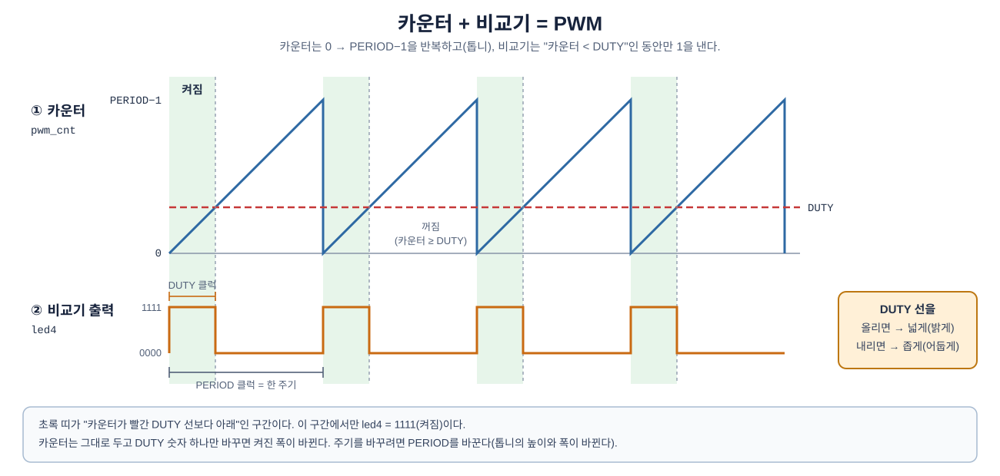

**그림 1-2** 위쪽 톱니 모양이 카운터 값이다. 0부터 `PERIOD−1`까지 올라갔다가 0으로 떨어지기를 반복한다.

- 빨간 가로선이 `DUTY`다. 카운터가 이 선보다 **아래**에 있는 동안(초록 구간) LED가 켜진다.
- 아래쪽 파형이 비교 결과, 즉 LED로 나가는 PWM이다.
- 빨간 선을 위로 올리면(`DUTY`를 키우면) 켜진 폭이 넓어지고, 아래로 내리면 좁아진다.

### 1.2.1 숫자를 시간으로 — 클럭 50 MHz

`my_pwm`의 카운터는 AXI 버스와 같은 클럭 `FCLK_CLK0`(50 MHz)으로 센다. 한 클럭은 1 ÷ 50,000,000 초 = **20 ns**다. 그래서 `PERIOD`와 `DUTY`는 "몇 클럭인가"로 쓴다.

| `PERIOD` | 주기 | 주파수 | 쓰는 곳 |
|---|---|---|---|
| `50000` | 50000 × 20 ns = **1 ms** | 1 kHz | LED 밝기 (3장 코드) |
| `200` | 200 × 20 ns = **4 µs** | 250 kHz | ILA로 파형 보기 (3장 3.6절) |

| `PERIOD = 50000`일 때 `DUTY` | 켜진 시간 | 밝기 |
|---|---|---|
| `0` | 0 | 0 % (꺼짐) |
| `12500` | 0.25 ms | 25 % |
| `25000` | 0.5 ms | 50 % |
| `50000` | 1 ms | 100 % (계속 켜짐) |

> **카운터를 16비트로 하는 이유.** 16비트는 0~65535까지 셀 수 있다. 50000을 담으려면 16비트가 필요하다. 가장 긴 주기는 65535클럭 ≈ 1.3 ms이고, 이것으로 LED 밝기에는 충분하다.

---

## 1.3 레지스터 맵 정하기

PS가 `my_pwm`에 내릴 명령은 세 가지다. **켜라/꺼라, 주기는 얼마, 켜진 시간은 얼마.** 템플릿이 만드는 레지스터 4개 중 3개에 하나씩 배정한다.

| 주소 | 이름 | 방향 | 비트 | 뜻 |
|---|---|---|---|---|
| `+0x0` | `CTRL` | 쓰기 | `[0]` | 1 = PWM 동작, 0 = 정지(LED 꺼짐) |
| `+0x4` | `PERIOD` | 쓰기 | `[15:0]` | 한 주기의 길이(클럭 수) |
| `+0x8` | `DUTY` | 쓰기 | `[15:0]` | 한 주기 중 켜진 시간(클럭 수) |
| `+0xC` | — | — | — | 쓰지 않는다 |

출력 핀은 `led4[3:0]` 하나다. shield LED 4개에 같은 PWM이 나가므로 네 개가 **같은 밝기**로 켜진다. 포트 이름은 4·5주차와 같은 `led4`라서 핀 배정도 그때와 같다.

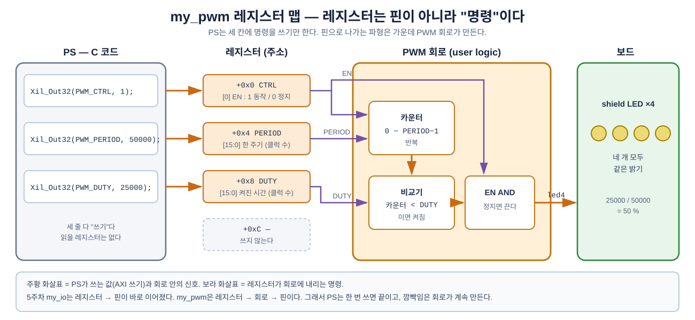

**그림 1-3** 세 레지스터가 PWM 회로의 어디로 들어가는지 그린 것이다.

- `PERIOD`는 카운터가 어디까지 셀지, `DUTY`는 비교기가 어디서 끌지를 정한다.
- `CTRL`의 0번 비트는 전체 스위치다. 0이면 카운터가 0에 멈추고 LED가 꺼진다.
- 5주차 `my_io`와 달리 **어떤 레지스터도 핀에 바로 연결되지 않는다.** 레지스터는 회로에 내리는 명령이고, 핀으로 나가는 파형은 회로가 만든다.

> **왜 `CTRL`이 따로 있나.** `PERIOD`와 `DUTY`를 다 정한 뒤에 시작하라는 뜻이다. 값을 쓰는 도중에 PWM이 돌면 잠깐 엉뚱한 밝기가 나올 수 있다. 3장의 코드도 `PERIOD` → `DUTY` → `CTRL = 1` 순서로 쓴다.

---

## 1.4 프로젝트 만들기

### 1.4.1 이번 주 작업 폴더

5주차와 같은 구조로 `week6` 폴더를 새로 만든다. 5주차 폴더는 그대로 둔다.

```text
.../week6/
├── W6_PWM/                  제공 파일 (저장소에서 복사, 고치지 않는다)
│   ├── LAB01/hdl/           1장 Verilog 완성본 (비교용)
│   ├── LAB01/sim/           1장 시뮬레이션 테스트벤치 (선택)
│   ├── LAB02/xdc/           2장 핀 배정 XDC
│   ├── LAB02/build_lab06_reference.tcl
│   └── LAB03/src/           3장 C 코드
├── vivado_prj/
│   ├── custom_pwm/          1장 IP 만들기 → 2장 Block Design + System ILA
│   └── ip_repo/             1장 — my_pwm IP 저장소
└── vitis_ws/                3장 — Vitis 작업 공간
```

`vivado_prj`와 `vitis_ws`는 비어 있는 채로 시작한다. `week6` 폴더도 **한글·공백이 없는 경로**에 둔다(5주차 1.3절의 경로 주의와 같다).

### 1.4.2 `custom_pwm` 프로젝트

`File → Project → New…` — Project name **`custom_pwm`**, Project location **`.../week6/vivado_prj`**, Board **Cora Z7-07S**. 빈 프로젝트로 둔다. 2장에서 이 프로젝트에 Block Design을 만든다.

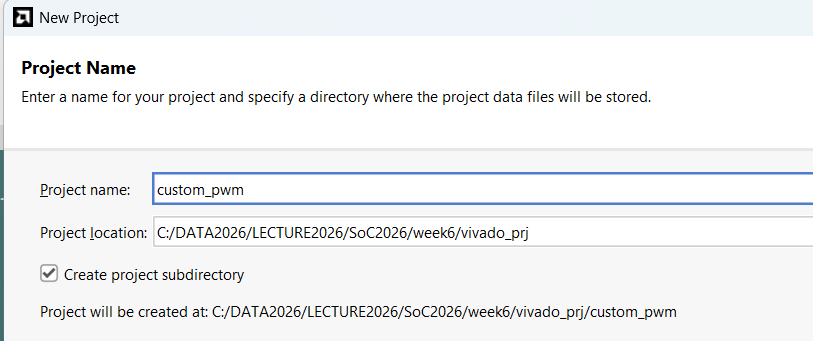

**그림 1-4** 5주차 그림 1-3과 같은 화면이다. 이름이 `custom_pwm`, 위치가 `week6\vivado_prj`인 것만 다르다. 아래 줄에 `…/week6/vivado_prj/custom_pwm`에 만들어진다고 나온다.

---

## 1.5 Create and Package New IP

5주차 1.4절과 **같은 순서**다. `Tools → Create and Package New IP…` → `Create a new AXI4 peripheral`. 다른 것은 IP 이름 하나뿐이다.

| 화면 | 항목 | 값 |
|---|---|---|
| Peripheral Details | Name | **`my_pwm`** |
| | Version | `1.0` |
| | IP location | 기본값 (`…\vivado_prj\ip_repo`) |
| Add Interfaces | Interface Type / Mode | `Lite` / `Slave` |
| | Data Width / Number of Registers | `32` / `4` |
| Create Peripheral | Next Steps | **`Edit IP`** |

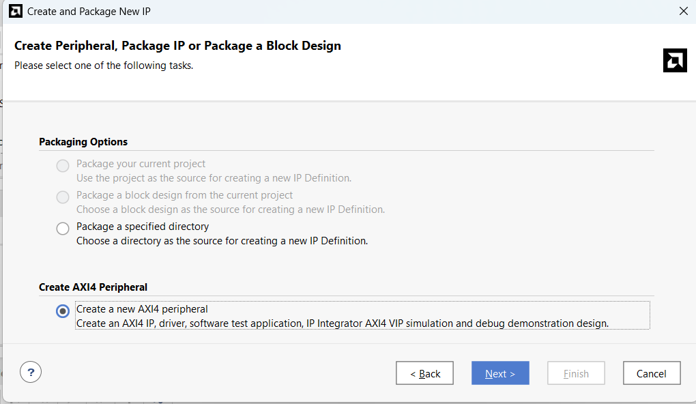

**그림 1-5** `Create AXI4 Peripheral` 아래의 `Create a new AXI4 peripheral`을 고른다. 빈 프로젝트라 위쪽 두 항목은 회색이다(5주차 그림 1-5와 같다).

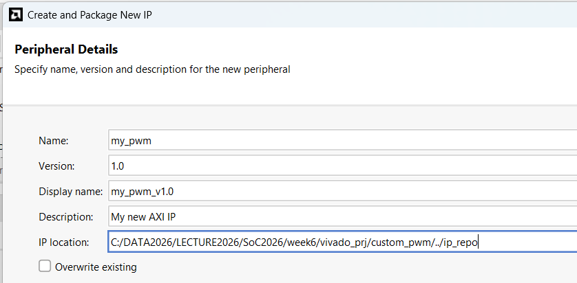

**그림 1-6** `Name`을 `my_pwm`으로 준다. `Display name`은 `my_pwm_v1.0`으로 저절로 바뀐다. `IP location`은 `…/vivado_prj/custom_pwm/../ip_repo`, 즉 `custom_pwm` 폴더 옆의 `vivado_prj\ip_repo`다.

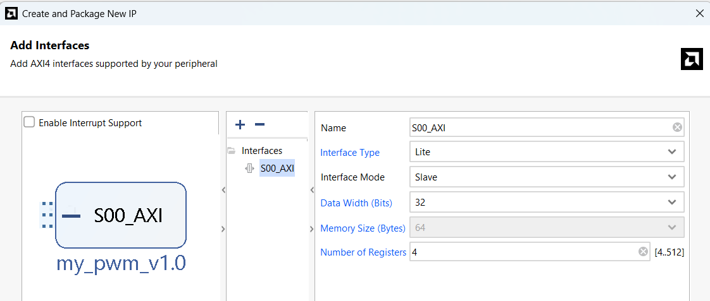

**그림 1-7** 기본값 그대로다. `Interface Type` `Lite`, `Mode` `Slave`, `Data Width` `32`, `Number of Registers` `4`. 레지스터 4개 중 3개(`CTRL`, `PERIOD`, `DUTY`)를 쓴다.

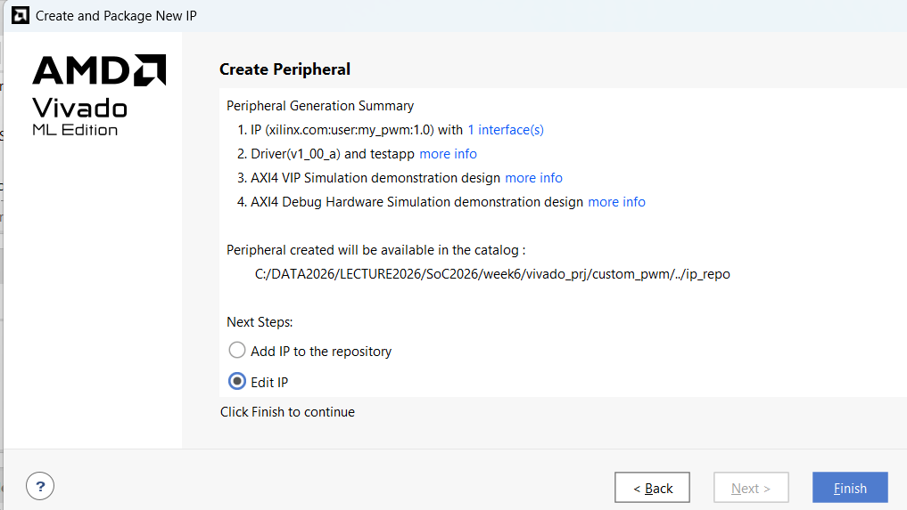

**그림 1-8** 요약에 `my_pwm:1.0`과 저장 위치(`…/ip_repo`)가 나온다. `Next Steps`에서 **`Edit IP`** 를 고르고 `Finish`.

`Finish`를 누르면 편집용 창 `edit_my_pwm_v1_0`이 열린다. `Sources`에 파일 두 개가 보인다.

| 파일 | 하는 일 | 이번 장에서 고치는 곳 |
|---|---|---|
| `my_pwm_v1_0.v` | 바깥 포장. IP의 포트를 정하고 안쪽 모듈을 부른다 | ③ 포트 추가, ④ 연결 |
| `my_pwm_v1_0_S00_AXI.v` | 안쪽. AXI 처리 + 레지스터 `slv_reg0~3` + user logic | ① 포트 추가, ② PWM 회로 |

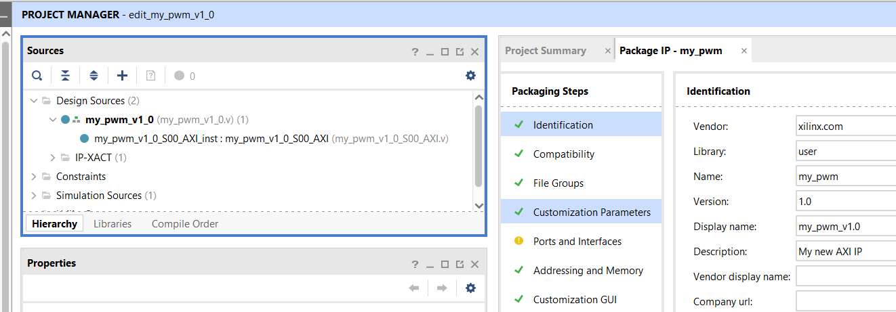

**그림 1-9** 창 제목이 `PROJECT MANAGER - edit_my_pwm_v1_0`이다. 왼쪽 `Design Sources`에서 위가 `my_pwm_v1_0`, 그 안이 `my_pwm_v1_0_S00_AXI_inst`다. 오른쪽 `Package IP - my_pwm` 탭은 1.7절에서 쓴다.

> **`Ports and Interfaces`의 노란 느낌표.** 그림 1-9처럼 아무것도 고치지 않은 처음부터 붙어 있다. 템플릿이 원래 그렇다. 1.7절에서 Re-Package 하는 데 지장이 없다.

> **템플릿은 5주차와 똑같다.** IP 이름만 `my_io` → `my_pwm`으로 바뀌었을 뿐, `slv_reg0~3`, 쓰기 `case`, 읽기 `case`는 5주차 1.5절에서 읽은 그대로다. 이번에는 **읽기 `case`도 고치지 않는다.** 네 레지스터 모두 쓴 값이 그대로 읽히는 기본 상태로 둔다.

---

## 1.6 Verilog 고치기 — 네 군데

수정 위치는 다음과 같다. 5주차보다 한 군데 적다.

| 번호 | 파일 | 위치(표시 주석) | 하는 일 |
|---|---|---|---|
| ① | `my_pwm_v1_0_S00_AXI.v` | `Users to add ports here` | 출력 포트 `led4` 추가 |
| ② | `my_pwm_v1_0_S00_AXI.v` | `Add user logic here` | PWM 회로 (이름 붙이기 → 카운터 → 비교기) |
| ③ | `my_pwm_v1_0.v` | `Users to add ports here` | 바깥 포트 `led4` 추가 |
| ④ | `my_pwm_v1_0.v` | 인스턴스 연결 부분 | `.led4(led4)` 연결 |

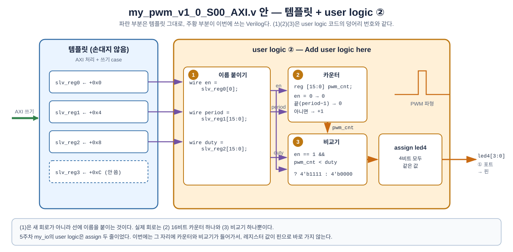

**그림 1-10** 고친 뒤 `my_pwm` 안에서 값이 흐르는 길. ②에서 쓰는 Verilog 줄이 그림의 어느 상자인지 표시했다.

- 왼쪽 파란 부분은 템플릿 그대로다. PS가 쓴 값이 `slv_reg0~2`에 저장된다.
- 가운데 주황 부분이 ②에서 쓰는 user logic이다. (1) 이름 붙이기 → (2) 카운터 → (3) 비교기 순서다.
- 오른쪽으로 나가는 선은 하나(`led4`)다. 4비트 모두 같은 값이다.

### 1.6.1 `my_pwm_v1_0_S00_AXI.v` — 두 군데

**① 포트 추가.** 파일 위쪽 포트 목록의 `Users to add ports here` 아래 빈 줄(18줄)에 한 줄을 넣는다.

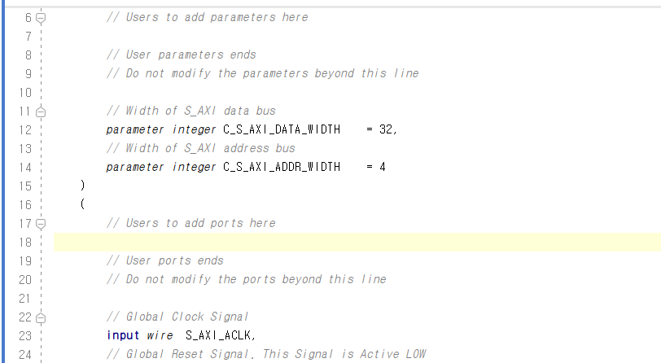

**그림 1-11** 고치기 전의 포트 목록. 17줄 `Users to add ports here`와 19줄 `User ports ends` 사이의 18줄이 비어 있다. 5주차 그림 1-16과 같은 자리다.

```verilog
		// Users to add ports here
		output wire [3:0] led4,		// shield LED x4 <- PWM output (all four the same)
		// User ports ends
```

이번에는 포트가 하나뿐이다.

**② PWM 회로.** 파일 맨 아래 `Add user logic here`와 `User logic ends` 사이에 넣는다.

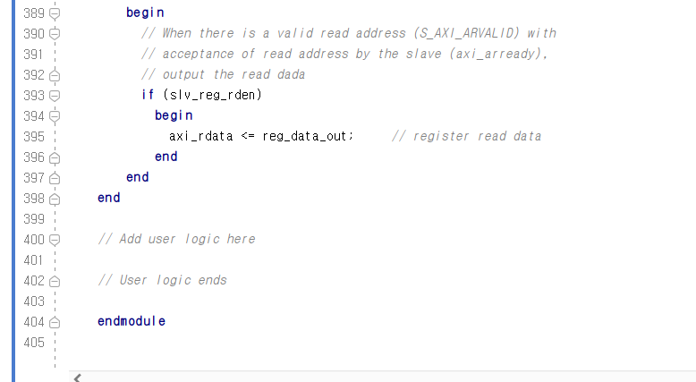

**그림 1-12** 고치기 전의 파일 끝. 400줄 `Add user logic here`와 402줄 `User logic ends` 사이(401줄)가 비어 있다. 바로 위는 템플릿의 읽기 부분(`axi_rdata <= reg_data_out;`)이다.

여기에 다음을 넣는다. 세 덩어리로 나뉜다.

```verilog
	// Add user logic here

	// (1) give the registers names
	wire        en     = slv_reg0[0];	// +0x0 CTRL   : 1 = run, 0 = stop
	wire [15:0] period = slv_reg1[15:0];	// +0x4 PERIOD : clocks in one period (50000 = 1 ms)
	wire [15:0] duty   = slv_reg2[15:0];	// +0x8 DUTY   : clocks the LEDs are on

	// (2) counter : 0, 1, 2, ... period-1, 0, 1, 2, ...
	reg [15:0] pwm_cnt;

	always @( posedge S_AXI_ACLK )
	begin
	  if ( en == 0 )
	    pwm_cnt <= 0;
	  else if ( pwm_cnt >= period - 1 )
	    pwm_cnt <= 0;
	  else
	    pwm_cnt <= pwm_cnt + 1;
	end

	// (3) compare : on while the counter is below duty
	assign led4 = ( en == 1 && pwm_cnt < duty ) ? 4'b1111 : 4'b0000;

	// User logic ends
```

한 줄씩 읽어 보자.

| 줄 | 뜻 |
|---|---|
| `wire en = slv_reg0[0];` | `slv_reg0`의 0번 비트에 `en`이라는 **이름을 붙인다.** 새 회로가 생기는 것이 아니라, 선 하나를 다른 이름으로 부르는 것이다 |
| `wire [15:0] period = slv_reg1[15:0];` | `slv_reg1`의 아래 16비트를 `period`라고 부른다. `duty`도 같다 |
| `reg [15:0] pwm_cnt;` | 카운터 값을 기억할 16비트 레지스터 |
| `always @( posedge S_AXI_ACLK )` | 클럭(50 MHz)이 올라갈 때마다 아래를 한 번 실행한다. DE0 실습의 카운터와 같은 모양이다 |
| `if ( en == 0 ) pwm_cnt <= 0;` | 정지 명령이면 카운터를 0에 묶어 둔다 |
| `else if ( pwm_cnt >= period - 1 ) pwm_cnt <= 0;` | 끝(`period−1`)까지 셌으면 0으로 돌아간다. 여기까지가 한 주기다 |
| `else pwm_cnt <= pwm_cnt + 1;` | 아니면 1 늘린다 |
| `assign led4 = ( … ) ? 4'b1111 : 4'b0000;` | **조건 ? 참일 때 : 거짓일 때.** 동작 중이고 카운터가 `duty`보다 작으면 LED 4개를 모두 켜고(`1111`), 아니면 모두 끈다(`0000`) |

> **`wire en = slv_reg0[0];`이 왜 좋은가.** 이 줄이 없어도 `slv_reg0[0]`이라고 직접 써도 동작은 같다. 하지만 `if ( slv_reg0[0] == 0 )`보다 `if ( en == 0 )`이 훨씬 읽기 쉽다. 1.3절에서 정한 레지스터 맵이 그대로 Verilog의 이름이 된다.

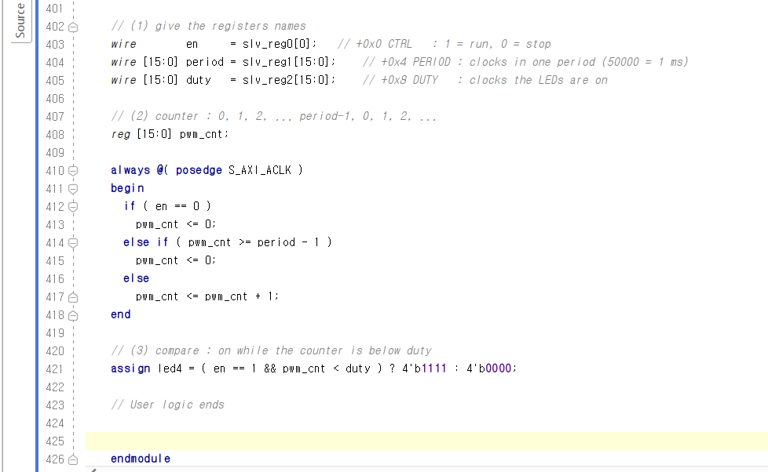

**그림 1-13** user logic을 넣은 뒤의 모습. 402~405줄이 (1) 이름 붙이기, 407~418줄이 (2) 카운터, 420~421줄이 (3) 비교기다. `User logic ends`가 423줄로 내려갔다.

> **`+0xC`(`slv_reg3`)는?** 손대지 않는다. PS가 써도 저장만 되고 회로에서는 쓰지 않는다. 읽기 `case`도 기본 그대로라서 `+0x0`~`+0xC` 모두 **쓴 값이 그대로 읽힌다.** 3장에서 `Xil_In32(PWM_DUTY)`로 방금 쓴 값을 되읽어 확인할 수 있다.

### 1.6.2 `my_pwm_v1_0.v` — 두 군데

5주차 1.6.2절과 같다. 바깥 포장에도 포트를 만들고, 안쪽 모듈과 잇는다.

**③ 포트 추가.**
```verilog
		// Users to add ports here
		output wire [3:0] led4,		// shield LED x4 <- PWM output
		// User ports ends
```

**④ 인스턴스 연결.** 아래쪽 `my_pwm_v1_0_S00_AXI_inst (` 바로 다음 줄에 넣는다.
```verilog
	) my_pwm_v1_0_S00_AXI_inst (
		.led4(led4),
		.S_AXI_ACLK(s00_axi_aclk),
```

완성본은 제공 파일 [`LAB01/hdl/`](LAB01/hdl/)(`.../week6/W6_PWM/LAB01/hdl/`)에 있다. 직접 고친 뒤 비교해 본다.

### 1.6.3 (선택) 시뮬레이션으로 확인

보드에 올리기 전에 PWM이 맞게 나오는지 시뮬레이션으로 볼 수 있다. 제공 파일 [`LAB01/sim/tb_my_pwm.v`](LAB01/sim/tb_my_pwm.v)는 3장의 C 코드와 같은 순서로 AXI 쓰기를 하고(`PERIOD` → `DUTY` → `CTRL = 1`), 한 주기 동안 `led4`가 몇 클럭 켜지는지 센다.

`edit_my_pwm_v1_0` 창에서 `Add Sources → Add or create simulation sources`로 `tb_my_pwm.v`를 넣고 `Run Simulation → Run Behavioral Simulation` → Tcl Console에 `run all`. 결과는 다음과 같아야 한다.

```text
PERIOD   200  DUTY    50 : led4 high    50 of   200 clocks (exp    50)  OK
PERIOD   200  DUTY   150 : led4 high   150 of   200 clocks (exp   150)  OK
PERIOD   200  DUTY     0 : led4 high     0 of   200 clocks (exp     0)  OK
PERIOD   200  DUTY   200 : led4 high   200 of   200 clocks (exp   200)  OK
PERIOD 50000  DUTY 12500 : led4 high 12500 of 50000 clocks (exp 12500)  OK
EN = 0 : led4 high 0 of 1000 clocks (exp 0), DUTY reads back 12500
```

`DUTY`가 0이면 한 번도 안 켜지고, `PERIOD`와 같으면 계속 켜진다. 그 사이는 정확히 `DUTY`클럭만큼 켜진다.

> **시뮬레이션 소스는 IP에 넣지 않는다.** `tb_my_pwm.v`는 확인용이다. 다음 절에서 Re-Package 할 때 `File Groups`에 시뮬레이션 파일이 들어갔다고 나오면, Merge 하기 전에 시뮬레이션 소스를 프로젝트에서 지운다(`Sources`에서 우클릭 → `Remove File from Project`).

---

## 1.7 Re-Package — IP로 다시 묶기

5주차 1.7절과 같다.

1. 두 파일을 저장한다(`Ctrl+S`). `Package IP - my_pwm` 탭의 `Packaging Steps`에 연필 표시가 붙는다.

   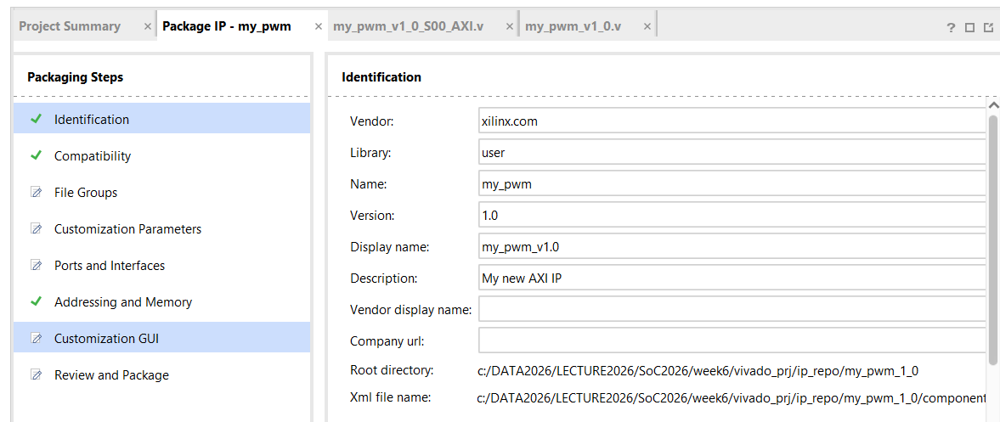

   **그림 1-14** 저장 뒤의 `Packaging Steps`. `File Groups`, `Customization Parameters`, `Ports and Interfaces`, `Customization GUI`, `Review and Package`에 연필 표시가 붙었다. "Verilog가 바뀌었으니 다시 읽어 들여라"는 뜻이다. 아래쪽 `Root directory`가 `week6/vivado_prj/ip_repo/my_pwm_1_0`이다.

2. 연필이 붙은 항목을 위에서부터 하나씩 눌러 `Merge changes from …`을 누른다.
3. `Customization GUI`의 `Preview`에서 블록 오른쪽에 **`led4[3:0]`** 이 보이는지 확인한다.

   ![Customization GUI — Preview에 led4[3:0]](img/w6s1_11.png)

   **그림 1-15** Merge 뒤 `Customization GUI`의 `Preview`. 블록 왼쪽에 `S00_AXI`, `s00_axi_aclk`, `s00_axi_aresetn`, 오른쪽에 ③에서 추가한 **`led4[3:0]`** 이 나온다. 2장 Block Design에서 보게 될 `my_pwm_0` 블록의 모양이 바로 이것이다. 왼쪽 목록의 연필이 초록 체크로 바뀌었다(`Ports and Interfaces`의 노란 느낌표는 처음부터 있던 것이다).

4. `Review and Package` → **`Re-Package IP`** → 창을 닫을지 묻는 질문에 `Yes`.

`custom_pwm` 창으로 돌아와 `IP Catalog`에서 검색해 `my_pwm_v1.0`이 보이는지 확인한다(5주차 그림 1-26과 같은 방법).

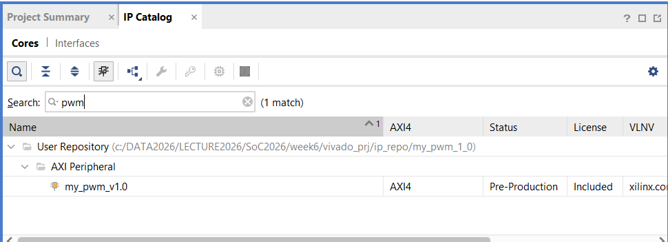

**그림 1-16** `pwm`으로 검색하면 `User Repository → AXI Peripheral → my_pwm_v1.0` 하나가 나온다. 위쪽 경로가 `week6/vivado_prj/ip_repo/my_pwm_1_0`이다. 5주차처럼 `Edit IP`로 만든 IP는 이 프로젝트에 이미 등록되어 있다.

---

## 1.8 정리

| 키워드 | 내용 |
|---|---|
| PWM | 빠르게 켜고 끄기를 반복하고, 켜진 시간의 비율(듀티 ÷ 주기)로 밝기를 정한다 |
| 카운터 + 비교기 | 카운터가 `0 ~ PERIOD−1`을 반복하고, `DUTY`보다 작은 동안만 켠다 |
| 클럭 50 MHz | 1클럭 = 20 ns. `PERIOD = 50000` → 1 ms(1 kHz) |
| 레지스터 맵 | `+0x0 CTRL`, `+0x4 PERIOD`, `+0x8 DUTY`. 레지스터는 핀이 아니라 **명령** |
| Verilog 수정 | ① 포트 ② user logic(이름 → 카운터 → 비교기) ③ 포트 ④ 연결 |
| 조건 연산자 | `조건 ? 참일 때 : 거짓일 때` |

---

## 과제 — 다음 시간 전까지

1. **표 채우기.** `PERIOD = 8`, `DUTY = 2`일 때 1.2절과 같은 표(클럭 *n* = 0~15, `pwm_cnt`, `pwm_cnt < duty`, `led4`)를 채운다. 주기는 몇 클럭이고 듀티 비율은 몇 %인가?
2. **주파수 계산.** `PERIOD = 25000`이면 주기는 몇 ms이고 주파수는 몇 Hz인가? 이때 밝기 50 %를 만들려면 `DUTY`는 얼마인가?
3. **`DUTY`가 `PERIOD`보다 크면?** `PERIOD = 100`, `DUTY = 150`을 쓰면 LED는 어떻게 되는가? Verilog의 비교 줄을 보고 답한다.

## 다음 시간 예고 — 제2장

- `custom_pwm`에 Block Design을 만들고 PS와 `my_pwm`을 연결한다. 5주차 2장과 같은 순서다.
- `led4` 선에 System ILA를 붙인다. ILA가 한 번에 기록하는 20 µs 안에 PWM 파형이 들어오려면 주기를 얼마로 해야 할지 계산해 본다.

---

*SoC 설계 · 6주차 1교시(W6_S1) | Vivado/Vitis 2023.2 · Windows · Cora Z7-07S*
