# 제2장 PWM IP (2) — Vivado 프로젝트와 System ILA

**SoC 설계** · 6주차 2교시(W6_S2) | Vivado/Vitis 2023.2 · Windows 11 · Digilent Cora Z7-07S

---

1장에서 만든 `my_pwm`을 PS와 연결해 하드웨어를 완성한다. 순서는 **5주차 2장과 같다.** IP 이름이 `my_io`에서 `my_pwm`으로, 바깥 핀이 네 개에서 하나(`led4`)로 바뀐 것이 전부다.

이번 장에서 새로 생각할 것은 하나다. ILA는 한 번에 약 20 µs만 기록한다. **PWM 한 주기가 20 µs보다 길면 ILA 화면에 파형 하나도 다 들어오지 않는다.** 2.5절에서 이것을 계산하고, 3장에서 어떤 `PERIOD`로 ILA를 볼지 정한다.

> **5주차 2장과 무엇이 다른가**
> ```text
>   5주차 2장                                  이번 장
>   Add IP → my_io                             Add IP → my_pwm
>   핀 4개 Make External (led4·led3·sw4·btn2)  핀 1개 Make External (led4)
>   ILA probe 4개                              ILA probe 1개 (ila_led4)
>   ILA로 버스를 본다                          ILA로 버스와 PWM 파형을 본다
> ```

이번 장의 흐름은 다음과 같다.

> **Block Design(PS + `my_pwm`)** → **Connection Automation** → **Make External·이름 정리** → **Address Editor** → **System ILA 붙이기** → **XDC·Bitstream·Export** → **파일 위치 확인**

이번 장이 끝나면 다음 하드웨어가 완성된다.

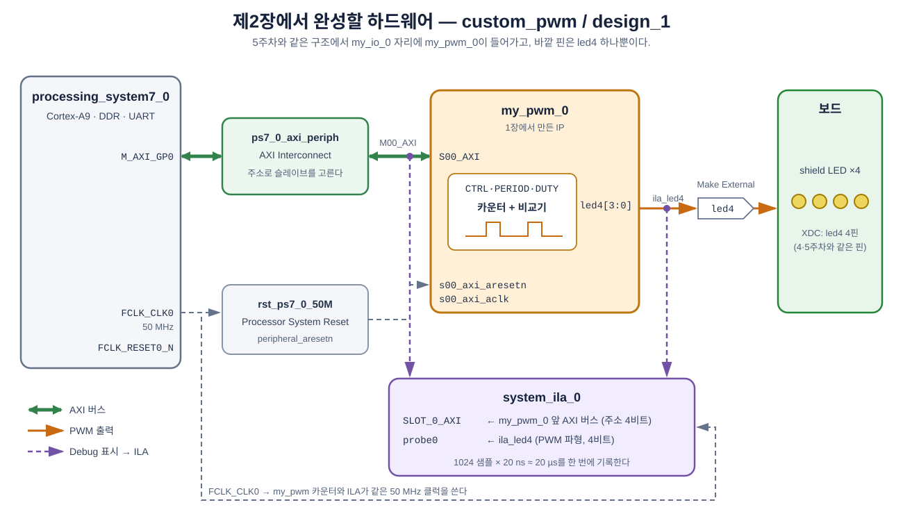

**그림 2-1** 이번 장에서 만들 Block Design을 신호 종류별로 정리한 그림.

- 초록 굵은 선이 AXI 버스다. PS의 `M_AXI_GP0`에서 Interconnect를 거쳐 `my_pwm_0`의 `S00_AXI`로 간다. 이 버스로 `CTRL`·`PERIOD`·`DUTY` 명령이 들어간다.
- 주황 선이 `led4` 하나다. `my_pwm_0` 안의 PWM 회로가 만든 파형이 shield LED 4개로 나간다.
- 보라 점선은 ILA로 보내는 신호다. `my_pwm_0` 바로 앞의 버스(`SLOT_0_AXI`)와 `led4` 선(`probe0`) 두 가지를 본다.
- 회색 점선은 클럭이다. `my_pwm`의 카운터도, ILA도 같은 `FCLK_CLK0`(50 MHz)으로 동작한다.

---

## 학습 목표

- 직접 만든 IP를 Block Design에 넣고 PS의 AXI 버스에 연결한다(5주차 복습).
- IP의 출력 핀을 Make External 하고 XDC와 이름을 맞춘다.
- ILA 기록 시간(깊이 ÷ 클럭)과 PWM 주기를 비교해, ILA로 볼 수 있는 주기를 계산한다.
- Bitstream·`.ltx`·`.xsa`가 생기는 위치를 확인한다.

---

## 2.1 Block Design — PS와 `my_pwm`

1장의 **`custom_pwm`** 프로젝트를 그대로 쓴다. 먼저 IP 저장소가 등록되어 있는지 본다. `Flow Navigator → PROJECT MANAGER → Settings → IP → Repository`.

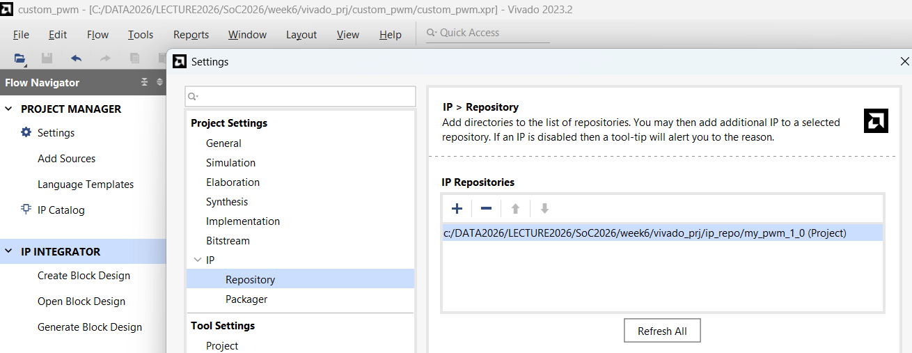

**그림 2-2** 1장에서 `Edit IP`로 만들었으므로 `…/week6/vivado_prj/ip_repo/my_pwm_1_0 (Project)`가 이미 들어 있다(5주차 그림 1-24와 같다). 손댈 것은 없다.

1. `Flow Navigator → IP INTEGRATOR → Create Block Design`, 이름은 `design_1`.
2. `+`(Add IP)로 **ZYNQ7 Processing System**을 넣고, 배너의 **Run Block Automation**을 실행한다.
3. 다시 `+`로 **`my_pwm`** 을 검색해 넣는다. 인스턴스 이름은 `my_pwm_0`이 된다.

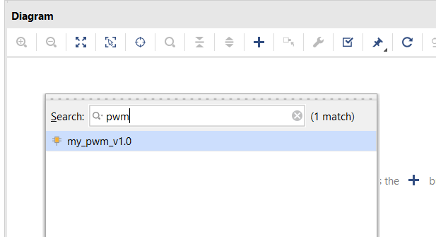

**그림 2-3** `pwm`으로 검색하면 `my_pwm_v1.0` 하나가 나온다.

![my_pwm_0 블록 — S00_AXI와 led4[3:0]](img/w6s2_06.png)

**그림 2-4** 들어온 `my_pwm_0` 블록. 왼쪽에 `S00_AXI`, `s00_axi_aclk`, `s00_axi_aresetn`, **오른쪽에 `led4[3:0]`** 이 있어야 한다. 1장 그림 1-15의 미리보기와 같은 모양이다.

> **`led4[3:0]`이 없으면 — 옛 버전이 들어온 것이다.**
>
> 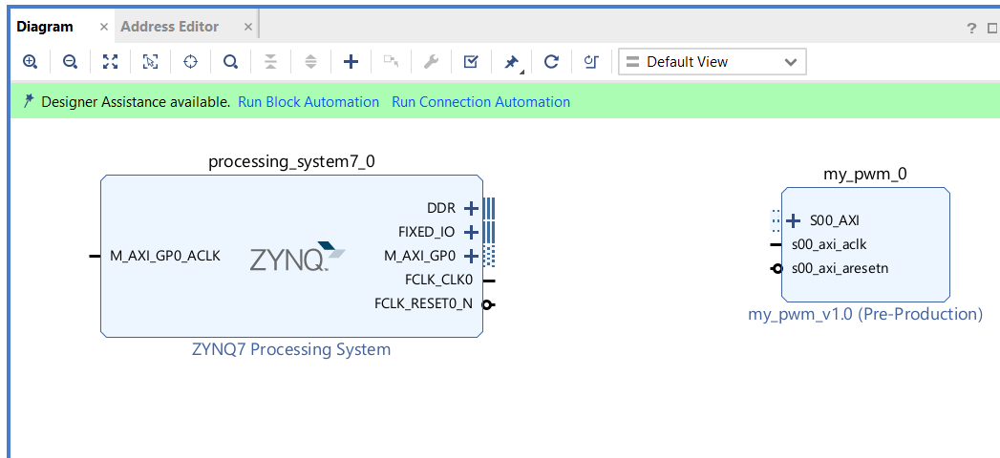
>
> **그림 2-5** 오른쪽이 비어 있는 `my_pwm_0`. 1장에서 Verilog를 고친 뒤 **Re-Package가 제대로 끝나지 않아**, IP Catalog에 템플릿 그대로의 첫 버전(`Rev. 1`)이 남아 있던 경우다.
>
> 고치는 순서는 다음과 같다. Block Design에서 지울 필요는 없다.
> 1. `IP Catalog`에서 `my_pwm_v1.0` 우클릭 → **`Edit in IP Packager`** → 1장 1.7절의 Merge와 **`Re-Package IP`** 를 다시 한다.
> 2. `custom_pwm` 창 위쪽에 IP가 바뀌었다는 노란 띠가 뜨면 **`Report IP Status`** → `my_pwm_0` 체크 → **`Upgrade Selected`**.
> 3. `Generate Output Products` 창은 `Generate`(또는 `Skip`). 블록 오른쪽에 `led4[3:0]`이 생긴다.
>
> 업그레이드 기록(`custom_pwm/ip_upgrade.log`)에 `Upgrade has added port 'led4'`가 남는다. **IP를 고치면 Re-Package → Upgrade** 순서가 한 묶음이라는 것을 기억해 둔다. 7주차에 IP를 다시 고칠 때도 같은 순서다.

## 2.2 Run Connection Automation

배너의 **Run Connection Automation** → `my_pwm_0/S00_AXI` 체크 → `OK`.

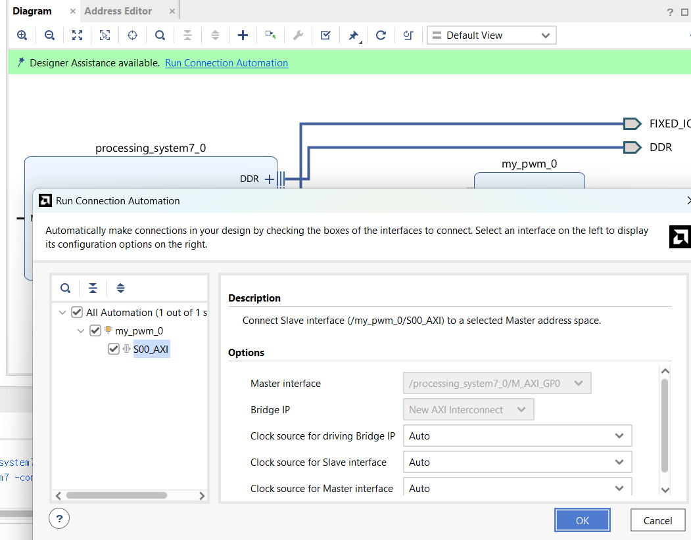

**그림 2-6** 목록에 `my_pwm_0/S00_AXI` 하나뿐이다. `Master interface`는 `/processing_system7_0/M_AXI_GP0`, `Bridge IP`는 `New AXI Interconnect`. 5주차 그림 2-3과 같다.

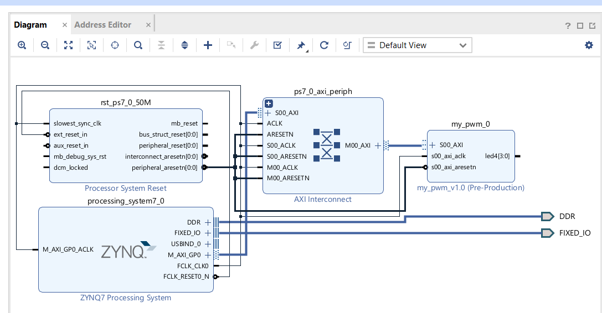

**그림 2-7** Interconnect(`ps7_0_axi_periph`)와 Reset(`rst_ps7_0_50M`)이 자동으로 들어오고, `M00_AXI` → `my_pwm_0/S00_AXI`가 연결되었다. `led4[3:0]`은 아직 아무 데도 이어지지 않았다.

## 2.3 Make External과 이름 정리

`my_pwm_0`의 `led4[3:0]`을 우클릭 → **`Make External`**. 바깥 포트 이름이 `led4_0`으로 생기므로, `External Port Properties`의 `Name`을 **`led4`** 로 고친다(5주차 그림 2-4와 같다). XDC가 찾는 이름이 `led4[0]`~`led4[3]`이기 때문이다.

![Make External — 바깥 포트 led4[3:0]](img/w6s2_08.png)

**그림 2-8** `my_pwm_0` 오른쪽에 바깥 포트 `led4[3:0]`이 생겼다(주황은 선택된 상태라는 표시).

이어서 `my_pwm_0`에서 나가는 선을 클릭하고 `System Net`의 `Name`을 **`ila_led4`** 로 고친다(5주차 그림 2-10과 같다). 3장 ILA 파형에 이 이름이 그대로 나온다.

## 2.4 Address Editor

`Address Editor` 탭에서 `my_pwm_0/S00_AXI`가 **`0x43C0_0000`**(Range 64K)에 배정된 것을 확인한다.

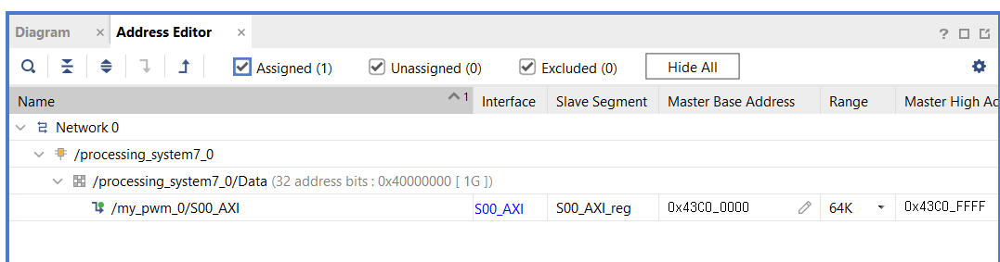

**그림 2-9** `Master Base Address` `0x43C0_0000`, `Range` 64K, 끝 주소 `0x43C0_FFFF`. 5주차 `my_io_0`과 같은 주소다. 둘 다 이 Block Design의 첫 번째 사용자 IP라서 Vivado가 같은 자리를 준 것이다.

그래서 3장의 레지스터 주소는 다음과 같다.

| 이름 | 주소 |
|---|---|
| `CTRL` | `0x43C0_0000` |
| `PERIOD` | `0x43C0_0004` |
| `DUTY` | `0x43C0_0008` |

## 2.5 System ILA 붙이기

5주차 2.5절과 같은 방법이다.

1. **AXI 버스** — Interconnect의 `M00_AXI`와 `my_pwm_0`의 `S00_AXI`를 잇는 굵은 선(`my_pwm_0` 바로 앞)을 우클릭 → **`Debug`**.
2. **`ila_led4` 선** — 우클릭 → **`Debug`**.
3. 배너의 **Run Connection Automation** → 두 개 모두 체크, `Source Clock`이 `/processing_system7_0/FCLK_CLK0`인지 확인 → `OK`.

> **5주차와 붙이는 자리가 다르다.** 5주차에는 PS 바로 옆 선(`M_AXI_GP0`)에 붙여서 주소가 32비트(`43c00008`)로 보였다. 이번에는 `my_pwm_0` 바로 앞 선에 붙인다. 이 선은 Interconnect가 "어느 IP인가"를 이미 골라 낸 뒤라 **주소가 아래 4비트만** 남아 있다. 그래서 3장 ILA에서 `DUTY` 쓰기는 `43c00008`이 아니라 **`8`** 로 보인다. 1장 레지스터 맵의 오프셋(`+0x8`)이 그대로 보이는 셈이다(5주차 그림 1-13에서 `my_io` 안으로는 아래 4비트만 들어온다고 한 것과 같다).

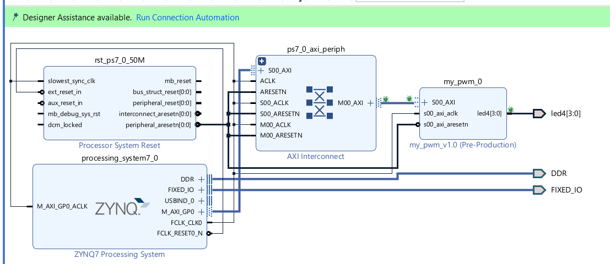

**그림 2-10** Debug를 표시한 모습. Interconnect `M00_AXI`와 `my_pwm_0` `S00_AXI` 양쪽 끝, `led4[3:0]` 선에 초록 벌레 아이콘이 붙었다. PS 옆 선(`M_AXI_GP0`)에는 붙지 않았다.

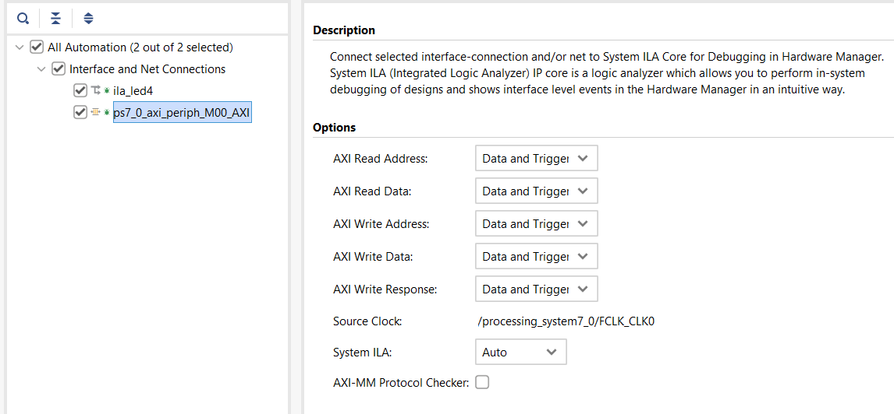

**그림 2-11** 대상이 두 개다. `ila_led4`(핀 선)와 `ps7_0_axi_periph_M00_AXI`(`my_pwm_0` 앞 버스). AXI 다섯 채널은 모두 `Data and Trigger`, `Source Clock`은 `/processing_system7_0/FCLK_CLK0`. 기본값 그대로 `OK`.

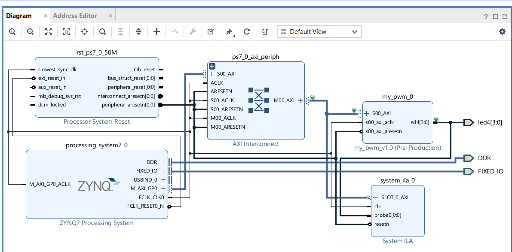

**그림 2-12** 이번 주의 최종 하드웨어(그림 2-1과 비교해 본다). 오른쪽 아래 `system_ila_0`의 `SLOT_0_AXI`에 `M00_AXI` 버스가, `probe0`에 `led4` 선이 들어간다. `my_pwm_0`의 동작에는 끼어들지 않고 옆에서 엿보기만 한다.

> **`probe0[0:0]`으로 보이는데 1비트인가?** 블록 위의 표시는 그렇지만, 실제로는 `led4` 4비트를 모두 잡는다. 3장 Hardware Manager에서 `ila_led4`가 4비트로 나온다(`.ltx`에 폭 4로 적혀 있다).

### 2.5.1 ILA로 PWM을 볼 수 있을까 — 기록 시간 계산

ILA는 기본 **깊이 1024**다. 50 MHz 클럭마다 한 칸씩 기록하므로 한 번에 기록하는 시간은 다음과 같다.

```text
1024 샘플 × 20 ns = 20,480 ns ≈ 20 µs
```

PWM 한 주기와 비교해 보자.

| `PERIOD` | PWM 한 주기 | ILA 20 µs 안에 들어오는 주기 수 | ILA로 보면 |
|---|---|---|---|
| `50000` | 1 ms = 1000 µs | 0.02개 | 켜짐이나 꺼짐이 **한 줄로만** 보인다 |
| `1000` | 20 µs | 1개 | 한 주기가 화면에 꽉 찬다 |
| **`200`** | **4 µs** | **5개** | 펄스 다섯 개가 보인다 — **3장에서 쓴다** |

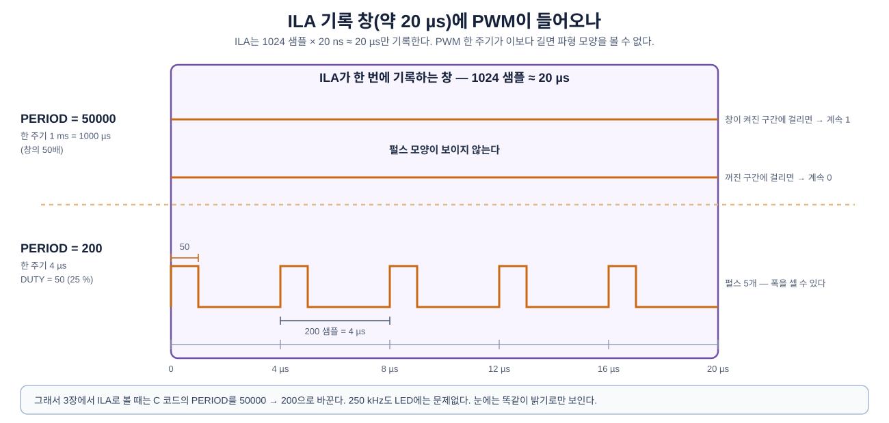

**그림 2-13** 같은 20 µs 기록 창에 두 가지 주기의 PWM을 겹쳐 본 것이다.

- 위 줄은 `PERIOD = 50000`(1 ms)이다. 20 µs는 한 주기의 2 %밖에 안 된다. 창이 켜진 구간에 걸리면 1만, 꺼진 구간에 걸리면 0만 보인다.
- 아래 줄은 `PERIOD = 200`(4 µs)이다. 20 µs 안에 다섯 주기가 들어와 켜진 폭을 셀 수 있다.
- 그래서 3장에서 ILA로 볼 때는 C 코드의 `PERIOD`를 200으로 바꾼다. 250 kHz도 LED에는 아무 문제가 없다. 눈에는 똑같이 밝기로만 보인다.

> **ILA 깊이를 늘리면 안 되나.** 깊이를 65536으로 늘리면 약 1.3 ms를 기록할 수 있다. 하지만 ILA가 BRAM을 그만큼 더 쓰고, 이번 칩(xc7z007s)의 BRAM은 50개뿐이다. 보고 싶은 파형의 주기를 줄이는 쪽이 간단하다.

## 2.6 XDC·Bitstream·Export

5주차 2.6절과 같다.

1. `Validate Design`(F6) → 저장 → `Sources → design_1` 우클릭 → `Create HDL Wrapper…`.
2. `Add Sources → Add or create constraints → Add Files`로 제공 파일 [`LAB02/xdc/cora_z7_07s_week06.xdc`](LAB02/xdc/cora_z7_07s_week06.xdc)(`.../week6/W6_PWM/LAB02/xdc/`)를 추가한다. `led4` 네 핀만 들어 있다(4·5주차와 같은 핀).

   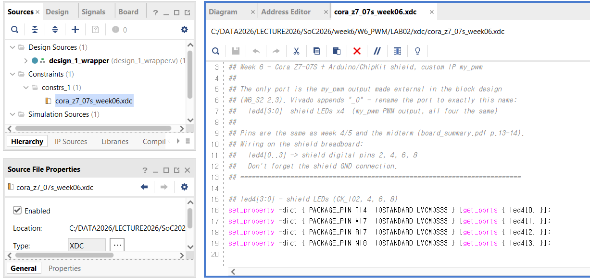

   **그림 2-14** `Constraints → constrs_1`에 `cora_z7_07s_week06.xdc`가 들어왔다. 위쪽 경로처럼 제공 파일 `W6_PWM/LAB02/xdc/`를 그대로 가리킨다. 16~19줄의 네 줄이 전부다.

3. `Generate Bitstream`.
4. `File → Export → Export Hardware…` → **`Include bitstream`** → `design_1_wrapper.xsa`. 저장 위치는 기본값(`.../week6/vivado_prj/custom_pwm`).

> **XDC에 `sw4`·`btn2`가 있으면?** 5주차 XDC를 그대로 넣으면 이 설계에 없는 포트(`led3`, `sw4`, `btn2`)를 찾지 못해 Critical Warning이 난다. 이번 주 XDC를 쓴다.

참고: 1·2장의 결과를 한 번에 만드는 스크립트가 [`LAB02/build_lab06_reference.tcl`](LAB02/build_lab06_reference.tcl)에 있다. 설계가 망가져 시간 안에 되돌리기 어려울 때만 쓴다. 결과는 `.../week6/W6_PWM/LAB02/build/`에 따로 생긴다.

## 2.7 참고 — 만들어진 파일 위치 확인

2교시를 마치기 전에 탐색기로 확인한다. 5주차 2.7절과 같은 자리에 같은 이름으로 생긴다. 폴더 이름만 `custom_ip` → `custom_pwm`이다.

| 파일 | 위치 (`.../week6/vivado_prj/` 아래) | 쓰는 곳 |
|---|---|---|
| `my_pwm` IP | `ip_repo/my_pwm_1_0/` | 2장 Add IP |
| `design_1_wrapper.xsa` | `custom_pwm/` | 3장 Vitis Platform |
| `design_1_wrapper.bit` | `custom_pwm/custom_pwm.runs/impl_1/` | (`.xsa` 안에 들어 있다) |
| `design_1_wrapper.ltx` | `custom_pwm/custom_pwm.runs/impl_1/` | 3장 Hardware Manager |

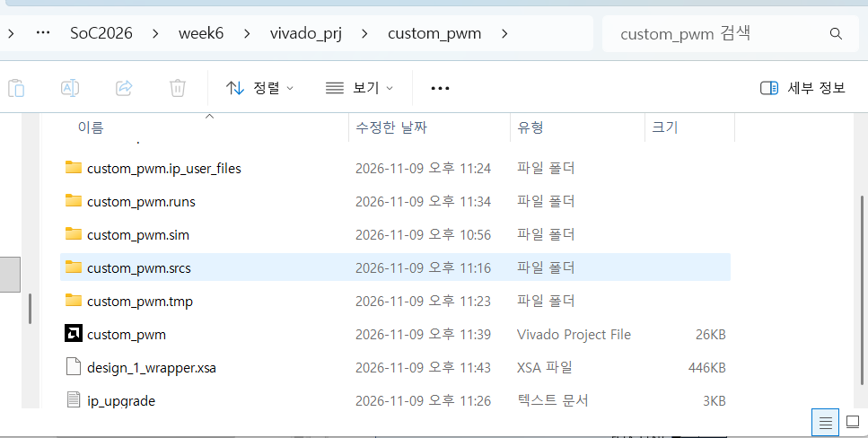

**그림 2-15** `.../week6/vivado_prj/custom_pwm`. Export한 `design_1_wrapper.xsa`(446 KB)가 프로젝트 폴더 바로 아래에 있다. `.bit`와 `.ltx`는 그 위의 `custom_pwm.runs` 안 `impl_1`에 있다(5주차 그림 2-16과 같은 자리). `ip_upgrade.log`는 그림 2-5의 Upgrade를 했을 때 생긴 기록이다.

---

## 2.8 정리

| 키워드 | 내용 |
|---|---|
| Block Design | PS + `my_pwm_0`. 순서는 5주차와 같다 |
| 바깥 핀 | `led4` 하나. 포트 이름 `led4`, 선 이름 `ila_led4` |
| 주소 | `0x43C0_0000` — `CTRL` `+0x0`, `PERIOD` `+0x4`, `DUTY` `+0x8` |
| ILA AXI 슬롯 | `my_pwm_0` 바로 앞 버스(Interconnect `M00_AXI` ↔ `S00_AXI`). 주소는 4비트 오프셋(`0`, `4`, `8`)으로 보인다 |
| ILA 기록 시간 | 1024 × 20 ns ≈ 20 µs. PWM을 보려면 주기가 이보다 짧아야 한다 → `PERIOD = 200`(4 µs) |
| 파일 | `.bit`·`.ltx`는 `custom_pwm.runs/impl_1/`, `.xsa`는 `custom_pwm/` |

---

## 과제 — 다음 시간 전까지

1. **ILA에 몇 주기?** `PERIOD = 500`이면 ILA 20 µs 안에 PWM이 몇 주기 들어오는가? `PERIOD = 2000`이면?
2. **`DUTY`를 몇으로?** `PERIOD = 200`에서 밝기 25 %, 50 %, 75 %를 만들려면 `DUTY`는 각각 얼마인가? ILA에서 켜진 구간은 몇 샘플로 보일까?
3. **자원 비교.** Implementation 후 `Report Utilization`에서 `my_pwm_0`과 `system_ila_0`의 LUT·FF를 비교한다. 5주차 `my_io_0`보다 `my_pwm_0`이 더 큰가? 무엇 때문일까?

## 다음 시간 예고 — 제3장

- Vitis에서 `Xil_Out32` 세 줄(`PERIOD` → `DUTY` → `CTRL`)로 LED 밝기를 바꾼다.
- `for` 문으로 밝기가 서서히 변하게 만든다.
- `PERIOD = 200`으로 바꿔 ILA로 PWM 파형을 직접 보고, `DUTY`를 쓰는 순간 펄스 폭이 바뀌는 것을 확인한다.

---

*SoC 설계 · 6주차 2교시(W6_S2) | Vivado/Vitis 2023.2 · Windows · Cora Z7-07S*
