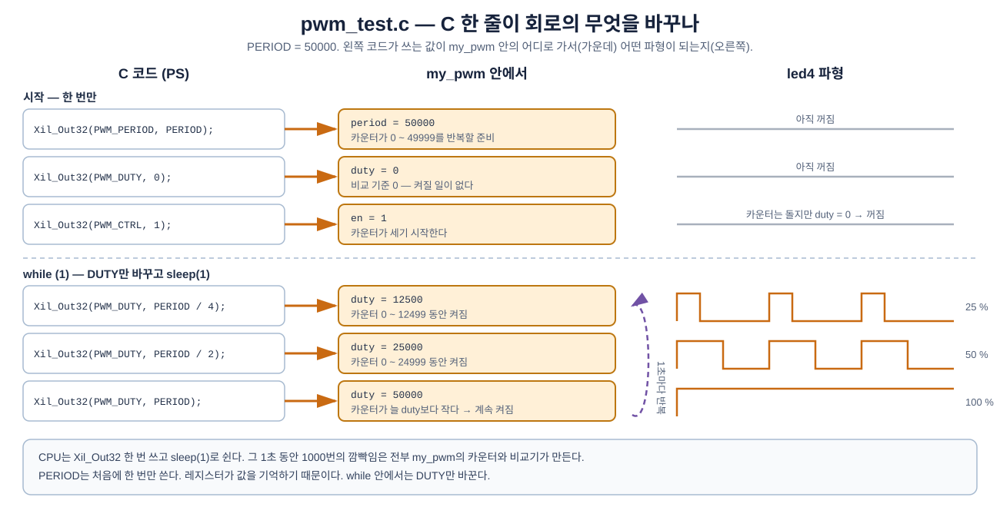
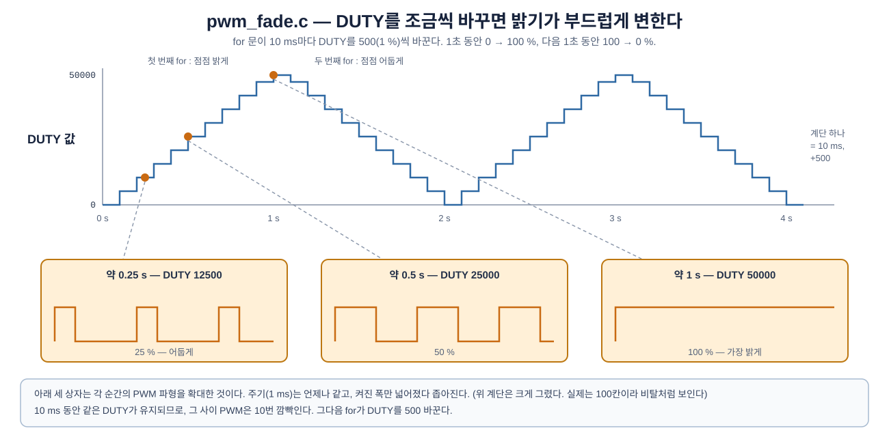
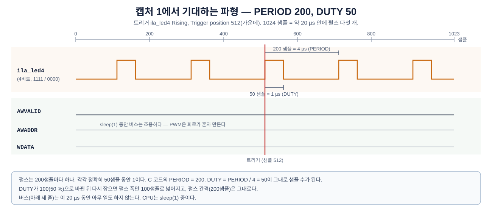

# 제3장 PWM IP (3) — C로 밝기 바꾸기, ILA로 PWM 보기

**SoC 설계** · 6주차 3교시(W6_S3) | Vivado/Vitis 2023.2 · Windows 11 · Digilent Cora Z7-07S

---

하드웨어는 2장에서 완성했다. 이번 장에서는 PS 프로그램으로 `my_pwm`에 **명령**을 내린다. 쓰는 함수는 5주차와 같은 `Xil_Out32` 하나다. 다른 점은 쓰는 값의 뜻이다. 5주차에는 "이 LED를 켜라"였고, 이번에는 **"주기는 이만큼, 켜진 시간은 이만큼으로 깜빡여라"** 다.

그다음 ILA로 PWM 파형을 직접 본다. C 코드가 `DUTY`에 값을 쓰는 순간부터 `led4`의 켜진 폭이 바뀌는 것을 확인한다.

> **5주차 3장과 무엇이 다른가**
> ```text
>   5주차 3장                                  이번 장
>   Xil_Out32(REG_LED4, sw)  → 핀이 바로 바뀜   Xil_Out32(PWM_DUTY, …)  → 회로가 파형을 바꿈
>   쓴 값 = 핀 값                              쓴 값 = 명령 (켜진 클럭 수)
>   ILA: 버스 + 핀 4개                         ILA: 버스 + PWM 파형 (ila_led4)
> ```

이번 장의 흐름은 다음과 같다.

> **Platform·Application** → **코드 1: 밝기 단계** → **실행** → **코드 2: 서서히 밝게·어둡게** → **ILA로 PWM 보기** → **DUTY 쓰기 순간 잡기**

---

## 학습 목표

- `xparameters.h`에서 `my_pwm`의 주소를 찾아 레지스터 이름(`PWM_CTRL`, `PWM_PERIOD`, `PWM_DUTY`)을 정의한다.
- `Xil_Out32` 세 줄로 PWM의 주기와 듀티를 정하고 시작한다.
- `for` 문으로 듀티를 조금씩 바꿔 밝기가 서서히 변하게 만든다.
- ILA로 PWM 파형을 잡고, 켜진 구간의 샘플 수가 `DUTY`와 같은지 확인한다.

---

## 3.1 Platform과 Application

5주차 3.1절과 같다.

1. `Open Workspace` → **`.../week6/vitis_ws`**.
2. `Create Platform Component` — 이름 **`platform`**, XSA는 **`.../week6/vivado_prj/custom_pwm/design_1_wrapper.xsa`**, OS `standalone`, Processor `ps7_cortexa9_0` → `FLOW → Build`.
3. `Create Embedded Application` → `Empty Application (C)` — 이름 **`app_component`**, Platform은 `platform`.
4. `Sources → src` 우클릭 → `Import → Files…` → 제공 파일 [`LAB03/src/pwm_test.c`](LAB03/src/pwm_test.c)(`.../week6/W6_PWM/LAB03/src/`).

`platform → export → platform → sw → standalone_ps7_cortexa9_0 → include → xparameters.h`에 `my_pwm_0`의 주소가 있다.

```c
/* Definitions for peripheral MY_PWM_0 */
#define XPAR_MY_PWM_0_BASEADDR 0x43c00000
#define XPAR_MY_PWM_0_HIGHADDR 0x43c0ffff
```


**그림 3-1** 2장 Address Editor의 `0x43C0_0000`이 그대로 들어 있다. 이름 규칙은 5주차와 같다(인스턴스 이름 `my_pwm_0`을 대문자로). 📷 *캡처 대기*

---

## 3.2 코드 1 — 밝기 단계 (`pwm_test.c`)

```c
#include "xparameters.h"
#include "xil_io.h"
#include "xil_printf.h"
#include "sleep.h"

#define PWM_BASE     XPAR_MY_PWM_0_BASEADDR   /* Address Editor 에서 본 my_pwm_0 의 주소 */

/* my_pwm 레지스터 맵 - 1장 1.3절에서 정했다 */
#define PWM_CTRL     (PWM_BASE + 0x0)         /* 1 = 동작, 0 = 정지          */
#define PWM_PERIOD   (PWM_BASE + 0x4)         /* 한 주기의 길이 (클럭 수)     */
#define PWM_DUTY     (PWM_BASE + 0x8)         /* 한 주기 중 켜진 시간 (클럭 수) */

#define PERIOD       50000                    /* 50000 클럭 = 1 ms (1 kHz)
                                                 ILA로 볼 때는 200 (4 us) 으로 바꾼다 */

int main(void)
{
    print("my_pwm start\n\r");

    Xil_Out32(PWM_PERIOD, PERIOD);            /* 주기 정하기 */
    Xil_Out32(PWM_DUTY, 0);                   /* 처음에는 꺼진 상태 */
    Xil_Out32(PWM_CTRL, 1);                   /* PWM 시작 */

    while (1) {
        Xil_Out32(PWM_DUTY, 0);               /*   0 % : 꺼짐 */
        print("duty   0 %\n\r");
        sleep(1);

        Xil_Out32(PWM_DUTY, PERIOD / 4);      /*  25 % */
        print("duty  25 %\n\r");
        sleep(1);

        Xil_Out32(PWM_DUTY, PERIOD / 2);      /*  50 % */
        print("duty  50 %\n\r");
        sleep(1);

        Xil_Out32(PWM_DUTY, PERIOD * 3 / 4);  /*  75 % */
        print("duty  75 %\n\r");
        sleep(1);

        Xil_Out32(PWM_DUTY, PERIOD);          /* 100 % : 계속 켜짐 */
        print("duty 100 %\n\r");
        sleep(1);
    }

    return 0;
}
```

### 3.2.1 위에서부터 읽기

**주소 이름 붙이기.** 5주차 3.3.1절과 같은 방법이다. 시작 주소에 1장 레지스터 맵의 오프셋을 더한다.

| 이름 | 식 | 실제 주소 | `my_pwm` 안에서 |
|---|---|---|---|
| `PWM_CTRL` | `0x43C00000 + 0x0` | `0x43C0_0000` | `slv_reg0` → `en` |
| `PWM_PERIOD` | `0x43C00000 + 0x4` | `0x43C0_0004` | `slv_reg1` → `period` |
| `PWM_DUTY` | `0x43C00000 + 0x8` | `0x43C0_0008` | `slv_reg2` → `duty` |

**`#define PERIOD 50000`.** 주기를 숫자 하나로 정해 두고, 아래에서는 `PERIOD`라는 이름만 쓴다. 3.5절에서 ILA로 볼 때 이 줄 하나만 `200`으로 바꾸면 나머지는 저절로 맞는다.

**시작하는 세 줄.** 1장 1.3절에서 정한 순서다.

| 줄 | 하는 일 | `my_pwm` 안에서 |
|---|---|---|
| `Xil_Out32(PWM_PERIOD, PERIOD);` | 주기를 50000클럭(1 ms)으로 | `period = 50000` → 카운터가 0~49999를 반복할 준비 |
| `Xil_Out32(PWM_DUTY, 0);` | 켜진 시간 0 | `duty = 0` → 켜질 일이 없다 |
| `Xil_Out32(PWM_CTRL, 1);` | 시작 | `en = 1` → 카운터가 세기 시작한다 |

**`while` 안.** `DUTY`만 바꿔 쓰고 1초 쉬기를 다섯 번 반복한다. `PERIOD`는 처음에 한 번 썼으므로 다시 쓰지 않는다. **레지스터는 값을 기억하기 때문이다.**

| 줄 | `DUTY` 값 (`PERIOD = 50000`) | 50000클럭 중 켜진 클럭 | 밝기 |
|---|---|---|---|
| `Xil_Out32(PWM_DUTY, 0);` | 0 | 0 | 꺼짐 |
| `Xil_Out32(PWM_DUTY, PERIOD / 4);` | 12500 | 12500 | 25 % |
| `Xil_Out32(PWM_DUTY, PERIOD / 2);` | 25000 | 25000 | 50 % |
| `Xil_Out32(PWM_DUTY, PERIOD * 3 / 4);` | 37500 | 37500 | 75 % |
| `Xil_Out32(PWM_DUTY, PERIOD);` | 50000 | 50000 | 100 % |



**그림 3-2** C 코드(왼쪽)가 쓰는 값이 `my_pwm` 안의 어디로 가서(가운데) 어떤 파형이 되는지(오른쪽).

- 위 세 줄이 시작 부분이다. `PERIOD`와 `DUTY`가 각각 카운터와 비교기로 가고, `CTRL = 1`이 카운터를 출발시킨다.
- 아래가 `while` 안이다. `DUTY`만 바꾸면 카운터는 그대로 돌고, 비교 기준만 바뀌어 켜진 폭이 달라진다.
- **CPU는 `Xil_Out32` 한 번 쓰고 쉰다.** 1초 동안 1000번 깜빡이는 일은 전부 PL의 회로가 한다.

> **`sleep(1)` 동안 LED는?** CPU는 1초 동안 아무것도 하지 않는다. 그래도 LED는 계속 같은 밝기로 켜져 있다. 깜빡임을 만드는 것은 CPU가 아니라 `my_pwm`이기 때문이다. 5주차 코드는 0.2초마다 `Xil_Out32`를 다시 써야 했지만, 이번에는 바꿀 때만 쓴다.

---

## 3.3 빌드와 실행

`FLOW → Build` → 보드 연결 → `FLOW → Run`. PuTTY(115200)를 열어 둔다.

> **`invalid command name "ps7_init"` 오류가 또 난다.** 5주차 3.4절과 같은 Vitis 2023.2 버그다. 이번에는 `.xsa` 안에 `my_pwm.tcl`이 들어 있어서, Vitis가 이것을 초기화 파일로 잘못 고른다. `app_component → Settings → launch.json`의 **`Initialization file`** 끝을 `…\psinit\my_pwm.tcl`에서 **`…\psinit\ps7_init.tcl`** 로 바꾸고 저장한 뒤 다시 `Run`(5주차 그림 3-8).

> **노란 WARNING `[Common 17-673] … C_BASEADDR`가 여러 줄 나와도 괜찮다.** 5주차와 같다. 오류가 아니다.

- shield LED 4개가 **꺼짐 → 25 % → 50 % → 75 % → 100 %** 밝기로 1초마다 바뀐다. 네 개 모두 같은 밝기다.
- PuTTY에 `duty   0 %` … `duty 100 %`가 1초마다 찍힌다.


**그림 3-3** PuTTY 출력. LED 밝기가 바뀌는 때와 줄이 찍히는 때가 같다. 📷 *캡처 대기*

> **25 %와 50 %가 별로 차이 없어 보인다면?** 정상이다. 사람 눈은 어두운 쪽 변화에는 민감하고 밝은 쪽 변화에는 둔하다. 25 %만 되어도 꽤 밝게 느낀다. 차이를 잘 보려면 `PERIOD / 4` 대신 `PERIOD / 50`(2 %)처럼 아주 작은 값을 넣어 본다.

---

## 3.4 코드 2 — 서서히 밝게, 서서히 어둡게 (`pwm_fade.c`)

코드 1은 밝기가 다섯 단계로 뚝뚝 바뀌었다. `DUTY`를 **조금씩 자주** 바꾸면 밝기가 부드럽게 변한다. 반복은 `for` 문으로 한다.

`src`에서 `pwm_test.c`를 지우고(우클릭 → `Delete`) 제공 파일 [`LAB03/src/pwm_fade.c`](LAB03/src/pwm_fade.c)를 Import 한다. `main`이 둘이면 빌드 오류가 나므로 한 번에 하나만 둔다.

```c
#define PERIOD       50000                    /* 50000 클럭 = 1 ms (1 kHz) */
#define STEP         500                      /* 한 번에 바꾸는 duty (1 %)   */

int main(void)
{
    u32 duty;

    print("my_pwm fade start\n\r");

    Xil_Out32(PWM_PERIOD, PERIOD);
    Xil_Out32(PWM_DUTY, 0);
    Xil_Out32(PWM_CTRL, 1);

    while (1) {
        /* 점점 밝게 : duty 0 -> PERIOD, 1 % 씩 100 번, 10 ms 씩 = 1 초 */
        for (duty = 0; duty <= PERIOD; duty = duty + STEP) {
            Xil_Out32(PWM_DUTY, duty);
            usleep(10000);
        }

        /* 점점 어둡게 : duty PERIOD -> 0 */
        for (duty = PERIOD; duty > 0; duty = duty - STEP) {
            Xil_Out32(PWM_DUTY, duty);
            usleep(10000);
        }
    }

    return 0;
}
```

### 3.4.1 `for` 문 읽기

`for (처음; 계속할 조건; 한 번 돌 때마다)` 모양이다. 첫 번째 `for`를 풀어 쓰면 다음과 같다.

| 부분 | 코드 | 뜻 |
|---|---|---|
| 처음 | `duty = 0` | `duty`를 0으로 시작 |
| 계속할 조건 | `duty <= PERIOD` | `duty`가 50000 이하인 동안 반복 |
| 한 번 돌 때마다 | `duty = duty + STEP` | 500씩 늘린다 |
| 반복할 내용 | `Xil_Out32(PWM_DUTY, duty); usleep(10000);` | `DUTY`에 쓰고 10 ms 쉰다 |

`duty`는 `0, 500, 1000, …, 50000`으로 101번 바뀐다. 한 번에 10 ms씩이니 약 1초 동안 0 %에서 100 %까지 올라간다. 두 번째 `for`는 반대로 50000에서 500씩 줄인다.



**그림 3-4** `pwm_fade.c`가 만드는 `DUTY` 값의 변화(위)와 그때의 PWM 파형 모양(아래).

- 위쪽 계단은 `DUTY` 값이다. 10 ms마다 500씩 오르내린다. 계단이 아주 잘아서 눈에는 비탈처럼 보인다.
- 아래쪽은 그 순간순간의 PWM 파형을 확대한 것이다. 주기(1 ms)는 늘 같고, 켜진 폭만 넓어졌다 좁아진다.

> **`u32 duty;`** 는 5주차에 본 "부호 없는 32비트 정수" 변수다. `for`가 바꿔 가며 쓸 값을 담는다.

---

## 3.5 ILA로 PWM 보기

### 3.5.1 `PERIOD`를 200으로

2장 2.5.1절에서 계산했듯이 `PERIOD = 50000`(1 ms)은 ILA의 20 µs 창에 들어오지 않는다. `pwm_test.c`로 돌아가서 **한 줄만** 바꾼다.

```c
#define PERIOD       200                      /* 200 클럭 = 4 us (250 kHz) */
```

`PERIOD / 4`가 50, `PERIOD / 2`가 100 … 으로 저절로 바뀐다. 다시 `Build` → `Run`. LED는 똑같이 다섯 단계 밝기로 바뀐다(250 kHz도 눈에는 밝기로만 보인다).

### 3.5.2 Hardware Manager 연결

5주차 3.5.1절과 같다. Vivado의 `custom_pwm` 프로젝트에서 `Open Hardware Manager` → `Open target` → `Auto Connect`. `Probes file`에 **`.../week6/vivado_prj/custom_pwm/custom_pwm.runs/impl_1/design_1_wrapper.ltx`** 를 지정한다. 프로젝트를 열지 않고 Hardware Manager만 열어도 된다(5주차 3.6절).

`Program Device`는 누르지 않는다. Waveform 창에 **`ila_led4`** 와 `slot_0 : ps7_0_axi_periph_M00_AXI`(`my_pwm_0` 앞의 AXI 버스)가 보인다. 이 슬롯의 주소(`AWADDR`, `ARADDR`)는 4비트라서 `0`, `4`, `8`처럼 레지스터 맵의 오프셋으로만 보인다(2장 2.5절).


**그림 3-5** `.ltx`를 지정하면 `ila_led4`(4비트)와 AXI 슬롯이 보인다. 📷 *캡처 대기*

### 3.5.3 캡처 1 — PWM 파형 잡기

`led4`가 0에서 1로 바뀌는 순간, 즉 **펄스가 시작하는 순간**을 트리거로 잡는다.

1. `Trigger Setup`에서 `+` → **`ila_led4`** 추가. `Radix`를 `[B]`(2진수)로 두고 `Value`를 **`RRRR`**(네 비트 모두 Rising)로 한다. 네 비트가 늘 같이 움직이므로 `XXXR`(0번 비트만)로 해도 같다.
2. **`Run Trigger`**(▶).

먼저 나와야 할 파형을 그려 보면 다음과 같다.



**그림 3-6** `PERIOD = 200`, `DUTY = 50`(25 %)일 때의 ILA 화면 예상도.

- 200샘플(4 µs)마다 펄스가 하나씩, 20 µs 창 안에 다섯 개 들어온다.
- 각 펄스는 정확히 50샘플(1 µs) 동안 1이다. 나머지 150샘플은 0이다.
- 빨간 선(트리거)은 가운데(샘플 512) 펄스가 올라가는 곳이다. `Trigger position` 기본값이 512라서 트리거 앞뒤로 펄스가 두 개씩 더 보인다.
- 아래 버스 신호는 이 20 µs 동안 움직이지 않는다. CPU는 `sleep(1)` 중이고, PWM은 회로가 혼자 만든다.


**그림 3-7** 실제로 잡은 PWM. 📷 *캡처 대기*

**켜진 폭 세기.** 파형 창에서 펄스가 올라가는 곳을 클릭하고, 내려가는 곳을 다시 클릭하면 위쪽에 두 지점의 샘플 차이가 나온다(마커를 쓴다). 지금 `DUTY`가 50이면 50, 100이면 100이 나와야 한다. **C 코드에 쓴 숫자가 그대로 클럭 수가 된 것이다.**

1초마다 `DUTY`가 바뀌므로 `Run Trigger`를 여러 번 누르면 폭이 다른 파형이 잡힌다.

| PuTTY에 찍힌 줄 | `DUTY` | ILA에서 켜진 폭 | 꺼진 폭 |
|---|---|---|---|
| `duty  25 %` | 50 | 50 샘플 | 150 샘플 |
| `duty  50 %` | 100 | 100 샘플 | 100 샘플 |
| `duty  75 %` | 150 | 150 샘플 | 50 샘플 |
| `duty   0 %` | 0 | — (트리거가 걸리지 않는다) | 200 샘플 |
| `duty 100 %` | 200 | — (계속 1, 트리거가 걸리지 않는다) | 0 |

> **0 %와 100 %에서는 왜 트리거가 안 걸리나.** 트리거 조건이 "0에서 1로 바뀌는 순간"이다. 0 %는 늘 0, 100 %는 늘 1이라 바뀌는 순간이 없다. ILA는 `Waiting for Trigger`로 기다리다가, 25 %로 바뀌는 순간 잡힌다.

### 3.5.4 캡처 2 — `DUTY`를 쓰는 순간 잡기

이번에는 C 코드가 `DUTY`를 쓰는 **그 순간**을 잡는다. 버스에서 쓰기가 일어나고, 그 직후 `led4`의 폭이 바뀌는 것을 한 화면에서 본다.

1. `Trigger Setup`에서 `ila_led4`를 지우고(`−`), AXI 슬롯의 **`AWADDR`** 를 추가한다. `Radix`를 `[H]`(16진수), `Value`를 **`8`** 로 한다. `DUTY`의 오프셋 `+0x8`이다.
2. `+`로 **`AWVALID`** 도 추가해 `1`로 한다. 두 조건이 모두 맞을 때, 즉 **`DUTY` 주소에 쓰기가 나가는 순간**에 트리거된다.
3. `Trigger position`을 **`512`**(가운데)로 둔다. 쓰기 앞뒤를 반씩 본다.
4. **`Run Trigger`**. 1초 안에 다음 `DUTY` 쓰기가 일어나며 잡힌다.


**그림 3-8** 가운데 트리거 지점에서 `AWADDR = 8`, `WDATA`에 새 `DUTY` 값이 실린다. 그 왼쪽의 `ila_led4` 펄스는 이전 폭, 오른쪽은 새 폭이다. 📷 *캡처 대기*

읽는 순서는 다음과 같다.

| 위치 | 보이는 것 | 뜻 |
|---|---|---|
| 트리거 왼쪽 | `ila_led4` 펄스 폭 = 이전 `DUTY` | 예: 50샘플 (25 %) |
| 트리거 | `AWVALID = 1`, `AWADDR = 8`, `WDATA = 00000064` | C 코드의 `Xil_Out32(PWM_DUTY, PERIOD / 2)` — 100 = `0x64` |
| 트리거 오른쪽 | `ila_led4` 펄스 폭 = 새 `DUTY` | 100샘플 (50 %) |

> **C 한 줄 → 버스 → 회로 → 핀.** 5주차에는 `Xil_Out32` 한 줄이 핀 값을 바로 바꿨다. 이번에는 `Xil_Out32` 한 줄이 **회로의 동작 방식**을 바꾼다. 쓴 뒤로는 CPU가 아무것도 하지 않아도 회로가 새 폭으로 계속 깜빡인다. 이것이 레지스터가 "명령"이라는 말의 뜻이다.

---

## 3.6 레지스터는 명령이다

5주차 3.7절에서 `my_io`의 `assign` 자리에 "무엇이든 넣을 수 있다"고 했다. 이번 주에 그 자리에 PWM 회로를 넣었다.

| | 5주차 `my_io` | 6주차 `my_pwm` |
|---|---|---|
| user logic | `assign led4 = slv_reg0[3:0];` | 카운터 + 비교기 |
| PS가 쓰는 값 | 핀 값 그 자체 | 회로에 대한 명령(주기, 켜진 시간, 시작) |
| PS가 할 일 | 바꾸고 싶을 때마다 쓴다 | 바꾸고 싶을 때만 쓰고, 나머지는 회로가 한다 |
| 1초에 1000번 깜빡이기 | CPU가 `Xil_Out32`를 2000번 해야 한다 | 회로가 한다. CPU는 0번 |

이 차이가 **하드웨어 IP를 만드는 이유**다. 빠르고 반복적인 일은 PL의 회로에 맡기고, CPU는 "무엇을 할지"만 정한다.

---

## 3.7 정리

| 키워드 | 내용 |
|---|---|
| `XPAR_MY_PWM_0_BASEADDR` | `my_pwm_0`의 주소 `0x43C0_0000` |
| 시작 순서 | `PWM_PERIOD` → `PWM_DUTY` → `PWM_CTRL = 1` |
| 밝기 바꾸기 | `Xil_Out32(PWM_DUTY, 값)`. 레지스터가 값을 기억하므로 바꿀 때만 쓴다 |
| `for` 문 | `for (처음; 계속할 조건; 한 번 돌 때마다)`. `DUTY`를 조금씩 바꿔 부드럽게 |
| `ps7_init` 오류 | `launch.json`의 Initialization file을 `ps7_init.tcl`로 |
| ILA로 PWM 보기 | `PERIOD = 200`(4 µs). 트리거 `ila_led4` Rising. 켜진 폭 = `DUTY` 샘플 |
| 쓰기 순간 잡기 | 트리거 `AWADDR = 8`(`DUTY`의 오프셋) 그리고 `AWVALID = 1` |

---

## 과제 — 다음 시간 전까지

1. **더 천천히.** `pwm_fade.c`에서 밝아지는 데 1초가 아니라 3초 걸리게 하려면 무엇을 바꾸면 되는가? 방법을 두 가지 적는다(`STEP`을 바꾸는 방법, `usleep`을 바꾸는 방법).
2. **주파수를 바꾸면?** `pwm_test.c`의 `PERIOD`를 50000 → 5000으로 바꾸면 LED 밝기는 달라지는가? 깜빡이는 횟수는 1초에 몇 번이 되는가? 직접 해 보고 이유를 적는다.
3. **정지.** `while` 안의 마지막에 `Xil_Out32(PWM_CTRL, 0); sleep(1); Xil_Out32(PWM_CTRL, 1);`을 넣으면 LED는 어떻게 되는가? 1장 Verilog의 `if ( en == 0 )` 줄과 연결해 설명한다.

## 다음 주 예고 — 7주차: 인터럽트

- 지금까지 PS는 `while (1)`과 `sleep`으로 시간을 재고, 버튼은 계속 읽어서(polling) 확인했다.
- 다음 주에는 버튼이 눌리면 하드웨어가 CPU에게 **먼저 알려 주는** 인터럽트를 쓴다.

---

*SoC 설계 · 6주차 3교시(W6_S3) | Vivado/Vitis 2023.2 · Windows · Cora Z7-07S*
