# 제1장 인터럽트 (1) — PL의 이벤트를 PS로: AXI GPIO 인터럽트

**SoC 설계** · 7주차 1교시(W7_S1) | Vivado/Vitis 2023.2 · Windows 11 · Digilent Cora Z7-07S

---

5주차까지 PS가 PL의 상태를 알아내는 방법은 하나였다 — **직접 읽어 보는 것**이다. 5주차 3장의 `my_io_test.c`를 다시 보자.

```c
while (1) {
    sw  = Xil_In32(REG_SW4);            /* 스위치를 읽는다 */
    btn = Xil_In32(REG_BTN2);

    Xil_Out32(REG_LED4, sw);
    Xil_Out32(REG_LED3, btn);

    xil_printf("sw = %d  btn = %d\n\r", sw, btn);
    usleep(200000);                     /* ← 0.2초 쉬고 다시 읽는다 */
}
```

이 방식을 **폴링**(polling)이라고 한다. 5주차 ILA에서 0.2초마다 버스에 읽기가 지나가는 것을 직접 봤다. 스위치를 하루 종일 건드리지 않아도 CPU는 0.2초마다 꼬박꼬박 읽는다. 반대로 0.2초보다 짧게 스쳐 간 변화는 **아예 못 보고 지나간다.** 이번 주에는 방향을 뒤집는다 — PS가 묻는 대신, **PL이 알린다.**

> **5·6주차와 무엇이 다른가**
> ```text
>   5·6주차                                   이번 주
>   PS ──"바뀌었니?"──▶ PL   (0.2초마다)     PS는 main 일을 한다
>   PS ◀──"아니"────── PL                   PL ──"바뀌었다!"──▶ PS  (바뀐 순간에만)
>   시간은 usleep()/sleep()으로 잰다         시간은 타이머 인터럽트로 잰다 (2장)
>   ILA로 버스와 핀을 본다                   ILA로 인터럽트 선까지 본다 (3장)
> ```

이번 주도 세 교시에 걸쳐 진행한다.

| 교시 | 장 | 하는 일 |
|---|---|---|
| 1교시 | 제1장 (이 장) | 인터럽트가 지나가는 길, 하드웨어(AXI GPIO 인터럽트 + System ILA), ISR 작성 |
| 2교시 | 제2장 | PS 타이머로 1 ms마다 인터럽트 — 잡 스케줄러 |
| 3교시 | 제3장 | ILA로 인터럽트 선과 ISR의 버스 접근을 직접 보기 |

이번 장의 흐름은 다음과 같다.

> **폴링의 한계** → **인터럽트 경로** → **AXI GPIO + 인터럽트 출력** → **PS의 `IRQ_F2P`** → **System ILA** → **Bitstream·Export** → **ISR 작성: 스위치가 바뀔 때마다 4비트 카운터**

---

## 이번 주에 쓰는 하드웨어

4주차 2교시에서 shield에 배선한 **스위치 4개·LED 4개를 그대로 쓴다.** 핀 배정도 4~6주차와 같다.

```text
AXI GPIO 하나, 2채널
  채널 1 (입력  4비트) = sw4[3:0]   ← shield 스위치 4개
  채널 2 (출력  4비트) = led4[3:0]  → shield LED 4개
  + 인터럽트 출력(ip2intc_irpt) → PS의 IRQ_F2P
  + System ILA (3장에서 쓴다)
```

> **왜 `my_io`가 아니라 AXI GPIO인가.** 인터럽트를 내려면 IP 안에 "값이 바뀌었는지 감지하는 회로", "처리 안 된 일이 있다는 표시(pending) 레지스터", 그리고 PS로 나가는 인터럽트 출력 핀이 있어야 한다. 5·6주차의 `my_io`·`my_pwm`에 이것을 직접 넣을 수도 있지만, **AXI GPIO에는 이미 들어 있어서 체크박스 하나로 켜진다.** 이번 주의 주제는 PL이 아니라 **PS 쪽**(GIC, ISR, 타이머)이므로, PL 쪽은 4주차에 써 본 검증된 IP를 쓴다. 5주차 3.7절에서 "이 정도 입출력이라면 AXI GPIO가 더 편하다"고 한 것과 같은 판단이다.

---

## 학습 목표

- 폴링과 인터럽트의 차이를 CPU가 쓰는 시간과 놓치는 이벤트의 관점에서 설명한다.
- PL의 이벤트가 PS의 ISR까지 도달하는 경로(`IPISR` → `ip2intc_irpt` → `IRQ_F2P` → GIC → CPU0)를 순서대로 설명한다.
- AXI GPIO를 2채널로 구성하고 `Enable Interrupt`를 켠다.
- PS의 `Fabric Interrupts`(`IRQ_F2P`)를 켜고 `ip2intc_irpt`를 연결한다.
- AXI GPIO의 인터럽트 레지스터(`GIER`/`IPIER`/`IPISR`)의 역할과 올바른 초기화 순서를 설명한다.
- ISR을 작성하고 `XSetupInterruptSystem()`으로 GIC에 등록한다.
- ISR은 짧게 유지하고 실제 작업(LED·터미널 출력)은 main으로 분리하는 이유를 설명한다.
- pending을 clear하지 않으면 무슨 일이 벌어지는지 설명한다.
- AXI GPIO의 인터럽트가 **비트별이 아니라 채널 단위**이고 **값이 바뀔 때마다** 발생한다는 것을 실험으로 확인한다.

---

## 1.1 폴링의 한계

폴링에는 서로 맞바꿀 수 없는 두 가지 문제가 같이 있다.

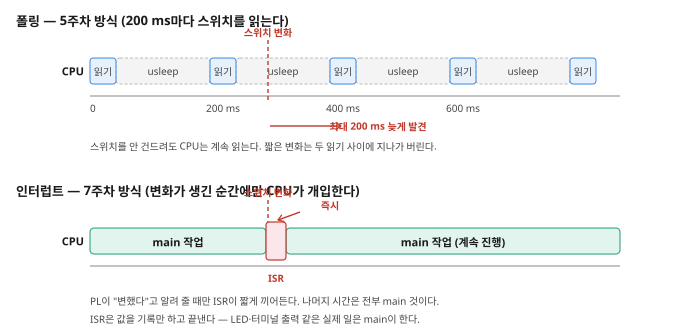

**그림 1-1** 위는 폴링(5주차 방식), 아래는 인터럽트(이번 장). 폴링에서는 스위치 변화가 두 번의 읽기 **사이**에 일어나면 다음 읽기까지 발견되지 않는다. 인터럽트에서는 변화가 생긴 순간에만 ISR이 짧게 끼어들고, 나머지 시간은 전부 main의 것이다.

- **주기를 길게 하면** CPU는 한가해지지만 반응이 느려지고, 짧은 변화를 놓친다.
- **주기를 짧게 하면** 반응은 빨라지지만 CPU가 읽기만 하다 끝난다. 그 시간에 다른 일을 할 수 없다.

5주차 코드의 `usleep(200000)`은 이 저울에서 한쪽을 고른 값이다. 그리고 진짜 문제는 **작업이 둘 이상일 때** 드러난다. 스위치도 감시하고, 6주차처럼 LED 밝기도 바꾸고, 통신도 해야 한다면 폴링 주기를 서로 어떻게 끼워 맞춰야 할까? 인터럽트는 이 질문 자체를 없앤다 — 각 장치가 자기 일이 생겼을 때 알리고, CPU는 알림이 올 때까지 다른 일을 한다.

---

## 1.2 인터럽트는 어떻게 동작하나

인터럽트가 무엇인지는 알고 있다고 보고, 여기서는 **Zynq에서 PL의 신호가 CPU의 ISR까지 어떻게 가는지**만 본다. 이번 장의 ISR은 `sw_isr()`다. main에는 이 함수를 부르는 줄이 없다 — 시작할 때 등록해 두면(1.11절) 하드웨어가 부른다.

AXI GPIO에서 `Enable Interrupt`를 켜면 다음과 같은 회로가 들어간다(개념만 줄인 것).

```verilog
always @(posedge clk) begin
  sw_old <= sw4;
  if (sw4 != sw_old)  pending <= 1;    // 바뀌면 표시를 세운다
  else if (clear)     pending <= 0;    // CPU가 지울 때만 내린다
end
assign ip2intc_irpt = pending;         // 이 1비트가 PS로 간다
```

이 표시를 **pending**(처리 대기)이라고 한다. 이 선이 PS의 입구 `IRQ_F2P`를 지나, 인터럽트를 모아 CPU에 전달하는 **GIC**를 거쳐 CPU에 닿는다.

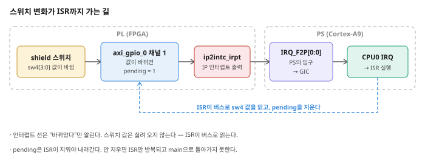

**그림 1-2** 스위치 변화가 ISR까지 가는 길. 파란 점선은 ISR이 버스로 되돌아가 값을 읽고 pending을 지우는 길이다.

위 코드에서 꼭 기억할 것이 두 가지 보인다.

- **선은 "바뀌었다"만 알린다.** `ip2intc_irpt`는 1비트라 스위치 값이 실려 있지 않다. 값은 ISR이 4·5주차처럼 버스로 읽어 온다.
- **pending은 ISR이 지워야 한다.** `pending`을 0으로 만드는 줄은 `clear`뿐이다. 지우지 않으면 선이 계속 1이라 ISR이 끝없이 다시 불리고, main으로 돌아가지 못한다.

두 가지 모두 3장에서 ILA 파형으로 확인한다.

---

## 1.3 프로젝트 만들기

### 1.3.1 이번 주 작업 폴더

5·6주차와 같은 구조로 `week7` 폴더를 새로 만든다. 지난주 폴더는 그대로 둔다.

```text
.../week7/
├── W7_Interrupt/            제공 파일 (저장소에서 복사, 고치지 않는다)
│   ├── LAB01/xdc/           1장 핀 배정 XDC
│   ├── LAB01/src/           1장 C 코드 (sw_irq_counter.c)
│   ├── LAB01/build_lab07_reference.tcl
│   └── LAB02/src/           2장 C 코드 (timer_scheduler.c)
├── vivado_prj/
│   └── gpio_irq/            1장 — Block Design + System ILA
└── vitis_ws/                1~3장 — Vitis 작업 공간 (Platform 하나, Application 둘)
```

`vivado_prj`와 `vitis_ws`는 비어 있는 채로 시작한다. `week7` 폴더도 **한글·공백이 없는 경로**에 둔다(5주차 1.3절의 경로 주의와 같다).

### 1.3.2 `gpio_irq` 프로젝트와 PS

이번 주는 IP를 만들지 않으므로, 4주차처럼 프로젝트를 만들자마자 Block Design으로 간다.

1. `File → Project → New…` — Project name **`gpio_irq`**, Project location **`.../week7/vivado_prj`**, Board **Cora Z7-07S**.

   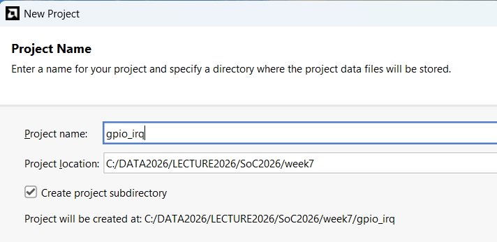

   **그림 1-3** 프로젝트 이름은 `gpio_irq`다. `Create project subdirectory`가 체크되어 있으므로 아래 줄에 나온 경로에 `gpio_irq` 폴더가 생긴다.

2. `Flow Navigator → IP INTEGRATOR → Create Block Design` → 이름은 기본값 `design_1`.
3. `Add IP`(+) → **ZYNQ7 Processing System** 추가.
4. 캔버스 위 배너의 **`Run Block Automation`** → `Apply Board Preset` 체크된 채로 `OK`.

   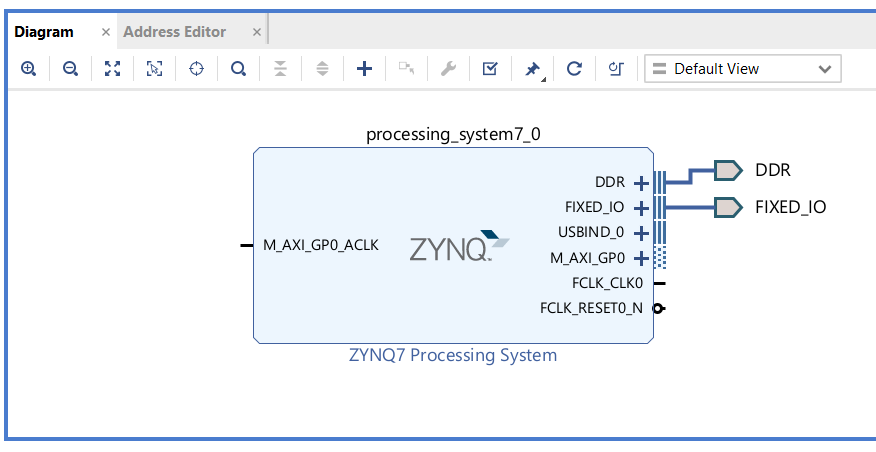

   **그림 1-4** Run Block Automation 직후의 `processing_system7_0`. 오른쪽에 `DDR`·`FIXED_IO`가 바깥으로 연결되었고, **`M_AXI_GP0`** 포트와 왼쪽의 `M_AXI_GP0_ACLK`가 이미 보인다.

---

## 1.4 PS 설정 — 버스의 출구와 인터럽트의 입구

AXI GPIO를 넣기 전에 PS 쪽 설정을 먼저 끝낸다. PS 블록을 더블클릭해 `Re-customize IP` 창을 연다. 처음 나오는 `Zynq Block Design` 화면에서 이번 주에 쓰는 곳을 확인한다.

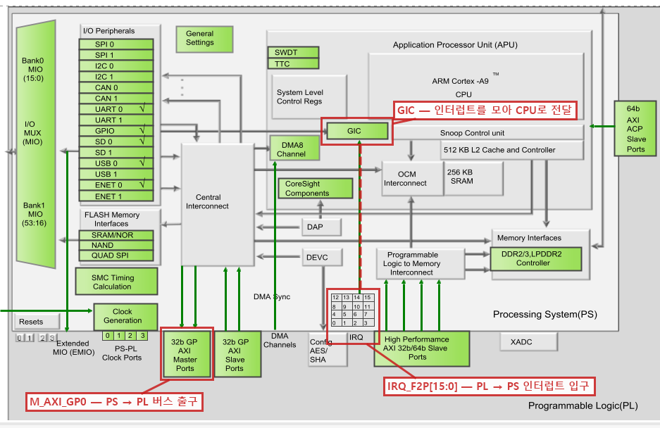

**그림 1-5** PS 안에서 이번 주에 쓰는 세 곳.

- 왼쪽 아래 **`M_AXI_GP0`**(32b GP AXI Master Ports)은 PS가 PL의 IP에 읽고 쓰는 **버스의 출구**다. 4주차부터 계속 써 왔다.
- 가운데 아래 **`IRQ`**(`IRQ_F2P[15:0]`)는 반대 방향, PL이 PS에 신호를 보내는 **인터럽트의 입구**다. 16칸이 입력 16개다.
- 빨간 점선을 따라 올라가면 **GIC**에 닿는다. PS 안에 이미 있는 장치라 켤 것은 없다.

### 1.4.1 `M_AXI_GP0` — 이미 켜져 있다

그림 1-4에서 보듯이 `M_AXI_GP0`은 **이미 켜져 있다.** Cora Z7-07S의 보드 프리셋이 Run Block Automation 때 켜 준 것이다. 5·6주차에 따로 켜지 않아도 사용자 IP가 연결된 이유도 이것이다. 확인하려면 왼쪽 `Page Navigator`의 `PS-PL Configuration` → `AXI Non Secure Enablement` → `GP Master AXI Interface` 아래 `M AXI GP0 interface`가 체크되어 있는지 본다.

### 1.4.2 `IRQ_F2P` — 켠다

왼쪽 `Page Navigator`에서 **`Interrupts`** 페이지로 이동한다.

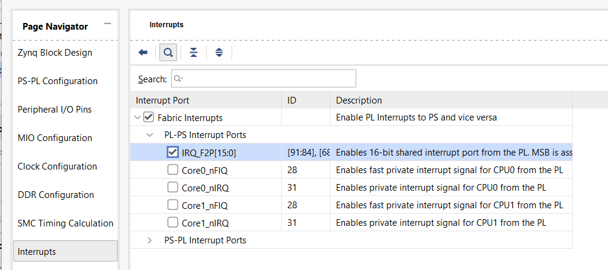

**그림 1-6** `Interrupts` 페이지에서 **`Fabric Interrupts`** 를 체크하고, 그 아래 `PL-PS Interrupt Ports`를 펼쳐 **`IRQ_F2P[15:0]`** 를 체크한다. 두 단계를 모두 해야 한다 — 상위 `Fabric Interrupts`만 켜면 포트가 생기지 않는다.

- `ID` 칸의 `[91:84], [68:61]`이 16개 입력이 GIC에서 받는 번호다. `IRQ_F2P[0]`이 **61번**이다.
- 그 아래 `Core0_nIRQ` 같은 항목은 PL에서 CPU에 직접 들어가는 다른 입구다. 이번 주에는 쓰지 않는다.

`OK`로 닫으면 PS 블록의 **왼쪽**에 `IRQ_F2P[0:0]` 입력 포트가 생긴다.

![IRQ_F2P를 켠 뒤의 PS — 왼쪽 IRQ_F2P[0:0], 오른쪽 M_AXI_GP0](img/w7s1_05.png)

**그림 1-7** 그림 1-4와 비교하면 왼쪽에 `IRQ_F2P[0:0]`이 새로 생겼다. 그림 1-5의 두 곳이 블록에서는 이렇게 보인다 — 오른쪽 `M_AXI_GP0`은 PS에서 **나가는** 버스, 왼쪽 `IRQ_F2P`는 PS로 **들어오는** 인터럽트다.

> **왜 `[15:0]`을 켰는데 `[0:0]`으로 보이는가.** `IRQ_F2P`는 최대 16개의 PL 인터럽트를 받을 수 있는 포트다. 지금은 연결할 선이 하나뿐이라 Vivado가 `[0:0]`으로 표시한다. 소스가 둘 이상이 되면 여러 선을 하나의 버스로 묶어 주는 **`Concat`** IP가 필요해진다 — 이번 장은 필요 없고, 과제에서 다룬다.

PS 설정은 여기서 끝이다. 입구는 열어 두었고, 1.6절에서 AXI GPIO의 인터럽트 선을 여기에 잇는다.

---

## 1.5 AXI GPIO — 2채널과 인터럽트 출력

### 1.5.1 IP 추가와 채널 설정

`Add IP`(+) → "AXI GPIO" 검색 → 캔버스에 추가한다. 인스턴스 이름은 `axi_gpio_0`이다. 더블클릭해 `Re-customize IP` 창을 연다.

창이 열리면 `Board` 탭이 먼저 보인다. 여기서는 손대지 않는다(`GPIO`·`GPIO2` 모두 `Custom`). 이번 주에 새로 켤 **`Enable Interrupt`** 는 탭 안이 아니라 **창 맨 아래**에 있다.

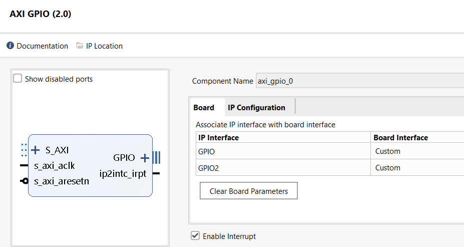

**그림 1-8** `Enable Interrupt`는 탭 바깥, 창 맨 아래에 있어서 어느 탭에서도 보인다. 체크하면 왼쪽 미리보기 블록에 **`ip2intc_irpt`** 출력 핀이 바로 생긴다. 이름 그대로 "IP에서 인터럽트 컨트롤러로" 가는 선이다.

이어서 `IP Configuration` 탭으로 가서 채널을 설정한다.

| 구역 | 항목 | 설정 |
|---|---|---|
| `GPIO`(채널 1) | `All Inputs` | 체크 — shield 스위치 |
| `GPIO`(채널 1) | `GPIO Width` | `4` |
| `GPIO`(채널 1) | `Enable Dual Channel` | 체크 |
| `GPIO 2`(채널 2) | `All Outputs` | 체크 — shield LED |
| `GPIO 2`(채널 2) | `GPIO Width` | `4` |
| (창 맨 아래) | **`Enable Interrupt`** | **체크** |

앞의 다섯 줄은 4주차 2교시의 shield용 AXI GPIO와 같다. **마지막 `Enable Interrupt`가 이번 주에 새로 추가되는 항목이다.**

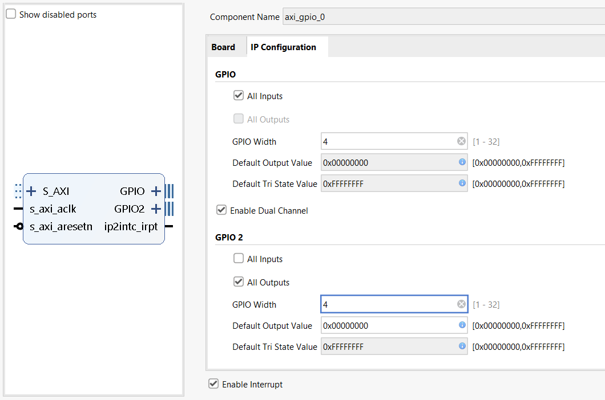

**그림 1-9** `IP Configuration` 탭. 채널 1은 `All Inputs`·Width 4, `Enable Dual Channel`을 켜면 나오는 채널 2(`GPIO 2`)는 `All Outputs`·Width 4. 미리보기 블록에 `GPIO`, `GPIO2`, `ip2intc_irpt` 세 출력이 보이면 맞다.

> **체크박스 하나가 하드웨어를 바꾼다.** 이 체크는 단순한 소프트웨어 설정이 아니다. AXI GPIO IP 안에 `GIER`/`IPIER`/`IPISR` 레지스터와 변화 감지 회로가 실제로 **합성되어 들어간다.** 6주차에 `my_pwm`의 user logic에 카운터를 넣은 것과 같은 일을, Xilinx가 미리 만들어 체크박스 뒤에 숨겨 둔 것이다. 그래서 체크를 바꾸면 비트스트림과 `.xsa`를 반드시 새로 만들어야 한다.

### 1.5.2 Run Connection Automation

캔버스 위 **`Run Connection Automation`** 배너를 클릭한다. 왼쪽 트리에서 `axi_gpio_0` 아래 `GPIO`/`GPIO2`는 **체크하지 않고, `S_AXI`만 체크**한다.

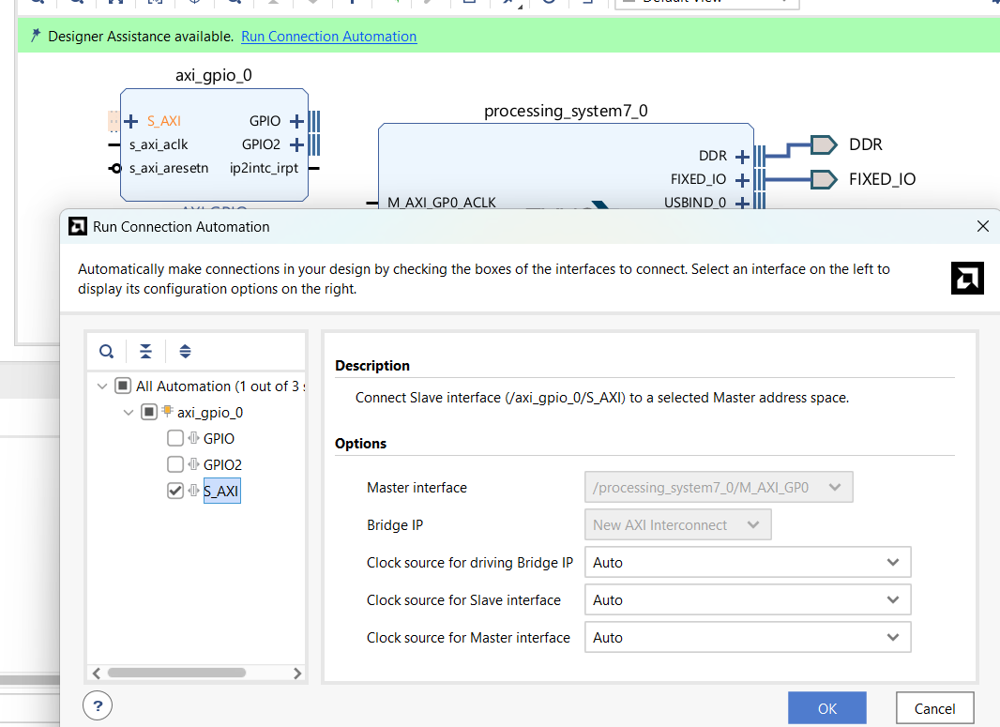

**그림 1-10** `S_AXI`만 체크한 상태. 오른쪽 `Master interface`가 `/processing_system7_0/M_AXI_GP0`이다 — 1.4절에서 확인한 버스의 출구에 AXI GPIO를 매단다는 뜻이다. `Bridge IP`는 `New AXI Interconnect`.

`OK`를 누르면 5·6주차와 같이 **`ps7_0_axi_periph`**(AXI Interconnect)와 **`rst_ps7_0_50M`**(Processor System Reset)이 자동으로 추가된다. 둘 다 설정을 건드릴 필요가 없다.

> **`GPIO`/`GPIO2`는 왜 체크하지 않는가.** 켜면 Vivado가 채널을 보드 프리셋 핀에 자동 연결해 버린다. 우리는 shield 핀에 연결해야 하므로, 버스 연결(`S_AXI`)만 자동화하고 외부 핀은 다음 절에서 직접 정한다.

### 1.5.3 Make External — 멤버 신호 방식

`axi_gpio_0`의 `GPIO`·`GPIO2` 옆의 **`+`를 눌러 펼친다.** 안에 있는 **멤버 신호** `gpio_io_i[3:0]`(채널1, 입력)과 `gpio2_io_o[3:0]`(채널2, 출력)이 나온다. 인터페이스가 아니라 **이 멤버 신호를 각각 우클릭 → `Make External`** 하고, `External Port Properties`의 `Name`을 고친다.

| Make External 할 핀 | 바깥 포트 이름 | 합성 후 top 포트 |
|---|---|---|
| `gpio_io_i[3:0]` (채널1, shield 스위치) | `sw4` | `sw4[3:0]` |
| `gpio2_io_o[3:0]` (채널2, shield LED) | `led4` | `led4[3:0]` |

> **왜 인터페이스가 아니라 멤버 신호를 내보내는가.** 4주차 2교시에서 다룬 차이다. `GPIO` 인터페이스를 통째로 내보내면 살아 있는 멤버에 맞춰 **접미사가 자동으로 붙어** `sw4_tri_i[3:0]`가 되고, 멤버 신호를 직접 내보내면 **입력한 이름 그대로** `sw4[3:0]`가 된다. 회로는 완전히 같지만 **XDC가 이 이름과 정확히 일치해야** 하므로, 헷갈릴 일이 없는 멤버 신호 방식을 쓴다.

이어서 `axi_gpio_0`과 바깥 포트 `sw4`를 잇는 선을 클릭하고 `System Net`의 `Name`을 **`ila_sw4`** 로 고친다(6주차 `ila_led4`와 같은 방법). 3장 ILA 파형에 이 이름이 그대로 나온다.

---

## 1.6 인터럽트 선 잇기

1.4절에서 열어 둔 PS의 입구(`IRQ_F2P`)와 1.5절에서 만든 AXI GPIO의 출구(`ip2intc_irpt`)를 잇는다.

`axi_gpio_0`의 `ip2intc_irpt` 핀에 마우스를 올려 연필 모양이 되면, 드래그해서 PS의 `IRQ_F2P[0:0]`에 **직접 연결**한다. AXI 버스에 쓴 `Run Connection Automation`은 이 선에는 쓰지 않는다 — 단순한 신호 선 하나이므로 손으로 잇는다. 연결한 선을 클릭해 `System Net`의 `Name`을 **`ila_irq`** 로 고친다.

![ip2intc_irpt가 IRQ_F2P[0:0]에 연결된 블록 디자인](img/w7s1_09.png)

**그림 1-11** ILA를 붙이기 전의 Block Design. 분홍색(선택된 상태)이 방금 이은 `ip2intc_irpt` → `IRQ_F2P[0:0]` 선이다. 이 선 하나가 그림 1-2에서 PL과 PS의 경계를 넘던 그 화살표다. 바깥 포트 `sw4[3:0]`·`led4[3:0]`도 1.5.3절의 이름대로 보인다.

`Address Editor` 탭을 열어 베이스 주소를 확인한다. `/axi_gpio_0/S_AXI`가 **`0x4120_0000`**(Range `64K`)에 배정되어 있다. 5·6주차의 사용자 IP는 `0x43C0_0000`이었다 — Vivado는 Xilinx IP와 사용자 IP에 서로 다른 구역의 주소를 준다. 코드에서는 이 주소를 직접 쓰지 않고 `XPAR_AXI_GPIO_0_BASEADDR` 매크로로 받으므로, 값이 다르게 배정돼도 코드는 그대로 동작한다.

---

## 1.7 System ILA 붙이기

3장에서 인터럽트를 눈으로 보기 위해 ILA를 미리 붙여 둔다. 방법은 6주차 2.5절과 같고, 이번에는 세 군데에 붙인다.

1. **AXI 버스** — Interconnect의 `M00_AXI`와 `axi_gpio_0`의 `S_AXI`를 잇는 굵은 선(`axi_gpio_0` 바로 앞)을 우클릭 → **`Debug`**.
2. **`ila_sw4` 선** — 우클릭 → **`Debug`**.
3. **`ila_irq` 선** — 우클릭 → **`Debug`**.
4. 배너의 **Run Connection Automation** → 세 개 모두 체크, `Source Clock`이 `/processing_system7_0/FCLK_CLK0`인지 확인 → `OK`.

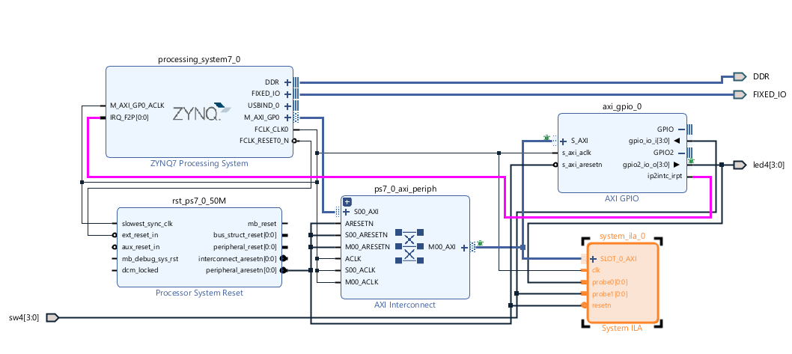

**그림 1-12** 이번 주의 최종 하드웨어. 오른쪽 아래 주황색 `system_ila_0`이 새로 들어왔다. `SLOT_0_AXI`에 `axi_gpio_0` 앞 버스(`M00_AXI`)가, `probe0`에 `ila_sw4`, `probe1`에 `ila_irq`가 들어간다. Debug를 표시한 세 곳에는 초록 벌레 아이콘이 붙는다. 분홍색 선은 1.6절에서 이은 인터럽트 선이다.

> **`probe0[0:0]`인데 1비트인가?** 6주차와 같다. 블록 위의 표시는 그렇지만 `ila_sw4`는 실제로 4비트가 모두 잡힌다. 3장 Hardware Manager에서 4비트로 나온다.

> **주소가 짧게 보인다.** 6주차와 마찬가지로 `axi_gpio_0` 바로 앞 선은 Interconnect가 "어느 IP인가"를 이미 골라 낸 뒤라 **주소 아래 9비트만** 남는다. 그래서 3장 ILA에서 `GPIO_DATA` 읽기는 `000`, `IPISR`(+0x120) 접근은 **`120`** 으로 보인다. 1.10절 표의 오프셋이 그대로 보이는 셈이다.

---

## 1.8 Wrapper·XDC·Bitstream·Export

1. 캔버스 우클릭 → `Validate Design`(F6). 경고 없이 통과해야 한다.
2. Block Design 저장(`Ctrl+S`).
3. `Sources → design_1` 우클릭 → **`Create HDL Wrapper…`** → 기본값 **"Let Vivado manage wrapper and auto-update"** 로 둔다.
4. 생성된 `design_1_wrapper.v`를 열어 top 포트 이름을 확인한다. **`sw4`, `led4`가 접미사 없이 그대로 보여야 한다**(1.5.3절에서 멤버 신호를 내보냈기 때문이다).
5. `Add Sources → Add or create constraints → Add Files`로 제공 파일 [`LAB01/xdc/cora_z7_07s_week07.xdc`](LAB01/xdc/cora_z7_07s_week07.xdc)(`.../week7/W7_Interrupt/LAB01/xdc/`)를 추가한다. 4주차 2교시와 **같은 8핀**이다 — shield 배선이 바뀌지 않았으니 핀도 그대로다.

| 신호 | 패키지 핀 |
|---|---|
| `sw4[0..3]` | U15, K18, J18, G15 |
| `led4[0..3]` | T14, V17, R17, N18 |

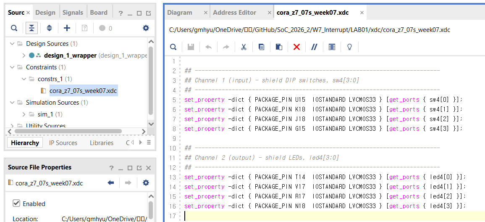

**그림 1-13** `Constraints → constrs_1`에 `cora_z7_07s_week07.xdc`가 들어왔다. 5~8줄이 `sw4`, 13~16줄이 `led4`다. `get_ports` 안의 이름이 그림 1-12의 바깥 포트 이름(`sw4`, `led4`)과 정확히 같아야 한다.

6. `Generate Bitstream`.
7. `File → Export → Export Hardware…` → **`Include bitstream`** → `design_1_wrapper.xsa`. 저장 위치는 기본값(`.../week7/vivado_prj/gpio_irq`).

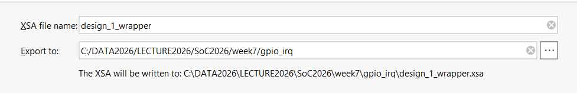

**그림 1-14** `XSA file name`은 `design_1_wrapper`, `Export to`는 프로젝트 폴더(`gpio_irq`)다. 아래 줄의 경로가 1.9절에서 Platform을 만들 때 고를 `.xsa`다.

> **`get_ports`에 이름이 없다는 경고가 나오면** XDC의 포트 이름과 래퍼에서 확인한 실제 이름이 다른 것이다. 인터페이스를 Make External 했다면 `sw4_tri_i`/`led4_tri_o`가 되므로, Make External을 멤버 신호 방식으로 다시 한다.

만들어진 파일은 5·6주차와 같은 자리에 생긴다.

| 파일 | 위치 (`.../week7/vivado_prj/` 아래) | 쓰는 곳 |
|---|---|---|
| `design_1_wrapper.xsa` | `gpio_irq/` | 1.9절 Vitis Platform |
| `design_1_wrapper.bit` | `gpio_irq/gpio_irq.runs/impl_1/` | (`.xsa` 안에 들어 있다) |
| `design_1_wrapper.ltx` | `gpio_irq/gpio_irq.runs/impl_1/` | 3장 Hardware Manager |

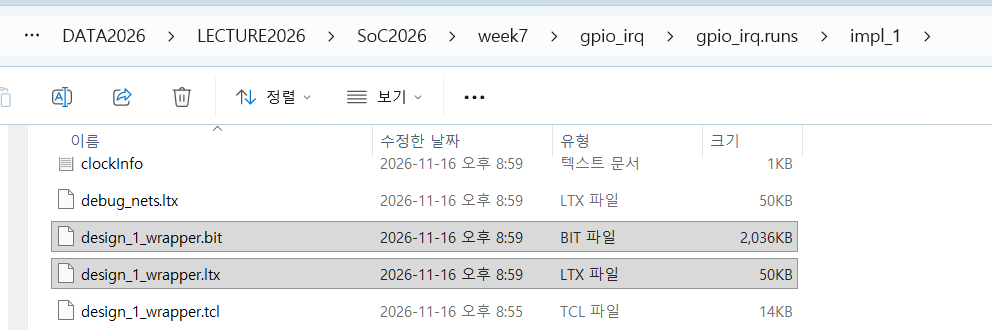

**그림 1-15** `gpio_irq.runs/impl_1` 폴더. `design_1_wrapper.bit`와 `design_1_wrapper.ltx`가 있다. 같은 폴더의 `debug_nets.ltx`는 쓰지 않는다 — 3장에서 지정할 것은 `design_1_wrapper.ltx`다.

참고: 1.3~1.8절의 결과를 한 번에 만드는 스크립트가 [`LAB01/build_lab07_reference.tcl`](LAB01/build_lab07_reference.tcl)에 있다. 설계가 망가져 시간 안에 되돌리기 어려울 때만 쓴다.

---

## 1.9 Vitis — Platform과 Application

### 1.9.1 Platform 만들기

1. `Open Workspace` → **`.../week7/vitis_ws`**.
2. `Create Platform Component` — 이름 **`platform`**, XSA는 **`.../week7/vivado_prj/gpio_irq/design_1_wrapper.xsa`**, OS `standalone`, Processor `ps7_cortexa9_0` → `FLOW → Build`.

> **이 Platform 하나를 이번 주 내내 쓴다.** 2장의 PS 타이머는 PS 안에 이미 들어 있는 블록이라 Vivado를 다시 열 필요가 없고, 3장의 ILA는 이미 이 하드웨어에 들어 있다. 그래서 7주차는 **Platform 하나에 Application 둘**이 된다.

### 1.9.2 Application 만들기

`Create Embedded Application` → `Empty Application (C)` — 이름 **`app_irq`**, Platform은 `platform`.

`Sources → src` 우클릭 → `Import → Files…` → 제공 파일 [`LAB01/src/sw_irq_counter.c`](LAB01/src/sw_irq_counter.c)(`.../week7/W7_Interrupt/LAB01/src/`).

> 5·6주차에는 Application 이름을 기본값 `app_component`로 두었다. 이번 주에는 같은 Platform에 Application을 둘 만들므로(2장에서 `app_timer`), 무엇을 하는 프로그램인지 이름으로 구분한다.

---

## 1.10 AXI GPIO의 인터럽트 레지스터

5·6주차처럼 이번에도 레지스터를 **직접** 읽고 쓴다. AXI GPIO의 레지스터 맵은 IP 스펙(Xilinx PG144)에 정해져 있다. 4주차 1교시에서 본 데이터 레지스터 뒤쪽에 인터럽트용 레지스터 세 개가 더 있다.

| 오프셋 | 이름 | 이번 주에 하는 일 |
|---|---|---|
| `+0x000` | `GPIO_DATA` | 채널 1(`sw4`) 값을 **읽는다** |
| `+0x008` | `GPIO2_DATA` | 채널 2(`led4`)에 값을 **쓴다** |
| `+0x11C` | `GIER` (Global Interrupt Enable) | bit 31에 1 → 이 IP의 인터럽트 출력 전체를 켠다 (**대문**) |
| `+0x120` | `IPISR` (IP Interrupt Status) | bit 0 = 채널 1 **pending**. 지울 때 여기에 쓴다 |
| `+0x128` | `IPIER` (IP Interrupt Enable) | bit 0에 1 → 채널 1 인터럽트를 허용한다 (**개별 문**) |

> **비트별이 아니라 채널 단위다.** `sw4[0]`이 바뀌어도 `sw4[3]`이 바뀌어도, 세워지는 것은 `IPISR`의 같은 bit 0 하나다. 어느 스위치가 바뀌었는지는 ISR이 `GPIO_DATA`를 읽어 봐야 안다. 1.2절의 "선은 바뀌었다만 알린다"가 레지스터에서도 그대로다.

### 레지스터에 이름 붙이기

5주차 `my_io_test.c`, 6주차 `pwm_test.c`와 같은 방법이다. 시작 주소에 위 표의 오프셋을 더한다.

```c
#define GPIO_BASE    XPAR_AXI_GPIO_0_BASEADDR   /* 0x4120_0000 */

#define GPIO_DATA    (GPIO_BASE + 0x000)        /* 채널 1 = sw4  (읽기)           */
#define GPIO2_DATA   (GPIO_BASE + 0x008)        /* 채널 2 = led4 (쓰기)           */
#define GPIO_GIER    (GPIO_BASE + 0x11C)        /* bit 31 = IP 전체 인터럽트 허용 */
#define GPIO_IPISR   (GPIO_BASE + 0x120)        /* bit 0  = 채널 1 pending        */
#define GPIO_IPIER   (GPIO_BASE + 0x128)        /* bit 0  = 채널 1 인터럽트 허용  */
```

### 레지스터 쓰는 법

| 하고 싶은 일 | 코드 |
|---|---|
| 스위치 읽기 | `sw = Xil_In32(GPIO_DATA);` |
| LED 쓰기 | `Xil_Out32(GPIO2_DATA, count);` |
| 채널 1 인터럽트 허용 | `Xil_Out32(GPIO_IPIER, 0x1);` |
| IP 전체 인터럽트 허용 | `Xil_Out32(GPIO_GIER, 0x80000000);` |
| pending 지우기 | `Xil_Out32(GPIO_IPISR, Xil_In32(GPIO_IPISR));` |

마지막 줄만 모양이 다르다. `IPISR`는 1을 쓰면 그 비트가 **뒤집히는**(toggle) 레지스터다. 1인 비트에 1을 쓰면 0이 되지만, 0인 비트에 1을 쓰면 오히려 1이 되어 버린다. 그래서 **읽은 값을 그대로 다시 쓴다** — 지금 1인 비트만 0으로 돌아간다.

### GIC에 ISR 등록 — 함수 하나

PL 쪽 레지스터는 위처럼 직접 다루지만, PS 안의 GIC 설정은 손으로 하기에는 복잡하다. 이 부분만 BSP가 주는 함수 하나를 쓴다.

```c
XSetupInterruptSystem(NULL, (void *)sw_isr,
                      XPAR_AXI_GPIO_0_INTERRUPTS,         /* 인터럽트 번호 */
                      XPAR_AXI_GPIO_0_INTERRUPT_PARENT,   /* GIC 주소     */
                      XINTERRUPT_DEFAULT_PRIORITY);
```

뜻은 "**이 번호의 인터럽트가 오면 `sw_isr`를 실행하라**"이다. 바꿔 쓰는 것은 두 번째 인자인 ISR 이름뿐이고, 나머지는 이 모양 그대로 쓴다. 첫 번째 `NULL`은 ISR의 `ref`로 넘어가는 값인데, 이번에는 쓰지 않는다.

인터럽트 번호와 GIC 주소는 외워 적지 않는다. Vivado 설계에서 만들어진 값이 Platform의 `xparameters.h`(`platform → export → platform → sw → standalone_ps7_cortexa9_0 → include`)에 매크로로 들어 있다.

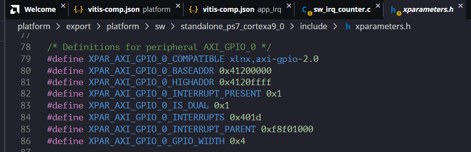

**그림 1-16** `axi_gpio_0`에 대해 Vivado 설계에서 만들어진 값들이다.

- `BASEADDR 0x41200000` — 1.6절 Address Editor의 주소. 위 `GPIO_BASE`가 이것이다.
- `INTERRUPT_PRESENT 0x1` — 1.5.1절의 `Enable Interrupt`가 켜져 있다는 뜻이다.
- `INTERRUPTS 0x401d` — `XSetupInterruptSystem()`에 넘기는 인터럽트 번호. 아래 `0x1d`(=29)에 32를 더한 **61**이 그림 1-6에서 본 `IRQ_F2P[0]`의 번호다.
- `INTERRUPT_PARENT 0xf8f01000` — GIC의 주소.

### 초기화 순서

위 코드를 부르는 순서가 중요하다. 특히 문 두 개(`IPIER`, `GIER`)를 언제 여느냐가 핵심이다.

```text
① 남아 있던 pending 지우기          Xil_Out32(GPIO_IPISR, Xil_In32(GPIO_IPISR))
② GIC에 ISR 등록                   XSetupInterruptSystem(...)
③ 채널 1 허용 (개별 문)             Xil_Out32(GPIO_IPIER, 0x1)
④ IP 전체 허용 (대문)               Xil_Out32(GPIO_GIER, 0x80000000)
```

②를 ③·④보다 먼저 하는 이유는 분명하다. 문을 먼저 열면, ISR이 등록되기 전에 인터럽트가 도착할 수 있다. 그러면 CPU는 등록되지 않은 핸들러로 뛰어가게 된다. **받을 준비를 먼저 하고 문을 연다.**

①이 필요한 이유는, 전원을 켠 직후나 이전 실행의 잔재로 이미 pending이 서 있을 수 있기 때문이다. 그대로 문을 열면 스위치를 건드리지도 않았는데 ISR이 한 번 불린다.

1.11절의 main이 이 ①~④를 그대로 따른다.

---

## 1.11 코드 — ISR은 짧게, 일은 main이

전체 파일은 [`LAB01/src/sw_irq_counter.c`](LAB01/src/sw_irq_counter.c)에 있다. 핵심은 ISR과 main의 역할 분담이다.

### 세 개의 공유 변수와 ISR

```c
volatile int flag  = 0;   /* 인터럽트가 생겼다는 표시 */
volatile int count = 0;   /* 4비트 카운터, 0~15       */
volatile int sw    = 0;   /* 그 순간의 스위치 값      */

void sw_isr(void *ref)
{
    sw    = Xil_In32(GPIO_DATA);
    count = (count + 1) & 0xF;
    flag  = 1;

    Xil_Out32(GPIO_IPISR, Xil_In32(GPIO_IPISR));   /* pending 지우기 - 꼭 한다 */
}
```

ISR이 하는 일은 **기록 세 줄과 clear 한 줄**, 전부다. LED에 쓰지도 않고 `xil_printf`도 부르지 않는다.

> **`volatile`이 왜 필요한가.** `flag`는 ISR이 바꾸고 main이 읽는다. 그런데 컴파일러는 main의 `while(1)` 안에서 `flag`를 바꾸는 코드를 찾을 수 없으므로, "이 값은 안 변하니 한 번만 읽어 두고 쓰자"고 최적화해 버릴 수 있다. 그러면 main은 ISR이 세운 `flag`를 영원히 보지 못한다. `volatile`은 "매번 메모리에서 다시 읽어라"라는 지시다. **ISR과 main이 함께 쓰는 변수에는 빠짐없이 붙인다.**

> **`void *ref`는 무엇인가.** ISR의 형식이 정해져 있어서 받는 인자다. `XSetupInterruptSystem()`의 첫 번째 인자(`NULL`)가 여기로 넘어온다. 이 코드에서는 쓰지 않는다.

### main

```c
Xil_Out32(GPIO_IPISR, Xil_In32(GPIO_IPISR));     /* ① 남아 있던 pending 지우기 */

XSetupInterruptSystem(NULL, (void *)sw_isr,      /* ② "이 인터럽트가 오면 sw_isr" */
                      XPAR_AXI_GPIO_0_INTERRUPTS,
                      XPAR_AXI_GPIO_0_INTERRUPT_PARENT,
                      XINTERRUPT_DEFAULT_PRIORITY);

Xil_Out32(GPIO_IPIER, 0x1);                      /* ③ 채널 1 허용 (개별 문) */
Xil_Out32(GPIO_GIER,  0x80000000);               /* ④ IP 전체 허용 (대문)   */

while (1) {
    if (flag == 1) {
        flag = 0;
        Xil_Out32(GPIO2_DATA, count);            /* 카운터 → LED 4개 */
        xil_printf("count = %2d, sw = %d\n\r", count, sw);
    }
}
```

> 4주차 드라이버 코드에 있던 `XGpio_SetDataDirection()`(입력·출력 방향 정하기)이 없다. 1.5.1절에서 채널 1을 `All Inputs`, 채널 2를 `All Outputs`로 만들었기 때문에 방향이 하드웨어에 이미 고정되어 있다.

①~④가 위 초기화 순서 그대로다. main은 `flag`가 섰는지만 본다. **스위치를 읽는 코드가 main에 한 줄도 없다** — 5주차의 `Xil_In32(REG_SW4)`와 비교하면 이 점이 가장 크게 달라진 부분이다.

> **왜 ISR에서 바로 LED를 쓰고 출력하지 않는가.** 지금 규모에서는 그렇게 해도 동작한다. 하지만 ISR이 실행되는 동안 CPU는 main으로 돌아가지 못하고, 같은 우선순위의 다른 인터럽트도 기다려야 한다. `count = 12, sw = 5` 한 줄은 약 20문자이고, 115200 baud에서 한 문자를 보내는 데 약 87 µs가 걸리므로 줄 하나를 다 보내는 데 약 1.7 ms가 걸린다. UART에 작은 버퍼(64바이트)가 있어서 가끔 찍는 한 줄은 금방 끝나지만, 인터럽트가 그보다 자주 오면 버퍼가 차고, 그때부터 ISR은 글자가 다 나갈 때까지 붙잡혀 있게 된다. **ISR은 "무슨 일이 있었는지 적어 두고 즉시 나온다", 실제 처리는 main이 한다** — 2장에서 1 ms 타이머로 이 규칙을 일부러 깨 본다.

---

## 1.12 실행과 관찰

`FLOW → Build` → 보드 연결 → `Run`. PuTTY(COM 포트, 115200)를 열어 둔다.

shield 스위치를 하나 올려 본다.

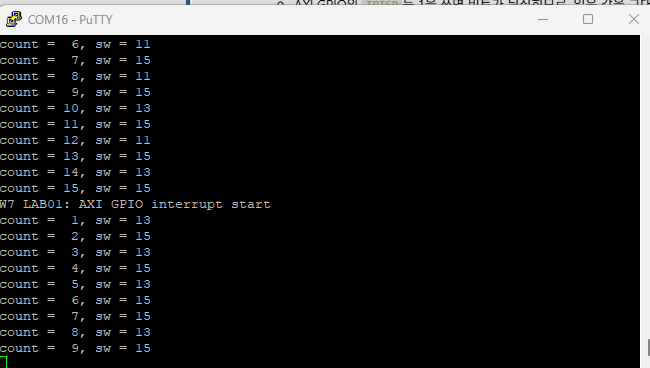

**그림 1-17** 실제 실행 화면. 스위치를 건드리지 않는 동안에는 **한 줄도 나오지 않고**, 움직일 때마다 한 줄씩 찍힌다. 5주차에는 가만히 둬도 0.2초마다 한 줄씩 찍혔다 — 이 차이가 폴링과 인터럽트의 차이다. `sw`가 `15 → 13 → 15 …`로 오가는 것은 `sw4[1]` 하나를 내렸다 올렸다 한 것이다(15 = `1111`, 13 = `1101`). 가운데 `W7 LAB01: … start` 줄은 프로그램을 다시 실행한 곳이라 `count`가 1부터 다시 시작한다.

### 스위치를 한 번 올렸다 내리면 카운터는 2 오른다

그림 1-17에서 `sw`가 15와 13을 오갈 때마다 `count`가 1씩 오른다. **인터럽트는 값이 "바뀔 때마다" 발생한다** — 내릴 때 한 번, 올릴 때 또 한 번이다. 그래서 "스위치를 한 번 움직였다"고 생각하는 동작(올렸다 내리기)에 카운터는 2 오른다.

> **바운스(bounce).** 기계식 스위치는 접점이 붙는 순간 아주 짧게 여러 번 붙었다 떨어질 수 있다. 그러면 손으로는 한 번 움직였는데 PL은 그 떨림을 전부 "변화"로 감지해, `count`가 한 번에 2 이상 뛴다. 그림 1-17을 찍을 때의 스위치는 떨림 없이 1씩 올랐지만, 스위치마다, 움직이는 속도마다 다르다. 빠르게, 천천히, 비스듬히 여러 번 움직여 보고 `count`가 한 번에 2 이상 뛰는 때가 있는지 본다. 폴링은 0.2초마다 한 번만 읽었기 때문에 이런 떨림이 있어도 보이지 않았다. 3장에서 ILA로 정확히 센다.

스위치를 **올릴 때만** 세는 방법, 떨림을 걸러 내는 방법이 이번 장 과제다.

---

## 1.13 정리

| 키워드 | 내용 |
|---|---|
| 폴링의 한계 | 안 바뀌어도 계속 읽고, 주기보다 짧은 변화는 놓친다. 작업이 여러 개면 주기를 맞추기 어렵다 |
| 인터럽트 경로 | `IPISR` pending → `ip2intc_irpt` → `IRQ_F2P` → GIC → CPU0 → ISR |
| 인터럽트 선은 값을 나르지 않는다 | "변했다"만 전달. 값은 ISR이 AXI4-Lite로 읽는다 |
| `Enable Interrupt` | AXI GPIO IP의 체크박스. 켜면 `ip2intc_irpt` 출력과 인터럽트 레지스터가 합성되어 들어간다 |
| `Fabric Interrupts`/`IRQ_F2P` | PS가 PL 인터럽트를 받는 입구. `M AXI GP0`과 같은 성격의 스위치 |
| 멤버 신호 Make External | 접미사 없이 `sw4[3:0]`/`led4[3:0]`. XDC 이름과 맞추기 쉽다 |
| System ILA | `axi_gpio_0` 앞 버스 + `ila_sw4` + `ila_irq`. 주소는 9비트 오프셋(`000`, `120`)으로 보인다 |
| `GIER`/`IPIER`/`IPISR` | 대문(+0x11C) / 개별 문(+0x128) / pending(+0x120) |
| 초기화 순서 | pending clear → ISR 등록 → 채널 enable → global enable |
| pending clear | ISR에서 반드시. 빠뜨리면 ISR이 무한 반복되고 main은 못 돌아온다 |
| 채널 단위 인터럽트 | 채널 안의 어느 비트가 바뀌어도 pending은 하나 |
| ISR은 짧게 | 기록만 하고 나온다. LED·출력은 main이 |
| `volatile` | ISR과 main이 공유하는 변수에는 반드시 붙인다 |

---

## 과제 — 다음 시간 전까지

1. **스위치를 올릴 때만 카운터가 1 증가하도록 고친다.** ISR에서 읽은 현재 값과 직전 값을 비교하면 어느 비트가 어느 방향으로 바뀌었는지 알 수 있다. 상승 변화(0→1)가 있을 때만 카운터를 올리도록 수정하고, 올렸다 내렸을 때 카운터가 정확히 1만 오르는지 확인한다.
2. **바운스를 줄여 본다.** 1번을 적용해도 바운스 때문에 여전히 여러 번 세질 수 있다. 마지막 이벤트로부터 일정 시간(예: 20 ms) 안에 들어온 이벤트를 무시하는 방법을 생각해 보고, **그 "시간"을 ISR 안에서 어떻게 알 수 있을지** 고민해 온다. (2장의 타이머가 바로 이 문제를 푸는 도구다.)
3. **인터럽트 소스가 둘이 되면 무엇이 필요한가.** 이 설계에 AXI GPIO를 하나 더 추가해 보드 버튼(`btn`)에도 인터럽트를 붙이려 한다고 하자. `ip2intc_irpt`가 두 개가 되는데 PS의 `IRQ_F2P`는 하나다. Vivado IP 카탈로그에서 **`Concat`**(`xlconcat`)을 찾아보고 어떻게 쓰면 될지 조사해 온다. (구현은 하지 않아도 된다.)
4. ISR 안의 pending 지우기 한 줄(`Xil_Out32(GPIO_IPISR, …)`)을 주석 처리하고 실행해 본다. **무슨 일이 일어나는지 관찰하고 이유를 설명한다.** (확인한 뒤에는 주석을 되돌린다. 3장에서 이 상황을 ILA로 다시 본다.)

## 다음 시간 예고 — 제2장

- 이번 장은 **"이벤트가 생겼을 때"** 인터럽트였다. 다음 장은 **"시간이 되었을 때"** 인터럽트다 — Cortex-A9 **Private Timer**로 1 ms마다 인터럽트를 만든다.
- 그 1 ms를 tick으로 삼아, 주기가 다른 작업 셋(50 ms·500 ms·1000 ms)을 하나의 main 루프에서 돌리는 **잡 스케줄러**를 만든다. `usleep()`으로는 할 수 없던 일이다.
- **Vivado 작업이 없다.** Private Timer는 PS 안에 이미 들어 있어서, 이번 장에서 만든 `gpio_irq` 하드웨어와 `platform`을 **그대로 재사용**한다 — Application만 하나 더 만든다.

---

*SoC 설계 · 7주차 1교시(W7_S1) | Vivado/Vitis 2023.2 · Windows · Cora Z7-07S*
