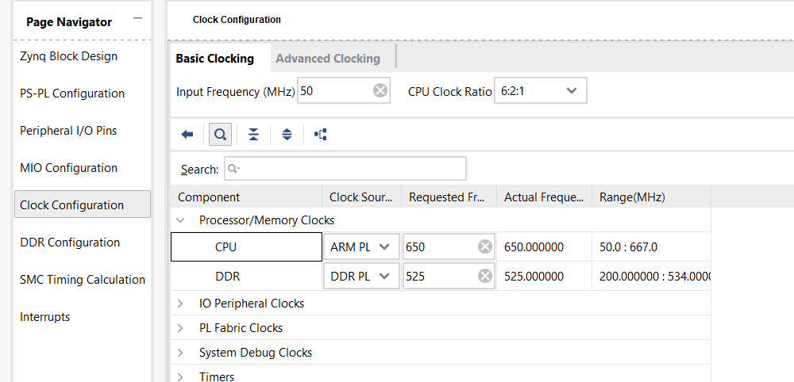
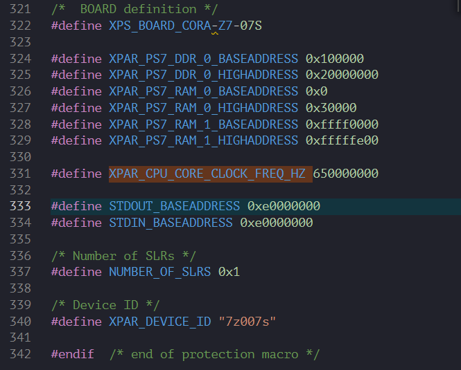
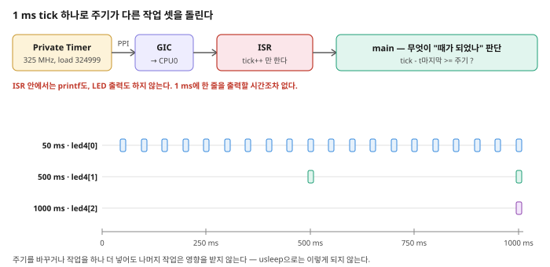
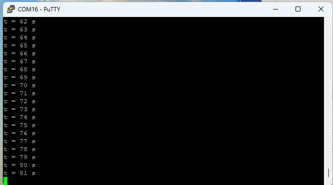

# 제2장 인터럽트 (2) — PS 타이머와 1 ms 잡 스케줄러

**SoC 설계** · 7주차 2교시(W7_S2) | Vivado/Vitis 2023.2 · Windows 11 · Digilent Cora Z7-07S

---

1장의 인터럽트는 **"이벤트가 생겼을 때"** 발생했다. 스위치를 언제 움직일지는 아무도 모르고, PL이 그 순간을 알려 줬다. 이번 장의 인터럽트는 **"시간이 되었을 때"** 발생한다 — 1 ms마다 정확히, 아무 일이 없어도.

시간 인터럽트가 왜 따로 필요한가. 지금까지 우리는 시간을 전부 `usleep()`으로 쟀다. 6주차 `pwm_fade.c`가 그랬다.

```c
for (duty = 0; duty <= PERIOD; duty = duty + STEP) {
    Xil_Out32(PWM_DUTY, duty);
    usleep(10000);              /* ← 10 ms 동안 CPU는 아무것도 못 한다 */
}
```

5주차 `my_io_test.c`도 `usleep(200000)`으로 0.2초를 쟀다. 여기에 요구사항을 하나 얹어 보자. **LED 하나는 50 ms마다, 다른 하나는 500 ms마다, 또 하나는 1초마다 깜빡이고 싶다.** `usleep` 하나로 이걸 어떻게 하는가? 주기가 넷, 다섯으로 늘면? 이번 장은 이 문제에 대한 표준적인 답 — **하나의 빠른 tick을 만들고, 무엇을 할 때가 되었는지는 main이 판단하는** 구조 — 를 만든다.

> **이번 장은 Vivado 작업이 없다.** Cortex-A9 Private Timer는 PS의 CPU 코어 안에 이미 들어 있는 블록이다. 켤 체크박스도, 연결할 선도 없다. 1장에서 만든 `gpio_irq` 하드웨어와 `platform`을 **그대로 재사용**하고, Application만 하나 더 만든다. 1장에서 붙인 ILA도 이번 장에서는 쓰지 않는다 — 1 ms tick은 PS 안에서 일어나는 일이라 PL의 ILA에는 보이지 않는다.

이번 장의 흐름은 다음과 같다.

> **`usleep`의 한계 → Private Timer와 PPI → 로드값 계산(324999) → Platform 재사용, Application 추가** → **1 ms tick + 잡 스케줄러** → **일부러 고장내 보기**

---

## 학습 목표

- `usleep()`으로 주기 작업을 만들 때 생기는 세 가지 문제(블로킹·주기 혼재·누적 오차)를 설명한다.
- Cortex-A9 Private Timer의 위치를 설명하고, 그 인터럽트가 **PPI**임을 1장의 **SPI**(`IRQ_F2P`)와 구분한다.
- Private Timer의 클럭이 CPU 클럭의 절반임을 BSP 파일에서 확인하고, 1 ms에 필요한 로드값을 직접 계산한다.
- 하드웨어가 바뀌지 않았을 때 Vitis Platform을 재사용하고 Application만 추가한다.
- Private Timer의 레지스터(`LOAD`, `CONTROL`, `ISR`)를 직접 써서 1 ms 주기 인터럽트를 만든다.
- tick 하나로 주기가 다른 작업 여러 개를 돌리는 잡 스케줄러를 작성한다.
- ISR을 짧게 유지해야 하는 이유를 **실제로 고장을 재현해서** 설명한다.

---

## 2.1 `usleep()`의 세 가지 문제

```c
job_a();          /* 50 ms마다 하고 싶다  */
job_b();          /* 500 ms마다 하고 싶다 */
usleep(50000);
```

`job_b`를 500 ms마다 하려면 카운터를 하나 두고 열 번째마다 부르는 식으로 직접 세야 한다. 작업이 셋, 넷으로 늘고 주기가 서로 배수가 아니면 이 계산은 금방 엉킨다. 문제를 정리하면 세 가지다.

**① 블로킹.** `usleep(50000)`이 도는 50 ms 동안 CPU는 아무 일도 못 한다. 그사이 스위치가 바뀌어도, 데이터가 도착해도 반응할 수 없다.

**② 주기가 섞인다.** 모든 작업이 하나의 `usleep` 주기에 종속된다. 가장 짧은 주기에 맞춰 루프를 돌리고, 나머지는 손으로 세는 수밖에 없다.

**③ 누적 오차(drift).** 실제 루프 한 바퀴는 `50 ms + job_a 실행시간 + job_b 실행시간`이다. `usleep`은 "50 ms를 쉰다"는 뜻이지 "50 ms마다 돌아온다"는 뜻이 아니다. 그래서 반복할수록 시각이 뒤로 밀린다. 특히 `xil_printf`처럼 실행시간이 길고 일정하지 않은 작업이 섞이면 오차가 눈에 보일 만큼 쌓인다.

타이머 인터럽트는 세 문제를 한꺼번에 없앤다. 타이머는 **CPU가 무엇을 하고 있든 상관없이** 독립적으로 시간을 세기 때문에, 작업이 얼마나 오래 걸렸든 tick은 정확히 1 ms 간격으로 올라간다(③ 해결). CPU는 쉬지 않고 main을 돌 수 있고(①), 각 작업은 자기 주기를 tick 수로만 따지면 되므로 서로 독립적이다(②).

---

## 2.2 Cortex-A9 Private Timer — PPI로 들어오는 인터럽트

Zynq-7000의 각 Cortex-A9 코어에는 **전용 타이머**(Private Timer)가 하나씩 붙어 있다. 코어 전용이므로 다른 코어나 PL과 공유하지 않고, PS 안에 있으므로 PL에 아무것도 놓지 않아도 쓸 수 있다.

1장의 인터럽트와 나란히 놓고 보면 차이가 분명해진다.

| | 1장 — AXI GPIO | 2장 — Private Timer |
|---|---|---|
| 인터럽트를 만드는 곳 | **PL** 안의 IP | **PS** 안, CPU 코어에 붙어 있음 |
| 무엇이 계기인가 | 입력 값의 변화 | 정해진 시간의 경과 |
| GIC까지 가는 경로 | `ip2intc_irpt` → `IRQ_F2P` → GIC | 코어에서 GIC로 직접 |
| GIC에서의 분류 | **SPI** (Shared Peripheral Interrupt) | **PPI** (Private Peripheral Interrupt) |
| Vivado에서 할 일 | `Enable Interrupt` + `Fabric Interrupts` | **없음** |
| 레지스터 주소 | `0x4120_0000` (Address Editor에서 정해짐) | `0xF8F0_0600` (칩에 고정) |

GIC는 들어오는 인터럽트를 출발지에 따라 두 가지로 나눈다.

- **PPI**(Private Peripheral Interrupt): CPU 코어 하나에 딸린 장치의 인터럽트. 그 코어만 받는다. Private Timer가 여기 속한다.
- **SPI**(Shared Peripheral Interrupt): 코어 바깥 주변장치의 인터럽트. 여러 코어 중 어느 쪽으로든 보낼 수 있다. PL에서 `IRQ_F2P`로 들어오는 인터럽트는 모두 여기 속한다.

> 여기서 SPI는 통신 규격 SPI(Serial Peripheral Interface)와 이름만 같고 관계가 없다.

이 대비가 이번 장에서 얻을 가장 중요한 그림이다. **GIC는 두 종류의 인터럽트를 같은 방식으로 CPU에 전달한다.** 우리 코드 쪽에서 보면 ISR을 등록하고 pending을 지우는 절차가 1장과 똑같다 — 달라지는 것은 레지스터 주소와, 인터럽트가 어디서 출발했는지뿐이다.

> **매크로 이름의 `SCUTIMER`는 오해를 부른다.** `xparameters.h`에서 이 타이머는 `XPAR_XSCUTIMER_0_…`이라는 이름으로 나온다. SCU(Snoop Control Unit)는 코어 간 캐시를 관리하는 별개의 블록이고, Private Timer는 그 안에 있지 않다. 이름이 그렇게 붙어 있을 뿐이다.

> **PS에는 다른 타이머도 있다.** TTC(Triple Timer Counter)는 PS의 주변장치로 세 채널을 가지고 있고, 이쪽은 Zynq 설정 화면에서 켜야 쓸 수 있다. 이번 장에서 Private Timer를 고른 이유가 바로 그 차이다 — **Vivado를 다시 열 필요가 없다.**

---

## 2.3 타이머 클럭과 로드값 — 왜 324999인가

Private Timer는 LOAD 레지스터에 넣은 값에서 **0까지 내려 세고**, 0에 닿는 순간 인터럽트를 발생시킨다. 그러므로 원하는 주기를 만들려면 두 가지를 알아야 한다: 타이머가 **몇 Hz로 세는지**, 그리고 **몇 번 세야 하는지**.

### 타이머는 CPU 클럭의 절반으로 센다

먼저 CPU 클럭이 어디서 정해지는지 본다. Vivado에서 PS 블록을 더블클릭 → `Page Navigator`의 **`Clock Configuration`**.



**그림 2-1** `Processor/Memory Clocks`의 `CPU`가 **650 MHz**다. 1장 1.3.2절의 Run Block Automation이 Cora Z7-07S 보드 프리셋을 적용하면서 정한 값이다. 위의 `CPU Clock Ratio`가 `6:2:1`이면 PS 안에는 CPU 클럭 외에 그 **절반(325 MHz)으로 도는 클럭**이 따로 있고, Private Timer는 이 클럭으로 센다. 이 화면은 확인만 하고 바꾸지 않는다.

외워서 쓸 값이 아니다. 이 플랫폼의 BSP가 직접 적어 두고 있다. `xparameters.h`와 같은 폴더(`platform → export → platform → sw → standalone_ps7_cortexa9_0 → include`)에 있는 `xtimer_config.h`를 열어 본다.

```c
#define XSLEEPTIMER_BASEADDRESS 0xf8f00600
#define XSLEEPTIMER_IS_SCUTIMER
#define XSLEEPTIMER_FREQ        XPAR_CPU_CORE_CLOCK_FREQ_HZ/2
```

BSP는 `usleep()`을 구현할 때 **이 Private Timer를 쓰고 있고**(베이스 주소 `0xf8f00600`이 그것이다), 그 주파수를 `CPU 클럭 ÷ 2`로 잡고 있다. 그리고 CPU 클럭은 `xparameters.h`에 있다.

```c
#define XPAR_CPU_CORE_CLOCK_FREQ_HZ 650000000
```



**그림 2-2** `xparameters.h` 끝부분. `XPAR_CPU_CORE_CLOCK_FREQ_HZ`가 `650000000`이다 — 그림 2-1의 Vivado 설정이 `.xsa`를 거쳐 그대로 들어왔다. 바로 위 `XPS_BOARD_CORA-Z7-07S`가 이 값을 정한 보드다. 위의 `xtimer_config.h`에서 이것을 2로 나누므로, 이 보드의 Private Timer는 **325 MHz**로 센다.

> **Cora Z7-07S의 CPU는 650 MHz다.** Zynq-7000 계열 자료에서 흔히 보이는 667 MHz가 아니다. 그림 2-1에서 본 것처럼 보드 프리셋이 이 값을 정한다. 다른 보드로 옮기면 이 숫자가 달라지므로, **숫자를 옮겨 적지 말고 매크로로 계산하는 습관**이 중요하다.

### 로드값 계산

1 ms 동안 325 MHz로 세면 `325,000,000 ÷ 1000 = 325,000`번이다. 타이머는 LOAD에서 0까지 세므로 실제 세는 횟수는 `LOAD + 1`이다. 따라서

```text
LOAD + 1 = 325,000   →   LOAD = 324,999
```

이 값을 코드 맨 위에 하나만 정의해 두고 쓴다.

```c
#define LOAD_1MS   324999      /* 325 MHz / 1000 - 1 */
```

> **이 숫자는 이 보드에서만 맞다.** 다른 보드로 옮기면 CPU 클럭이 달라지므로 `324999`도 달라진다. 그래서 **어디서 나온 숫자인지 주석으로 남겨 두는 것**이 중요하다. 나중에 여러 보드를 함께 쓰게 되면 `(XPAR_CPU_CORE_CLOCK_FREQ_HZ / 2 / 1000) - 1`처럼 매크로로 계산하게 만들어 두면 보드가 바뀌어도 고칠 것이 없다.

> **프리스케일러.** CONTROL 레지스터의 bit[15:8]에 값을 넣으면 입력 클럭을 `1/(값+1)`로 더 나눌 수 있다. 이번에는 `0`(나누지 않음)을 쓴다. LOAD가 32비트이므로 325 MHz에서 만들 수 있는 최대 주기는 약 13초다 — 1 ms에는 프리스케일러가 필요 없다. 더 긴 주기가 필요할 때 쓰는 장치다.

---

## 2.4 Vitis — Platform은 재사용, Application만 추가

1장에서 만든 `platform`을 **그대로 쓴다.** 새로 만들지 않는다.

> **4주차와 대비해 보자.** 4주차에는 LAB01과 LAB02의 하드웨어가 달라서(AXI GPIO가 1개 → 2개) Platform을 두 개 만들어야 했고, Application을 만들 때 어느 Platform을 고르는지 주의해야 했다. 이번 주는 **1~3장이 완전히 같은 하드웨어**(`gpio_irq`)를 쓰므로 Platform이 하나면 된다. **하드웨어가 바뀌었을 때만 Platform을 새로 만든다** — 이것이 Platform과 Application을 나누어 놓은 이유다.

`Create Embedded Application` → `Empty Application (C)` — 이름 **`app_timer`**, Platform은 **`platform`**(1장에서 만든 것).

`Sources → src` 우클릭 → `Import → Files…` → 제공 파일 [`LAB02/src/timer_scheduler.c`](LAB02/src/timer_scheduler.c)(`.../week7/W7_Interrupt/LAB02/src/`).

> **타이머 정보도 이미 `xparameters.h`에 있다.** 주소(`XPAR_XSCUTIMER_0_BASEADDR`)와 인터럽트 번호(`XPAR_XSCUTIMER_0_INTERRUPTS`)가 1장의 AXI GPIO 값들과 같은 파일에 들어 있다. AXI GPIO는 PL의 IP라서 Vivado 설계에 넣어야 생겼지만, Private Timer는 칩에 항상 있으므로 Platform을 만들면 언제나 들어 있다.

---

## 2.5 Private Timer 레지스터와 초기화 순서

1장의 AXI GPIO처럼 타이머도 레지스터를 직접 다룬다. 이번에 쓰는 레지스터는 세 개다(Cortex-A9 기술 문서에 정해져 있다).

| 오프셋 | 이름 | 이번 주에 하는 일 |
|---|---|---|
| `+0x0` | `LOAD` | 여기에 넣은 값부터 0까지 센다 → `324999` |
| `+0x8` | `CONTROL` | 비트 셋으로 타이머를 켠다 (아래 표) |
| `+0xC` | `ISR` (Interrupt Status) | bit 0 = 0까지 다 셌다는 표시. **ISR에서 1을 써서 지운다** |

`CONTROL`에서 쓰는 비트는 아래 세 개다. 셋 다 켜면 `0b111` = **`0x7`** 이다.

| 비트 | 뜻 |
|---|---|
| bit 0 | 1 = 세기 시작 |
| bit 1 | 1 = **auto-reload** — 0에 닿으면 `LOAD` 값을 다시 넣고 계속 센다 |
| bit 2 | 1 = 0에 닿을 때 인터럽트를 낸다 |

(bit[15:8]은 2.3절의 프리스케일러다. `0x7`에서는 0이라 나누지 않는다.)

### 레지스터에 이름 붙이기

1장과 같은 방법이다. 시작 주소는 `xparameters.h`에 있다.

```c
#define TIMER_BASE   XPAR_XSCUTIMER_0_BASEADDR   /* 0xF8F0_0600 */
#define TIMER_LOAD   (TIMER_BASE + 0x0)
#define TIMER_CTRL   (TIMER_BASE + 0x8)
#define TIMER_ISR    (TIMER_BASE + 0xC)
```

### 초기화 순서

원칙은 1장과 같다. **받을 준비를 먼저 하고 문을 연다.**

```c
XSetupInterruptSystem(NULL, (void *)timer_isr,      /* ① "타이머 인터럽트가 오면 timer_isr" */
                      XPAR_XSCUTIMER_0_INTERRUPTS,
                      XPAR_XSCUTIMER_0_INTERRUPT_PARENT,
                      XINTERRUPT_DEFAULT_PRIORITY);

Xil_Out32(TIMER_LOAD, LOAD_1MS);                    /* ② 1 ms 주기                     */
Xil_Out32(TIMER_CTRL, 0x7);                         /* ③ 인터럽트 + auto-reload + 시작 */
```

GIC 등록 함수는 1장과 **같은 함수**이고, 넘기는 매크로 이름만 `AXI_GPIO_0`에서 `XSCUTIMER_0`으로 바뀌었다. ①을 ③보다 뒤에 두면, ISR이 등록되기 전에 타이머가 만료될 수 있다. ③에서 `CONTROL`을 쓰는 순간부터 1 ms마다 인터럽트가 온다.

> **auto-reload(bit 1)를 빼면 어떻게 되는가.** 타이머는 `LOAD`에서 0까지 한 번 세고, 인터럽트를 한 번 내고 **멈춘다.** tick은 1로 끝이다. bit 1을 켜면 0에 닿는 순간 하드웨어가 `LOAD` 값을 다시 넣으므로, 소프트웨어가 아무것도 하지 않아도 1 ms마다 tick이 올라간다. 2.8절에서 실제로 빼 보고 확인한다.

> **ISR에서 `TIMER_ISR`에 1을 쓰는 것은 1장 ISR의 `GPIO_IPISR` 쓰기와 같은 역할이다.** 만료 표시를 지우지 않으면 ISR을 나오는 즉시 다시 불린다. 장치와 레지스터는 다르지만 규칙은 하나다 — **pending은 ISR이 지운다.** (타이머의 `ISR` 레지스터는 1을 쓰면 지워지는 방식이라, 1장처럼 읽은 값을 다시 쓸 필요 없이 `1`을 쓰면 된다.)

---

## 2.6 1 ms tick과 잡 스케줄러

### ISR은 오직 tick만 센다

```c
volatile int tick = 0;      /* 1 ms마다 1 증가, 그 외엔 아무것도 안 한다 */

void timer_isr(void *ref)
{
    Xil_Out32(TIMER_ISR, 0x1);   /* 만료 표시 지우기 - 꼭 한다 */
    tick = tick + 1;
}
```

1초에 1000번 실행되는 함수다. 이보다 짧게 만들 수 없을 만큼 짧아야 한다. 1장의 ISR과 마찬가지로 `volatile`과 pending clear가 빠지면 안 된다.

### main이 "때가 되었는지" 판단한다



**그림 2-3** 타이머 → GIC → ISR(`tick++`) → main. main은 각 작업마다 "마지막으로 실행한 tick"을 기억하고, 지금 tick과의 차이가 주기를 넘었는지만 본다. 아래 세 줄은 같은 1초 동안 세 작업이 각자의 주기로 실행되는 모습이다.

이번 실습의 작업 세 개는 다음과 같다.

| 주기 | 하는 일 | LED가 깜빡이는 모습 |
|---|---|---|
| 50 ms | `led4[0]` 토글 | 1초에 10번 (빠르게) |
| 500 ms | `led4[1]` 토글 | 1초에 1번 |
| 1000 ms | `led4[2]` 토글 + 터미널에 `t = N s` 한 줄 | 2초에 1번 (느리게) |

세 작업이 **LED를 하나씩** 맡는다. 주기가 10배, 20배 차이 나는 것이 눈으로 바로 보인다.

```c
#define LED_50     0x1    /* led4[0] */
#define LED_500    0x2    /* led4[1] */
#define LED_1000   0x4    /* led4[2] */

int t50 = 0, t500 = 0, t1000 = 0;   /* 각 작업이 마지막으로 실행된 tick */
int led = 0;                        /* 지금 LED 4개가 보여 주는 값 */

while (1) {
    /* 50 ms마다: led4[0] 토글 */
    if (tick - t50 >= 50) {
        t50 = tick;
        led = led ^ LED_50;
        Xil_Out32(GPIO2_DATA, led);
    }

    /* 500 ms마다: led4[1] 토글 */
    if (tick - t500 >= 500) {
        t500 = tick;
        led = led ^ LED_500;
        Xil_Out32(GPIO2_DATA, led);
    }

    /* 1000 ms마다: led4[2] 토글 + 터미널 한 줄 */
    if (tick - t1000 >= 1000) {
        t1000 = tick;
        led = led ^ LED_1000;
        Xil_Out32(GPIO2_DATA, led);
        xil_printf("t = %d s\n\r", tick / 1000);
    }
}
```

세 작업이 모두 같은 모양이다. **`led = led ^ 자기 비트`** 로 자기 LED만 뒤집고, 전체를 다시 쓴다. `^`(XOR)는 1인 자리만 뒤집는다 — `LED_50`(`0001`)과 XOR하면 `led4[0]`만 바뀌고 나머지 세 비트는 그대로다.

> **왜 `led` 변수를 따로 두는가.** `Xil_Out32(GPIO2_DATA, 값)`은 채널 2의 **4비트를 한꺼번에** 덮어쓴다. 50 ms 작업이 `0x1`이나 `0x0`만 쓰면 다른 두 작업이 켜 둔 LED가 꺼져 버린다. 그래서 **지금 LED가 보여 주는 값을 `led`에 기억해 두고, 각 작업은 자기 비트만 바꿔서 전체를 다시 쓴다.** 하나의 출력 레지스터를 여러 작업이 나눠 쓸 때 늘 나오는 문제이고, 해법도 늘 이 형태다.

`if` 한 덩어리가 작업 하나다. **작업을 추가하려면 `if`를 하나 더 쓰고, 주기를 바꾸려면 숫자만 고친다.** 어느 쪽도 다른 작업에 영향을 주지 않는다 — 2.1절에서 본 `usleep`의 ② 문제가 사라졌다.

> **`tick - t50 >= 50`을 읽는 법.** `tick`은 지금 시각, `t50`은 이 작업을 마지막으로 한 시각이다. 둘의 차이가 50(=50 ms)을 넘었으면 할 때가 된 것이고, 하고 나서 `t50 = tick`으로 시각을 새로 적어 둔다. 세 작업이 각자 자기 변수만 보므로 서로 간섭하지 않는다.

> **참고 — 실제 제품에서는 한 가지를 더 챙긴다.** `tick`은 정수이므로 아주 오래(수십 일) 돌면 값이 넘쳐서 이 비교가 깨질 수 있다. 실무에서는 `unsigned`로 두고 뺄셈으로 비교하는 관용구를 쓴다. 이번 실습 시간 안에는 문제가 되지 않으니 지금은 위 형태로 충분하다.

---

## 2.7 실행과 관찰

`FLOW`의 `Component`가 **`app_timer`** 인지 확인하고 `Build` → 보드 연결 → `Run`. PuTTY(115200)를 열어 둔다.



**그림 2-4** 실제 실행 화면. `t = N s` 줄이 1초에 한 줄씩 끊김 없이 이어진다(그림은 62초~81초). 이 줄이 찍힐 때마다 `led4[2]`가 한 번씩 바뀐다.

두 가지를 확인한다.

1. **`t = N s` 줄이 초시계와 맞는지 먼저 확인한다.** 이것이 2.3절에서 계산한 로드값(324999)이 맞았다는 증거다. 2배 빠르거나 2배 느리면 타이머 클럭이 325 MHz가 아니라는 뜻이므로 로드값을 조정해야 한다.
2. **LED 세 개가 서로 다른 빠르기로 깜빡인다.** `led4[0]`은 1초에 10번, `led4[1]`은 1초에 1번, `led4[2]`는 2초에 1번이다. `led4[2]`가 바뀔 때마다 터미널에 한 줄이 찍히는지 같이 본다. 세 LED가 서로 박자를 잃지 않고 계속 맞아 들어간다 — `led4[1]`이 한 번 바뀔 때 `led4[0]`은 정확히 10번 바뀐다. 하나의 tick을 함께 쓰기 때문이다.

---

## 2.8 일부러 고장내 보기

"ISR은 짧게"라는 규칙은 설명을 듣는 것보다 한 번 깨뜨려 보는 편이 확실하다. 아래 실험은 각각 **한 군데만** 고치고, 확인한 뒤에는 반드시 되돌린다.

### 실험 1 — ISR에 출력문을 넣는다

```c
void timer_isr(void *ref)
{
    Xil_Out32(TIMER_ISR, 0x1);
    tick = tick + 1;
    xil_printf("tick = %d\n\r", tick);   /* ← 이 한 줄을 추가 */
}
```

결과: 터미널에는 `tick = …` 줄이 끝없이 쏟아지는데, **보드는 멈춘다.** LED 세 개가 모두 깜빡이기를 멈추고, `t = N s` 줄도 더 이상 나오지 않는다.

이유는 산수로 나온다.

| 항목 | 값 |
|---|---|
| 115200 baud에서 한 문자 (10비트) | 약 87 µs |
| 1 ms 동안 보낼 수 있는 문자 | 약 11.5자 |
| `tick = 1234\n\r` 한 줄 | 13자 → 약 **1.13 ms** |

**1 ms마다 1.13 ms 분량의 글자를 보내라고 하는 셈이다.** UART에는 64바이트 버퍼가 있어서 처음 몇십 ms는 버퍼가 받아 준다. 하지만 1 ms마다 1.5자씩 밀리므로 버퍼는 곧 가득 찬다. 그때부터 `xil_printf`는 글자가 나갈 때까지 기다리고, ISR 하나가 1 ms보다 오래 걸린다. ISR을 나오는 순간 다음 tick 인터럽트가 이미 기다리고 있으므로 CPU는 곧바로 ISR로 다시 들어간다. **main은 실행될 틈이 없다.** 터미널의 `tick` 줄은 ISR이 찍는 것이라 계속 나온다.

> **짧은 출력은 왜 괜찮아 보일까.** `xil_printf("tick\n\r");`(6자, 약 0.52 ms)로 바꿔 보면 시스템이 멈추지 않는다. 버퍼가 1 ms마다 비워지기 때문이다. 하지만 1 ms 중 절반을 ISR이 출력에 쓰는 것이라, 글자 몇 개만 늘어나도 바로 위 상황이 된다. ISR에 넣어도 되는 일과 안 되는 일을 가르는 기준은 "인터럽트 주기보다 **충분히** 짧은가"다. 1 ms 주기에서는 변수 몇 개 대입이 한계다. 1장의 ISR이 세 줄만 적고 나온 이유도 같다.

### 실험 2 — auto-reload를 뺀다

`Xil_Out32(TIMER_CTRL, 0x7);`을 `Xil_Out32(TIMER_CTRL, 0x5);`로 바꾼다. `0x7` = `0b111`에서 bit 1(auto-reload)만 끈 값이 `0b101` = `0x5`다.

결과: 시작 메시지는 나오지만 그 뒤로 아무 일도 일어나지 않는다. `t = 1 s` 줄도, LED 깜빡임도 없다. 타이머가 한 번 만료되고 멈췄으므로 `tick`이 1에서 더 올라가지 않고, 세 작업 모두 "아직 때가 안 됐다"고 판단하기 때문이다.

### 실험 3 — main의 작업을 무겁게 만든다

실험 1의 출력문을 ISR에서 빼고, 이번에는 **main의 `while (1)` 맨 앞**에 넣는다. `if` 밖이므로 main이 한 바퀴 돌 때마다 찍는다.

```c
while (1) {
    xil_printf("tick = %d\n\r", tick);   /* ← 실험 1과 같은 줄, 자리만 main */

    if (tick - t50 >= 50) {
    ...
```

결과: 터미널은 실험 1처럼 `tick = …` 줄로 쏟아진다. 그런데 **시스템은 멈추지 않는다.** LED 세 개는 여전히 같은 빠르기로 깜빡이고, 쏟아지는 줄 사이사이에 `t = N s` 줄이 1초마다 끼어든다.

main 한 바퀴가 출력 때문에 약 1.1 ms로 느려졌을 뿐이다. 50 ms 작업은 그 1.1 ms마다 "때가 되었나"를 확인하므로 길어야 1 ms쯤 늦게 실행된다. tick은 타이머가 ISR에서 세는 것이라 main이 얼마나 느리든 정확히 올라간다.

이 대비가 이번 장의 결론이다. **같은 출력문을 ISR에 두면 시스템이 멈추고, main에 두면 조금 느려질 뿐이다.** `t = N s` 줄의 간격이 여전히 1초인지 초시계로 확인해 보면, 출력이 쏟아지는 동안에도 시간 기준은 흐트러지지 않았다는 것을 볼 수 있다.

---

## 2.9 정리

| 키워드 | 내용 |
|---|---|
| `usleep`의 문제 | 블로킹 / 여러 주기를 섞기 어려움 / 실행시간이 쌓여 누적 오차 |
| Private Timer | Cortex-A9 코어에 붙은 전용 타이머. PS 안에 있어 Vivado 작업이 없다 |
| PPI vs SPI | Private Timer는 PPI(코어 전용), 1장의 PL 인터럽트는 `IRQ_F2P`를 통한 SPI |
| 타이머 레지스터 | `LOAD`(+0x0) 시작값, `CONTROL`(+0x8) `0x7` = 시작·auto-reload·인터럽트, `ISR`(+0xC) 1을 써서 지움 |
| 타이머 클럭 | CPU 클럭의 1/2. 이 보드는 650 MHz → **325 MHz** (`xtimer_config.h`에서 확인) |
| 로드값 | `클럭/주기 - 1`. 1 ms → `325000000/1000 - 1 = 324999` |
| auto-reload | `CONTROL` bit 1. 없으면 한 번만 만료되고 멈춘다. 켜면 하드웨어가 알아서 재적재 |
| Platform 재사용 | 하드웨어가 안 바뀌면 Platform 하나에 Application 여러 개 |
| tick 스케줄러 | ISR은 tick만 세고, main이 `tick - t마지막 >= 주기`로 판단한다 |
| 작업 추가 | `if` 한 덩어리가 작업 하나. 주기를 바꾸려면 숫자만 고친다 |
| 출력 공유 | 한 채널을 여러 작업이 나눠 쓸 때는 현재 값을 변수에 기억해 두고 자기 비트만 바꿔 쓴다 |
| ISR 길이 | 인터럽트 주기보다 충분히 짧아야 한다. 1 ms 주기에서 `xil_printf`는 시스템을 세운다 |
| ISR vs main | 같은 무게의 일을 ISR에 두면 정지, main에 두면 느려질 뿐 — tick은 그래도 정확하다 |

---

## 과제 — 다음 주 전까지

이번 과제는 1·2장을 **하나의 프로그램으로 합치는** 것이다. 하드웨어는 `gpio_irq` 그대로이고, Platform도 `platform` 그대로다 — **Application만 새로 만든다**(`app_homework`).

### 요구사항

1. `platform`에 Empty Application (C) `app_homework`를 만들고 `main.c`를 **직접 작성**한다.
2. 인터럽트를 **두 개** 등록한다: 1장의 AXI GPIO 인터럽트(`sw4` 변화)와 2장의 Private Timer 인터럽트(1 ms).
3. 1 ms tick을 이용해 **1장 과제 2의 바운스 문제를 해결한다.** GPIO ISR에서 현재 tick을 읽어, 마지막으로 인정한 이벤트로부터 **20 ms 이내**에 들어온 이벤트는 무시한다. (이것이 소프트웨어 디바운스의 가장 기본적인 형태다.)
4. 인정된 이벤트에 대해서만 4비트 카운터를 올리고, 그 값을 `led4`에 출력한다.
5. 1초마다 터미널에 인정된 이벤트 수와 **무시한 이벤트 수**를 함께 출력한다. 스위치를 한 번 움직였을 때 두 숫자가 각각 얼마나 늘어나는지 관찰한다.

### 확인해 볼 것

- **인터럽트가 두 개인데 Vivado에서 `Concat`이 필요하지 않다. 왜인가?** 1장 과제 3에서는 필요하다고 했다. 2.2절의 표를 보고 설명할 수 있어야 한다 — 두 인터럽트가 GIC에 도달하는 **경로가 애초에 다르다**는 점이 핵심이다.
- GPIO ISR과 타이머 ISR 중 어느 쪽이 더 자주 실행되는가? 둘이 동시에 걸리면 어떻게 되는가?
- 20 ms를 5 ms, 100 ms로 바꿔 보고 각각 어떤 문제가 생기는지 확인한다. (너무 짧으면? 너무 길면?)
- ISR에서 `tick`을 읽는 것은 안전한가? 두 ISR이 같은 변수를 건드리는 부분이 어디인지 짚어 본다.

## 다음 시간 예고 — 제3장

- 1장에서 붙여 둔 System ILA로 인터럽트를 **직접 본다.** 스위치가 바뀌는 순간 `ila_irq`가 올라가고, ISR이 버스로 `GPIO_DATA`를 읽고 `IPISR`를 지우면 다시 내려가는 것을 한 화면에서 확인한다.
- 스위치 한 번에 인터럽트가 몇 번 오는지, 1장에서 본 바운스를 ILA로 센다.
- Vivado 작업은 없다. 1장의 `app_irq`를 다시 실행하고 Hardware Manager만 연다.

---

*SoC 설계 · 7주차 2교시(W7_S2) | Vivado/Vitis 2023.2 · Windows · Cora Z7-07S*
