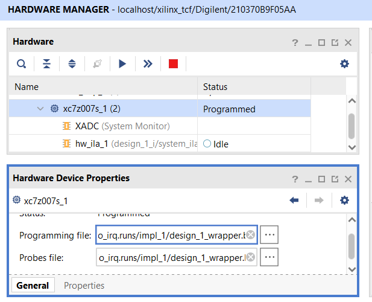
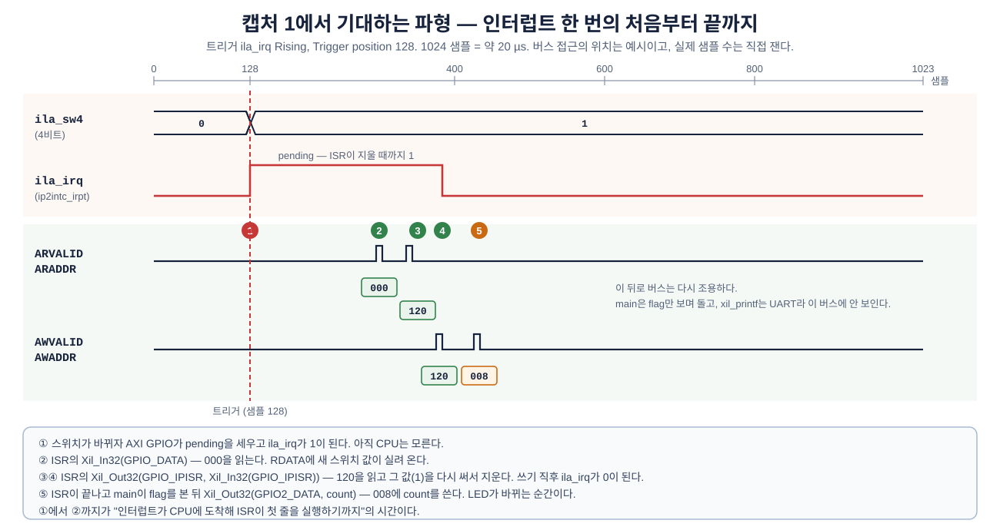

# 제3장 인터럽트 (3) — ILA로 인터럽트 보기

**SoC 설계** · 7주차 3교시(W7_S3) | Vivado/Vitis 2023.2 · Windows 11 · Digilent Cora Z7-07S

---

1장에서 인터럽트가 지나가는 길을 그림 1-2로 그렸다. 스위치가 바뀌면 pending이 서고, `ip2intc_irpt`가 올라가고, ISR이 버스로 값을 읽고 pending을 지운다. 그런데 지금까지 이것을 **본 적은 없다.** PuTTY에 줄이 찍히는 것으로 "아마 그랬을 것"이라고 짐작했을 뿐이다.

이번 장에서는 1장에서 붙여 둔 System ILA로 이 과정을 **파형으로 직접 본다.** 1장 1.2절에서 "꼭 가져갈 것" 두 가지 — 인터럽트 선은 값을 나르지 않는다, pending은 반드시 지워야 한다 — 를 눈으로 확인하는 것이 목표다.

> **5·6주차 ILA와 무엇이 다른가**
> ```text
>   5주차 ILA                     6주차 ILA                      이번 장
>   버스: 0.2초마다 읽기·쓰기      버스 + PWM 파형(ila_led4)       버스 + 인터럽트 선(ila_irq) + 스위치(ila_sw4)
>   트리거: ARVALID, AWVALID       트리거: ila_led4 Rising         트리거: ila_irq Rising
>   CPU가 시켜서 일어난 일          회로가 혼자 하는 일              PL이 먼저 알리고, CPU가 응답하는 일
> ```

> **이번 장은 Vivado·Vitis 작업이 없다.** 하드웨어(`gpio_irq`)와 ILA는 1장에서 이미 만들었고, 프로그램은 1장의 `app_irq`를 그대로 다시 실행한다. Hardware Manager만 연다.

이번 장의 흐름은 다음과 같다.

> **준비(app_irq 실행 + Hardware Manager)** → **캡처 1: 인터럽트 한 번의 처음부터 끝까지** → **캡처 2: 스위치 한 번에 인터럽트 몇 번?** → **캡처 3: clear를 빼면**

---

## 학습 목표

- ILA 파형에서 `ila_irq`가 올라가는 순간과 ISR의 버스 접근을 찾아, 그림 1-2의 경로를 순서대로 짚는다.
- 인터럽트가 걸린 뒤 ISR의 첫 버스 접근까지 걸린 시간을 샘플 수로 재고 µs로 바꾼다.
- 스위치 한 번에 인터럽트가 여러 번 들어오는 것(바운스)을 ILA로 센다.
- pending을 지우지 않으면 `ila_irq`가 내려가지 않고 ISR이 반복된다는 것을 파형으로 확인한다.

---

## 3.1 준비

### 3.1.1 `app_irq` 실행

Vitis에서 1장의 **`app_irq`** 를 연다. `FLOW`의 `Component`가 `app_irq`인지 확인하고 `Run`. PuTTY(115200)를 열어 두고, 스위치를 움직이면 `count = …` 줄이 찍히는지 먼저 확인한다(1장 1.12절).

> 2장에서 `app_timer`를 마지막으로 실행했다면 보드에는 지금 타이머 프로그램이 돌고 있다. 반드시 `app_irq`로 바꿔서 다시 `Run`한다.

### 3.1.2 Hardware Manager 연결

5·6주차와 같다. Vivado에서 `gpio_irq` 프로젝트를 열고(또는 시작 화면에서 `Open Hardware Manager`만 열고) `Open target` → `Auto Connect`. `Probes file`에 **`.../week7/vivado_prj/gpio_irq/gpio_irq.runs/impl_1/design_1_wrapper.ltx`** 를 지정한다. `Program Device`는 누르지 않는다 — 회로는 Vitis가 이미 올렸다.



**그림 3-1** `Hardware` 창에서 칩(`xc7z007s_1`)이 `Programmed`이고, 그 아래 `hw_ila_1`이 보인다. 칩을 고른 뒤 아래 `Hardware Device Properties`의 **`Probes file`** 에 `design_1_wrapper.ltx`를 지정한다(1장 그림 1-15의 그 파일). 그 위 `Programming file`은 Vitis가 올린 `.bit`이라 건드리지 않는다.

`hw_ila_1`을 더블클릭하면 Waveform 창이 열리고 다음 신호가 보인다.

| 신호 | 폭 | 무엇인가 |
|---|---|---|
| `ila_sw4` | 4비트 | shield 스위치 4개. AXI GPIO 채널 1로 들어가는 값 |
| `ila_irq` | 1비트 | `ip2intc_irpt` → `IRQ_F2P`. pending이 서 있으면 1 |
| `slot_0 : ps7_0_axi_periph_M00_AXI` | — | `axi_gpio_0` 바로 앞의 AXI 버스. 주소(`ARADDR`, `AWADDR`)는 9비트 |


**그림 3-2** `.ltx`를 지정한 뒤의 Waveform 창. 위에 `ila_sw4`, `ila_irq`, 아래에 AXI 슬롯이 보인다. 📷 *캡처 대기*

버스에서 보게 될 주소는 넷이다. 모두 1장 1.10절과 4주차 1교시의 AXI GPIO 레지스터 오프셋이다.

| `ARADDR`/`AWADDR` | 레지스터 | 누가 접근하나 |
|---|---|---|
| `000` | `GPIO_DATA` (채널 1, `sw4`) | ISR의 `Xil_In32(GPIO_DATA)` |
| `008` | `GPIO2_DATA` (채널 2, `led4`) | main의 `Xil_Out32(GPIO2_DATA, count)` |
| `120` | `IPISR` | ISR의 `Xil_Out32(GPIO_IPISR, Xil_In32(GPIO_IPISR))` — 읽고 나서 쓴다 |
| `11C`, `128` | `GIER`, `IPIER` | 프로그램 시작할 때 한 번만 (이번 캡처에는 안 나온다) |

---

## 3.2 캡처 1 — 인터럽트 한 번의 처음부터 끝까지

### 3.2.1 트리거 설정

1. `Trigger Setup`에서 `+` → **`ila_irq`** 추가. `Value`를 **`R`**(Rising, 0→1)로 한다.
2. `Settings` 창에서 **`Trigger position in window`** 를 **`128`** 로 바꾼다. 기본값 512(가운데)보다 앞쪽에 두어, 트리거 **뒤**에 일어나는 ISR의 버스 접근을 길게 본다.
3. **`Run Trigger`**(▶). 상태가 `Waiting for Trigger`가 된다.
4. shield 스위치 하나(`sw4[0]`)를 **한 번** 올린다.

### 3.2.2 기대하는 파형



**그림 3-3** 캡처 1의 예상도. 동그라미 번호가 아래 표의 순서다. 버스 접근의 가로 위치는 예시이고, 실제 샘플 수는 직접 잰다.


**그림 3-4** 실제로 잡은 파형. 📷 *캡처 대기*

### 3.2.3 순서대로 읽기

| 순서 | 파형에서 보이는 것 | 코드에서 무엇인가 |
|---|---|---|
| ① | `ila_sw4`가 바뀌고, 곧바로 `ila_irq`가 0 → 1 | AXI GPIO가 변화를 감지해 `IPISR`에 pending을 세웠다. **CPU는 아직 아무것도 하지 않았다** |
| ② | `ARVALID = 1`, `ARADDR = 000`, `RDATA` = 새 스위치 값 | ISR 첫 줄 `sw = Xil_In32(GPIO_DATA);` |
| ③ | `ARADDR = 120`, `RDATA = 1` | ISR 마지막 줄의 `Xil_In32(GPIO_IPISR)` — 채널 1 pending이 서 있다 |
| ④ | `AWADDR = 120`, `WDATA = 1` → 직후 `ila_irq`가 1 → 0 | 같은 줄의 `Xil_Out32(GPIO_IPISR, …)` — 읽은 1을 그대로 써서 지운다. **pending이 지워지는 순간이 선이 내려가는 순간이다** |
| ⑤ | `AWADDR = 008`, `WDATA` = 새 `count` | ISR이 끝나고 main이 `flag`를 본 뒤 `Xil_Out32(GPIO2_DATA, count);` — LED가 바뀌는 순간 |

1장 1.2절의 두 가지를 파형에서 확인한다.

- **인터럽트 선은 값을 나르지 않는다.** ①에서 `ila_irq`는 1비트로 올라갈 뿐이다. 스위치 값은 ②에서 ISR이 **버스로 읽어 와야** 비로소 CPU에 들어온다.
- **pending은 ISR이 지운다.** `ila_irq`는 ①에서 올라가 ④의 쓰기 직후에야 내려간다. 그사이 하드웨어는 아무도 선을 내려 주지 않는다.

> **⑤가 ISR이 아니라 main이라는 것은 어떻게 아나.** ISR(`sw_isr`)에는 `GPIO2_DATA`에 쓰는 줄이 없다. ④에서 ISR이 끝나고, main의 `while (1)`이 `flag == 1`을 보고 LED를 쓴 것이다. 그 뒤의 `xil_printf`는 UART라서 이 버스에는 나오지 않는다.

### 3.2.4 시간 재기

마커로 ①(`ila_irq`가 올라가는 곳)과 ②(`ARVALID`가 처음 1이 되는 곳)를 찍어 샘플 차이를 잰다. 한 샘플은 20 ns(50 MHz)다.

| 구간 | 샘플 수 | 시간 (× 20 ns) |
|---|---|---|
| ① → ② : 인터럽트가 걸린 뒤 ISR의 첫 읽기까지 | | |
| ① → ④ : `ila_irq`가 1로 있던 시간 | | |
| ④ → ⑤ : ISR이 끝나고 main이 LED를 쓰기까지 | | |

① → ②에는 GIC가 CPU에 알리고, CPU가 하던 일을 멈추고, BSP의 공통 처리 코드를 거쳐 `sw_isr`의 첫 줄에 오기까지가 모두 들어 있다. 5주차의 폴링은 이 자리가 **최대 200 ms**였다(그림 1-1). 같은 칸에 들어가는 숫자를 비교해 본다.

> **같은 창에 펄스가 또 보이면.** 20 µs 창 안에서 `ila_sw4`가 다시 바뀌고 `ila_irq`가 한 번 더 올라가는 경우가 있다. 스위치 접점의 떨림(바운스)이다. 다음 캡처에서 이것을 센다.

---

## 3.3 캡처 2 — 스위치 한 번에 인터럽트 몇 번?

1장 1.12절에서 스위치를 한 번 움직였는데 `count`가 2~4씩 뛰었다. 바운스는 수 밀리초 동안 이어지므로 20 µs 창 하나로는 다 담을 수 없다. 그래서 ILA의 **창 나누기**를 쓴다. 1024 샘플을 짧은 창 여러 개로 나누면, **창 하나가 트리거 한 번**을 담는다. 창이 몇 개 찼는지가 곧 인터럽트가 몇 번 왔는지다.

1. 트리거는 캡처 1과 같다(`ila_irq` = `R`).
2. `Settings` 창에서 **`Number of windows`** 를 **`8`**, **`Window data depth`** 를 **`128`**, **`Trigger position in window`** 를 **`16`** 으로 한다.
3. `Run Trigger`. 상태 표시에 `Window 0 of 8`처럼 몇 번째 창을 기다리는지 나온다.
4. **`sw4[0]`을 천천히 한 번 올린다.** 상태 표시의 창 번호가 몇까지 올라갔는지 적는다. PuTTY의 `count`가 몇 늘었는지도 함께 적는다.
5. 다시 한 번 내린다. 8개 창이 다 찰 때까지 반복하고, 몇 번 움직였는지 센다.

| 스위치 조작 | 찬 창의 수 (= 인터럽트 수) | PuTTY `count` 증가 |
|---|---|---|
| 1번째 (올림) | | |
| 2번째 (내림) | | |
| 3번째 (올림) | | |


**그림 3-5** 8개 창을 다 채운 뒤의 파형. 창 경계마다 `ila_irq`가 올라간다. 바운스가 있었다면 **스위치를 한 번 올렸을 뿐인데** 이웃한 창들에서 `ila_sw4[0]` 값이 1 → 0 → 1로 오락가락한다. 📷 *캡처 대기*

바운스가 없다면 스위치 한 번에 창도 하나, `count`도 1이어야 한다. 표의 숫자가 1보다 크면 그만큼 PL이 "변화"를 더 봤다는 뜻이다. 그리고 **찬 창의 수와 `count` 증가가 같은지** 본다 — 같다면 ISR이 인터럽트를 하나도 놓치지 않았다는 증거다.

> 이 문제를 소프트웨어로 해결하는 것이 2장 과제(1 ms tick으로 20 ms 디바운스)다. 과제를 끝낸 뒤 이 캡처를 다시 해 보면, `ila_irq`는 여전히 여러 번 올라가지만 `AWADDR = 008`(LED 쓰기)은 한 번만 나온다. **하드웨어는 그대로 떨리고, 소프트웨어가 걸러 낸 것이다.**

캡처가 끝나면 `Number of windows`를 **`1`**, `Trigger position in window`를 **`128`** 로 되돌린다.

---

## 3.4 캡처 3 — clear를 빼면

1장 과제 4에서 pending 지우기를 빼면 보드가 멈춘 것처럼 보였다. 왜 그런지 파형으로 본다.

1. `app_irq`의 `sw_irq_counter.c`에서 **ISR 안의** `Xil_Out32(GPIO_IPISR, Xil_In32(GPIO_IPISR));` 한 줄만 주석 처리한다(main 앞부분의 ①은 그대로 둔다).
2. `Build` → `Run`. PuTTY에는 시작 메시지만 나온다.
3. ILA 트리거는 캡처 1과 같게(`ila_irq` = `R`, 위치 128) 두고 `Run Trigger` → 스위치를 한 번 올린다.


**그림 3-6** `ila_irq`가 올라간 뒤 **창 끝까지 내려오지 않는다.** 버스에는 `ARADDR = 000` 읽기가 일정한 간격으로 계속 반복되고, `AWADDR = 120`(clear)도 `AWADDR = 008`(main의 LED 쓰기)도 나오지 않는다. 📷 *캡처 대기*

| 캡처 1과 비교 | 캡처 1 (clear 있음) | 캡처 3 (clear 없음) |
|---|---|---|
| `ila_irq` | ④에서 내려간다 | 계속 1 |
| `ARADDR = 000` | 한 번 | 반복된다 — ISR이 끝나자마자 다시 불린다 |
| `AWADDR = 120` | 있다 | 없다 |
| `AWADDR = 008` | 있다 (main이 실행됐다) | 없다 — **main이 한 번도 실행되지 못한다** |

`ila_irq`가 1로 남아 있으니 GIC는 ISR이 끝나는 순간 "아직 인터럽트가 걸려 있다"고 보고 ISR을 다시 부른다. 반복되는 `000` 읽기 사이의 샘플 수가 **ISR 한 번이 도는 시간**이다. 마커로 재 본다.

확인한 뒤에는 **반드시 주석을 되돌리고** 다시 `Build` → `Run` 한다.

---

## 3.5 폴링과 인터럽트 — ILA로 본 차이

5주차 3장 ILA와 나란히 놓으면 이번 주에 바뀐 것이 한눈에 보인다.

| | 5주차 (폴링) | 7주차 (인터럽트) |
|---|---|---|
| 버스에 읽기가 나오는 때 | 0.2초마다, 스위치가 안 바뀌어도 | 스위치가 바뀌었을 때만 |
| 스위치를 안 건드리면 | 0.2초마다 읽기 | 버스가 완전히 조용하다 |
| 변화 → CPU가 알기까지 | 최대 200 ms | 3.2.4절에서 잰 값 |
| 짧은 떨림(바운스) | 안 보인다 (읽는 사이에 지나감) | 전부 인터럽트가 된다 (3.3절) |

마지막 줄이 인터럽트의 양면이다. 빠르고 놓치지 않는 대신, **하드웨어가 실제로 하는 일을 전부 받아야 한다.** 무엇을 걸러 낼지는 소프트웨어가 정한다.

---

## 3.6 정리

| 키워드 | 내용 |
|---|---|
| ILA 신호 | `ila_sw4`(4비트), `ila_irq`(1비트), `axi_gpio_0` 앞 버스(주소 9비트) |
| 주소 | `000` 채널1 데이터, `008` 채널2 데이터, `120` `IPISR` |
| 인터럽트 한 번 | `ila_irq` ↑ → ISR 읽기 `000` → `IPISR` 읽기·쓰기 `120` → `ila_irq` ↓ → main 쓰기 `008` |
| 선은 값을 나르지 않는다 | 스위치 값은 ISR이 `000`을 읽어야 들어온다 |
| pending | `ila_irq`는 ISR이 `120`에 쓸 때까지 1. 안 지우면 계속 1 → ISR만 반복, main 정지 |
| 반응 시간 | `ila_irq` ↑ 에서 첫 `ARVALID`까지 샘플 수 × 20 ns |
| 창 나누기 | `Number of windows` — 창 하나가 트리거 한 번. 인터럽트 횟수를 셀 수 있다 |
| 바운스 | 스위치 한 번에 인터럽트 여러 번. 하드웨어는 그대로, 거르는 것은 소프트웨어 |

---

## 과제 — 다음 주 전까지

1. **반응 시간.** 캡처 1을 세 번 반복해 3.2.4절 표를 채우고 평균을 낸다. ① → ② 구간이 5주차 폴링의 최대 지연(200 ms)보다 몇 배 빠른가?
2. **상승 에지만 세기.** 1장 과제 1(올릴 때만 카운터 증가)을 적용한 코드로 캡처 2를 다시 한다. `ila_irq`가 올라가는 횟수는 달라지는가? `AWADDR = 008` 쓰기의 횟수는? 왜 그런지 설명한다.
3. **디바운스 확인.** 2장 과제(`app_homework`, 20 ms 디바운스)를 실행한 상태로 캡처 2를 한다. 창이 여러 개 차는데도 LED 쓰기(`008`)가 스위치 조작당 한 번만 나오는지 확인하고 그 파형을 제출한다.

---

*SoC 설계 · 7주차 3교시(W7_S3) | Vivado/Vitis 2023.2 · Windows · Cora Z7-07S*
